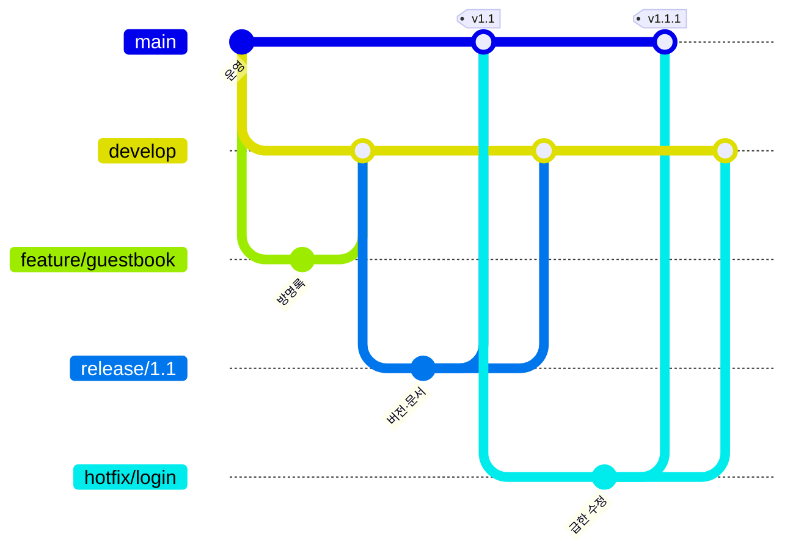

# 브랜치 전략과 PR 규칙

Blogville은 **Git Flow**를 씁니다. `main`에 merge되면 곧 운영 서버에 배포되므로, 개발은 `develop`에 모으고 배포할 때만 `main`으로 보냅니다.

## 브랜치

| 브랜치 | 어디서 만듦 | 어디로 merge | 용도 |
|---|---|---|---|
| `main` | — | — | 운영. merge하면 `deploy.yml`이 서버에 무중단 배포 |
| `develop` | `main` | — | 다음 배포에 들어갈 기능을 모으는 곳 |
| `feature/<이름>` | `develop` | `develop` | 기능 하나 (예: `feature/guestbook`, `feature/social-login`) |
| `release/<버전>` | `develop` | `main`, 그리고 `develop` | 배포 준비. 버전·문서·마지막 수정만 |
| `hotfix/<이름>` | `main` | `main`, 그리고 `develop` | 운영에서 급히 고칠 것 |

- 기능 PR은 **항상 `develop` 대상**입니다. `main`으로 바로 보내지 않습니다.
- `release/*`·`hotfix/*`를 `main`에 merge한 뒤에는 같은 브랜치를 `develop`에도 merge해 두 브랜치를 맞춥니다.
- merge는 merge commit으로 합니다 (squash·rebase 하지 않음). `main`·`develop`에는 force push 하지 않습니다.
- 배포한 `main` 커밋에는 `v1.1`처럼 태그를 붙일 수 있습니다.

## PR

1. `develop`에서 `feature/<이름>` 브랜치를 만듭니다.
2. 기능 문서(요구사항·spec·plan·tasks)는 문서 저장소 [handsomeguen/docs](https://github.com/handsomeguen/docs)에 같은 이름으로 올립니다.
3. 로컬에서 확인합니다: `npm run lint`, `npm run typecheck`, `npm test`, 바뀐 부분의 E2E.
4. PR을 열면 CI(`ci.yml`)가 lint·타입 검사·단위 테스트·빌드를 돌립니다. 초록이 되면 merge합니다.
5. 배포할 때 `develop`에서 `release/<버전>`을 만들어 `main`으로 PR을 엽니다. 이 브랜치에서 `package.json` 버전을 올리고, 새 화면 그림이 든 릴리스 노트 `docs/releases/v<버전>.md`(그림은 `docs/releases/img/v<버전>/`)와 `CHANGELOG.md` 줄을 씁니다.
6. merge되면 서버에 배포되고(`deploy.yml`), `release.yml`이 그 노트로 GitHub 릴리스와 `v<버전>` 태그를 만듭니다.

## 브랜치 보호 (저장소 관리자가 GitHub에서 설정)

Settings → Branches → Add branch ruleset(또는 Add rule)에서 `main`과 `develop`에 각각:

- Require a pull request before merging
- Require status checks to pass → `check` (CI 작업 이름)
- Block force pushes, Restrict deletions
