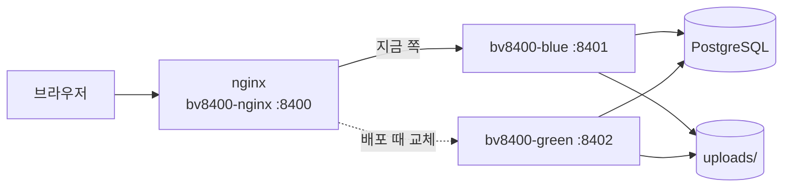

# Blogville

티스토리처럼 글을 쓰는 블로그에, 블로그 주인마다 집이 생기는 **도트(픽셀아트) 마을**을 더한 서비스입니다.
가입하면 블로그(`/@주소`)와 마을의 내 집이 함께 생기고, 글을 쓰고 출석하고 이웃과 소통하며 캐릭터와 집을 꾸밉니다.

- 운영: https://unqiuepcg.java21.net
- 요구사항 명세서, 기능별 spec·plan·tasks(`specs/`), 프로젝트 원칙(constitution): 문서 저장소 [handsomeguen/docs](https://github.com/handsomeguen/docs). 코드 주석의 `specs/0xx-...`는 그 저장소의 `docs/specs/` 폴더를 가리킵니다.
- 개발환경 설명: [docs/dev-environment.md](docs/dev-environment.md)
- 브랜치 전략(Git Flow)과 PR 규칙: [CONTRIBUTING.md](CONTRIBUTING.md)

## 주요 기능

| 영역 | 기능 |
|---|---|
| 회원 | 아이디·비밀번호 가입과 로그인(5번 틀리면 5분 잠금), 로그인 상태 유지, 비밀번호 바꾸기, 프로필 사진, 탈퇴, 소셜 로그인(네이버·카카오·구글, 키를 넣으면 켜짐) |
| 블로그 | 가입 때 블로그 자동 생성, 2단계 카테고리, 위젯(소개·카테고리·최근 글·최근 댓글·방문자 7일 막대), 블로그 둘러보기, RSS·sitemap·공유 미리보기 |
| 글 | Tiptap 에디터, 사진·파일 첨부와 붙여 넣기 재업로드, 태그, 공개·비공개, 임시저장, 대표 사진, 이전/다음 글, 같은 카테고리의 다른 글 |
| 소통 | 댓글·답글(수정, 🔒 비밀 댓글), 공감, 이웃·즐겨찾는 이웃, 이웃 새 글, 알림함 🔔, 방명록 |
| 마을 | 2.5D 도트 마을, 내 집과 이웃 집 자리, 광장·텔레포트, 우체통, 낚시터, 동물 농장, 내 정원, 친구 마을 놀러 가기, 걷는 이웃 |
| 성장·꾸미기 | 출석 보상, 포인트, 상점, 옷가게·미용실, 옷장, 집 가구·지붕 색, 성장 아이템 |
| 관리 | 사이트 관리자(`/admin`): 통계, 회원 정지·권한·강제 탈퇴, 글·댓글·방명록 선택 삭제·블라인드, 사이트 공지 띠, 금지어, 관리 기록, 버그·문의, 공지 블로그 `/@notice` |

## 기술 스택

| 구분 | 사용 |
|---|---|
| 앱 | Next.js 16 (App Router, Server Actions), React 19, TypeScript, Tailwind CSS 4 |
| 데이터 | PostgreSQL 16, Drizzle ORM (`drizzle/` 마이그레이션) |
| 인증 | better-auth (username 플러그인, 세션 쿠키), 소셜 로그인은 better-auth OAuth2 |
| 에디터 | Tiptap 3 |
| 마을 그림 | 코드로 그린 16×16 도트를 캔버스에 그림 (`src/lib/art`, `src/components/town`) |
| 시험 | Vitest(단위), Playwright(E2E) |
| 배포 | GitHub Actions → Docker 이미지 → SSH로 서버에 올려 블루·그린 무중단 교체 |

## 구조



| 경로 | 내용 |
|---|---|
| `src/app/` | 화면(라우트)과 Server Action. `blog/[slug]`가 `/@주소` 블로그, `town`이 마을, `admin`이 관리자 |
| `src/server/` | DB를 읽고 쓰는 서버 로직 (`server-only`) |
| `src/lib/` | 화면과 서버가 같이 쓰는 순수 함수·규칙 (단위 테스트 대상) |
| `src/components/` | React 컴포넌트 |
| `src/db/` | Drizzle 스키마와 DB 연결 |
| `drizzle/` | DB 마이그레이션 SQL |
| `tests/` | `unit/` Vitest, `e2e/` Playwright, `perf/` 성능 측정 |
| `scripts/` | 시드, 관리자 만들기, 운영 마이그레이션, 백업, 정리 작업 |
| `deploy/` | 운영 서버 구성: `compose.yml`(nginx + 앱 두 벌), `deploy.env`(포트), `nginx/`(설정), `run.sh`(블루·그린 교체), `rollback.sh` |
| `.github/workflows/` | `ci.yml` 검사, `deploy.yml` 배포, `status.yml` 서버 상태 보기 |

## 실행

Node.js 22, PostgreSQL 16이 필요합니다.

```bash
cp .env.example .env.local     # BETTER_AUTH_SECRET은 긴 무작위 값으로 바꾼다
docker compose up -d db        # 또는 로컬 PostgreSQL에 blogville DB를 만든다
npm install
npm run db:migrate
npm run db:seed                # (선택) demo / demo1234, /@demo
npm run admin:create           # (선택) .env.local의 ADMIN_USERNAME·ADMIN_PASSWORD로 관리자와 /@notice
npm run release:post           # (선택, 손으로) docs/releases의 릴리스 노트를 /@notice '업데이트' 글로 올림
npm run dev                    # http://localhost:3000
```

## 확인

```bash
npm run typecheck
npm run lint
npm test                       # Vitest 단위 테스트
npm run test:e2e               # Playwright E2E (개발 서버를 띄우거나 자동으로 띄운다)
npm run test:perf              # 글 1,000개 블로그 홈 응답 시간 (서버를 먼저 띄운다, 기준 1초)
```

미리 설치된 Chromium을 쓰려면 `PW_CHROMIUM_PATH=/경로/chrome npm run test:e2e`.
E2E는 `.env.local`의 DB에 고유한 아이디로 회원을 만들어 시험합니다.

## 첨부 파일

올린 사진·파일은 `storage/uploads/`(git 제외, `UPLOAD_DIR`로 바꿈)에 저장됩니다.
어느 글에도 붙지 않은 지 하루 지난 첨부는 정리 작업이 지웁니다. 같은 작업이 어제보다 오래된 조회 기록, 만료된 로그인 세션, 하루 넘게 지난 로그인 실패 기록(잠금 중인 것은 남김)도 지웁니다. 자동 실행 설정은 없어서 하루에 한 번 손으로 돌립니다.

```bash
npm run posts:cleanup -- --dry-run   # 지울 개수만
npm run posts:cleanup
```

## CI/CD

| 언제 | 무엇 | 파일 |
|---|---|---|
| `main`·`develop`으로 가는 PR, `develop`에 push | lint → 타입 검사 → 단위 테스트 → 빌드 | `.github/workflows/ci.yml` |
| `main`에 merge (release·hotfix) | 도커 이미지 → 서버에 올림 → 블루·그린 무중단 교체 (릴리스 노트는 아래 막대의 🆕 업데이트 소식 `/updates`에 보임) | `.github/workflows/deploy.yml` |
| `main`에 새 버전·릴리스 노트가 올라옴 | `docs/releases/v<버전>.md`로 GitHub 릴리스와 태그 만들기 | `.github/workflows/release.yml` |
| 손으로 (Actions → status) | 서버 컨테이너·포트·로그 보기 (아무것도 바꾸지 않음) | `.github/workflows/status.yml` |

E2E는 DB와 브라우저가 필요하고 전체가 약 25분 걸려서 CI에서 돌리지 않고, 기능을 만들 때 로컬에서 바뀐 부분의 시험을 돌립니다.

## 배포 (도커, 포트 8400)

`main`에 올라오면 GitHub Actions(`.github/workflows/deploy.yml`)가 도커 이미지를 만들어 서버에 올리고, SSH로 `deploy/run.sh`를 실행합니다. 손으로 돌리려면 Actions 탭의 **deploy → Run workflow**를 누릅니다.

- 저장소 시크릿: `SSH_ADDRESS`, `SSH_PORT`, `SSH_ID`, `SSH_PASSWORD`, `DB_ADDRESS`, `DB_PORT`, `DB_NAME`, `DB_SCHEMA`, `DB_USERNAME`, `DB_PASSWORD`, (선택) `APP_URL`, (선택) `ADMIN_USERNAME`·`ADMIN_PASSWORD`(있으면 배포 때 관리자 계정과 공지 블로그 `/@notice`를 만들거나 비밀번호를 갱신, 비밀번호 12~64자)
- `APP_URL`이 없으면 `http://SSH_ADDRESS:8400`을 로그인 주소로 씁니다. 도메인·https를 붙이면 `APP_URL`을 그 주소로 등록합니다.
- 서버에는 docker가 있어야 하고, SSH 계정이 docker를 쓸 수 있어야 합니다(docker 그룹 또는 비밀번호 없는 sudo).
- 컨테이너는 시작할 때 `scripts/migrate.mjs`(drizzle 마이그레이터, 실패하면 DB 오류를 그대로 보여 줌)로 DB를 맞춘 뒤 `next start -p 8400`으로 뜹니다.
- **무중단(블루·그린) 배포**: 서버에서 docker compose(`deploy/compose.yml`, 프로젝트 이름 `bv8400`)로 세 컨테이너를 띄웁니다.

  | 컨테이너 | 포트 | 하는 일 |
  |---|---|---|
  | `bv8400-nginx` | 8400 (`PROXY_PORT`) | 사용자 요청을 받아 지금 서비스 중인 앱으로 넘김 |
  | `bv8400-blue` | 8401 (`BLUE_PORT`) | 앱 한 벌 |
  | `bv8400-green` | 8402 (`GREEN_PORT`) | 앱 다른 한 벌 |

  - 환경 파일: 포트·nginx 이미지·기다리는 시간은 `deploy/deploy.env`(공개, 서버의 `~/blogville/.env`로 복사), 비밀 값은 배포 때 GitHub 시크릿으로 만드는 `~/blogville/app.env`(권한 600)에 들어갑니다.
  - 트래픽 전환: nginx는 `~/blogville/nginx/conf.d/upstream.conf`에 적힌 앱 하나로만 보냅니다. 새 버전은 쉬고 있는 색에 띄워 응답을 확인한 뒤, 이 파일의 포트를 바꾸고 `nginx -s reload`를 합니다. reload는 새 요청부터 새 쪽으로 보내고 하던 요청은 원래 쪽에서 끝내므로 끊기지 않습니다. 그다음 nginx를 거쳐 새 버전이 답하는지(응답 머리 `X-Bv8400-Upstream`) 확인하고, 이전 버전은 15초 뒤 멈춰 둡니다(되돌리기용).
  - 새 버전이 뜨지 않거나 nginx 설정 검사(`nginx -t`)가 실패하면 아무것도 바꾸지 않고 이전 버전이 그대로 서비스합니다.
  - 지금 어느 쪽이 답하는지: 서버에서 `curl -sI http://127.0.0.1:8400/ | grep -i x-bv8400-upstream`
  - 서버의 도커를 다른 사람도 같이 쓰므로 컨테이너·이미지 이름은 `bv8400-`로 시작하고, 스크립트는 자기 것(compose 프로젝트 `bv8400` 또는 자기 이미지)만 지웁니다. nginx 이미지는 배포 때 앱 이미지와 함께 올라가고, 서버에 docker compose가 없으면 함께 올린 `bin/docker-compose`를 씁니다.
  - nginx 설정(`deploy/nginx/blogville.conf.template`)을 고치면 다음 배포 때 reload로 바로 적용됩니다. nginx 이미지를 바꿀 때만 nginx 컨테이너를 다시 만들며 1초쯤 끊깁니다.
- 서버의 `~/blogville/`에 로그인 비밀키(`auth-secret`, 처음 한 번 생성), 환경 변수(`app.env`), 올린 파일(`uploads/`)이 남습니다.
- `DB_SCHEMA`가 `public`이 아니면 `scripts/migrate.mjs`가 SQL의 `"public".`을 그 스키마로 바꿔 적용합니다. 스키마를 새로 만들지 않으므로 미리 있는 스키마를 씁니다.

### 운영 안전장치

| 할 일 | 방법 |
|---|---|
| 방금 배포한 버전을 되돌리기 | Actions → **rollback** → Run workflow. 배포 때 이전 색(blue/green) 컨테이너를 멈춰 두므로 몇십 초 안에 이전 버전으로 넘어가요. 한 번 더 돌리면 다시 돌아와요. DB 마이그레이션은 되돌리지 않아요 |
| DB 백업 | 매일 새벽 3시(KST) 자동, 바로 하려면 Actions → **backup**. 서버 `~/blogville/backups/<시각>/`에 표마다 JSON 줄(`.jsonl.gz`)과 `manifest.json`(행 수), 최근 14개만 남김 (`scripts/backup.mjs`) |
| 백업 되살리기 | 새(회원이 없는) 스키마에 `DATABASE_URL=… node scripts/migrate.mjs` 뒤 `DATABASE_URL=… node scripts/restore.mjs <백업 폴더>`. 외래 키 순서대로 한 트랜잭션에 넣고 번호를 이어 붙인 뒤 표마다 `manifest.json`의 행 수와 맞는지 확인해요. 회원이 있는 스키마에는 넣지 않아요 (`scripts/restore.mjs`) |
| 사이트 감시 | 15분마다 첫 화면을 확인하고(Actions → **uptime**), 두 번 연속 응답이 없으면 이슈 `🚨 사이트 응답 없음`을 열어요. 회복하면 저절로 닫혀요. 이슈 알림은 GitHub 알림 설정(Watch)으로 받아요 |
| 서버 상태 보기 | Actions → **status** (컨테이너, 포트, 관리자 계정 점검, 최근 로그) |
