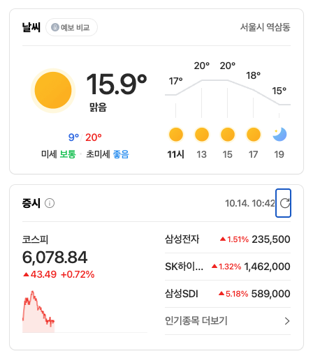
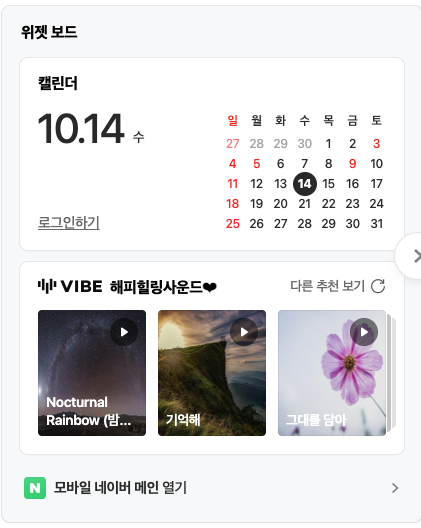

# 위젯 보드 예시 그림 (v1.7.0)

박창근 님이 보내 준 네이버 메인 위젯 그림(2026-10-14 10:55 KST). 블로그 위젯 보드는 이 모양에 맞춘다.

| 날씨·증시 | 캘린더·위젯 보드 |
| --- | --- |
|  |  |

## 맞출 점
- 흰 카드 + 얇은 회색 테두리 + 둥근 모서리, 카드 사이 넉넉한 간격, "위젯 보드" 제목 아래 카드들.
- 카드 머리: 왼쪽 굵은 제목, 오른쪽 작은 회색 부가 정보(위치·갱신 시각) + 새로고침 아이콘.
- 날씨: 큰 해 아이콘 + 큰 현재 기온(15.9°) + 상태, 최저(파랑)/최고(빨강), 미세먼지. 오른쪽에 시간대별 기온 꺾은선 + 아이콘 줄.
- 증시: 왼쪽 지수(코스피) 큰 숫자 + 등락 + 작은 붉은 영역 그래프, 오른쪽 관심 종목 목록(이름·▲%·가격), 아래 "더보기 >".
- 캘린더: 왼쪽 큰 날짜 "10.14 수", 오른쪽 작은 월 달력(일요일·공휴일 빨강, 토요일 파랑, 오늘 검은 동그라미).
