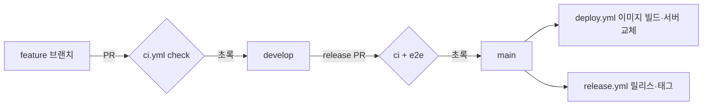

# 05. GitHub Actions CI/CD

## 개념

- **CI**(지속적 통합): 코드를 올릴 때마다 자동으로 빌드·검사·테스트해서, 깨진 코드가 합쳐지기 전에 잡습니다.
- **CD**(지속적 배포): 검사를 통과한 코드를 자동으로 운영 서버까지 내보냅니다.

GitHub Actions는 저장소의 `.github/workflows/*.yml`에 적은 **워크플로**를 GitHub이 빌려 주는 가상 머신(러너)에서 돌립니다.

| 용어 | 뜻 |
|---|---|
| `on` | 언제 돌지 (push, pull_request, schedule(cron), workflow_dispatch(손으로)) |
| job | 한 러너에서 도는 작업 묶음. job끼리는 동시에 돌 수 있음 |
| step | job 안의 한 줄 명령(`run`) 또는 남이 만든 동작(`uses`) |
| `secrets.*` | 저장소에 숨겨 둔 비밀 값. 로그에는 `***`로 가려짐 ([06-secrets.md](06-secrets.md)) |
| 필수 검사 | 브랜치 보호에 걸어 두면 이 검사가 초록이어야 merge 가능 |

## 우리 프로젝트에서는

| 워크플로 | 언제 | 하는 일 |
|---|---|---|
| [ci.yml](../../.github/workflows/ci.yml) | `main`·`develop`으로 가는 PR, `develop`에 push | job `check`: `npm ci` → lint → typecheck → 단위 테스트 → build. `main`·`develop` 브랜치 보호의 필수 검사 |
| [e2e.yml](../../.github/workflows/e2e.yml) | `main`으로 가는 PR(release·hotfix), `e2e` 꼬리표 단 PR, 손으로 | 실제 PostgreSQL + 운영 빌드로 Playwright 화면 시험. 4개 샤드로 나눠 동시에 돌리고 `e2e` job이 결과를 모음. `main` 브랜치 보호의 필수 검사 |
| [sonar.yml](../../.github/workflows/sonar.yml) | `main`·`develop`으로 가는 PR, `main`·`develop`에 push, 손으로 | SonarCloud 분석 + 품질 게이트 ([03-sonar.md](03-sonar.md)). 시크릿 `SONAR_TOKEN`이 비어 있으면 건너뜀 |
| [deploy.yml](../../.github/workflows/deploy.yml) | `main`에 push, 손으로 | **이미지 자동 배포**: 도커 이미지 빌드 → 파일로 저장 → SSH로 서버에 올림 → `deploy/run.sh`로 블루·그린 교체 → GHCR에 이미지 올리기 |
| [release.yml](../../.github/workflows/release.yml) | `main`에 push | `package.json` 버전의 `docs/releases/v<버전>.md`로 GitHub 릴리스와 태그 생성 |
| [rollback.yml](../../.github/workflows/rollback.yml) | 손으로 | 서버의 `deploy/rollback.sh`로 바로 전 버전으로 되돌림 |
| [backup.yml](../../.github/workflows/backup.yml) | 매일 03:00 KST(cron `0 18 * * *`), 손으로 | 서버에서 DB 백업, 최근 14개 보관 |
| [uptime.yml](../../.github/workflows/uptime.yml) | 15분마다, 손으로 | 운영 첫 화면 확인. 두 번 연속 실패하면 이슈를 열고, 회복하면 닫음 |
| [status.yml](../../.github/workflows/status.yml) | 손으로 | 서버 컨테이너·포트·로그 보기(아무것도 바꾸지 않음) |
| [mirror.yml](../../.github/workflows/mirror.yml) | `main`·`develop`에 push, `v*` 태그 push, 손으로 | 과제 제출 저장소로 브랜치·태그 복사 |

흐름으로 보면:



시간을 아끼는 장치도 들어 있습니다: `concurrency`로 같은 브랜치의 옛 실행을 취소하고, `setup-node`의 `cache: npm`으로 의존성 받기를 줄이며, E2E는 오래 걸려서 배포 PR에서만 돕니다.

## 직접 해 보기

```bash
gh run list --limit 10                 # 최근 실행
gh run view --log-failed               # 마지막 실패 로그만
gh workflow run status.yml             # 손으로 돌리기 (서버 상태 보기, 바꾸는 것 없음)
gh pr checks <PR 번호> --watch          # PR 검사 기다리기
```

해 볼 것:

1. `ci.yml`을 열어 step 이름(`패키지 설치`, `lint`, …)과 Actions 화면의 단계 이름이 같은지 봅니다.
2. 연습 브랜치에서 일부러 lint 오류를 넣은 PR을 열고 `check`가 빨갛게 되어 merge 버튼이 막히는지 봅니다.
3. `deploy.yml`에서 이미지 태그가 어떻게 정해지는지(커밋 해시) 찾아봅니다.


## 이미지 저장소(GHCR)

`deploy.yml`은 서버 배포가 끝나면 같은 이미지를 `ghcr.io/handsomeguen/blogville`에 `커밋 7자리`·`버전`·`latest` 꼬리표로 올립니다(올리기에 실패해도 배포는 그대로). 운영과 같은 버전을 내 컴퓨터에서 띄워 보려면:

```bash
docker pull ghcr.io/handsomeguen/blogville:latest
```

받은 이미지는 [04-docker.md](04-docker.md)의 `docker run` 예시에서 `blogville:local` 대신 쓰면 됩니다.
