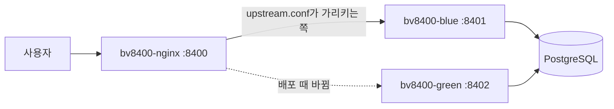

# 08. 무중단 배포 (블루·그린)

## 개념

새 버전을 배포할 때 옛 컨테이너를 멈추고 새 것을 띄우면, 그 사이 몇 초~몇십 초 동안 사이트가 끊깁니다. 무중단 배포는 **새 버전이 완전히 뜬 다음에** 트래픽을 넘겨 이 틈을 없앱니다.

| 방식 | 방법 | 장단점 |
|---|---|---|
| **블루·그린** | 같은 앱을 두 벌(blue/green) 두고, 쉬는 쪽에 새 버전을 띄운 뒤 앞단 프록시가 가리키는 쪽만 바꿈 | 되돌리기가 빠름(다시 바꾸면 끝). 자원이 두 배 순간 필요 |
| 롤링 | 서버 여러 대를 한 대씩 교체 | 자원 적게 씀. 옛·새 버전이 잠시 섞임 |
| 카나리 | 일부 사용자에게만 새 버전을 먼저 | 위험을 작게 시험. 라우팅 설정이 복잡 |

블루·그린의 열쇠는 **앞단 프록시(nginx)** 와 **상태 확인(헬스 체크)** 입니다. 확인을 통과하지 못한 새 버전에는 절대 트래픽을 넘기지 않습니다.

## 우리 프로젝트에서는

구성은 [deploy/compose.yml](../../deploy/compose.yml), 포트는 [deploy/deploy.env](../../deploy/deploy.env), 교체 순서는 [deploy/run.sh](../../deploy/run.sh), 되돌리기는 [deploy/rollback.sh](../../deploy/rollback.sh)입니다.



`run.sh`가 하는 일(순서대로):

1. `state/active`에서 지금 서비스 중인 색을 읽고, 반대 색을 이번 배포 대상으로 정합니다.
2. DB 접속을 먼저 확인합니다. 안 되면 아무것도 바꾸지 않고 멈춥니다.
3. 쉬는 색에 새 이미지를 `docker compose up -d --no-deps --force-recreate <색>`으로 띄웁니다. 컨테이너는 시작하며 마이그레이션을 합니다.
4. 최대 2분 동안 새 포트의 `/api/health`가 답하는지 확인합니다(DB에 못 닿으면 503이라 통과하지 못함). 안 오면 새 컨테이너를 지우고 끝. **옛 버전은 그대로 서비스 중**입니다.
5. `switch_traffic`([deploy/common.sh](../../deploy/common.sh)): `nginx/conf.d/upstream.conf`의 포트를 새 색으로 바꾸고 `nginx -t`로 검사한 뒤 `nginx -s reload`. 검사가 실패하면 설정을 되돌립니다. reload는 새 요청만 새 쪽으로 보내고 하던 요청은 옛 쪽에서 마칩니다.
6. nginx(8400)를 거쳐 새 버전이 답하는지 응답 머리 `X-Bv8400-Upstream`으로 확인합니다. 아니면 옛 색으로 되돌립니다.
7. `state/active`를 새 색으로 적고, 옛 색은 `DRAIN_SECONDS`(15초) 기다린 뒤 **지우지 않고 멈춰 둡니다.**

멈춰 둔 옛 컨테이너 덕분에 Actions → **rollback**은 그 컨테이너를 다시 켜고 nginx만 돌려서 몇십 초 안에 되돌립니다. DB 마이그레이션은 되돌리지 않으므로, 마이그레이션은 **열·표를 더하기만** 하는 방식으로 씁니다(옛 버전도 새 DB에서 돌아야 하니까요).

## 직접 해 보기

운영 서버에서 확인하는 명령(읽기만 합니다):

```bash
curl -sI http://127.0.0.1:8400/ | grep -i x-bv8400-upstream   # 지금 답하는 쪽
cat ~/blogville/state/active                                  # blue 또는 green
cat ~/blogville/nginx/conf.d/upstream.conf                    # nginx가 보내는 포트
docker ps --filter name=bv8400- --format '{{.Names}}\t{{.Status}}'
```

서버에 들어갈 수 없으면 Actions → **status** → Run workflow로 같은 내용을 봅니다.

생각해 볼 것:

1. 4번에서 새 버전이 안 뜨면 왜 사용자는 아무것도 못 느낄까요?
2. 마이그레이션이 열 이름을 **바꾸면** 블루·그린이 왜 깨질까요? (힌트: 3번과 7번 사이에는 옛 버전이 새 DB를 씁니다)
3. 서버를 두 대로 늘리면 nginx 한 대가 또 하나의 단일 장애점이 됩니다. 3순위의 API Gateway·Service Discovery가 이 문제와 어떻게 이어지는지 09번 이후 문서에서 봅니다.
