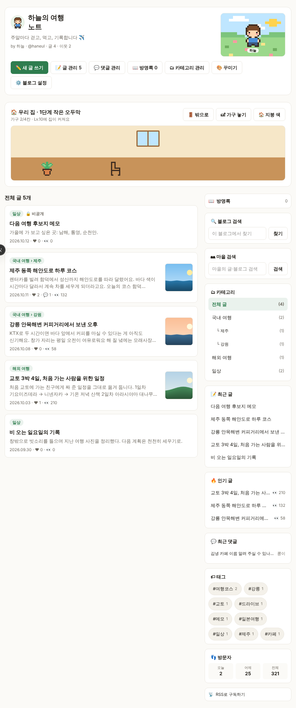
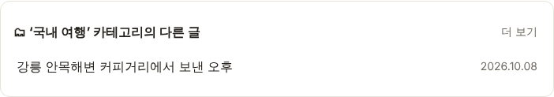
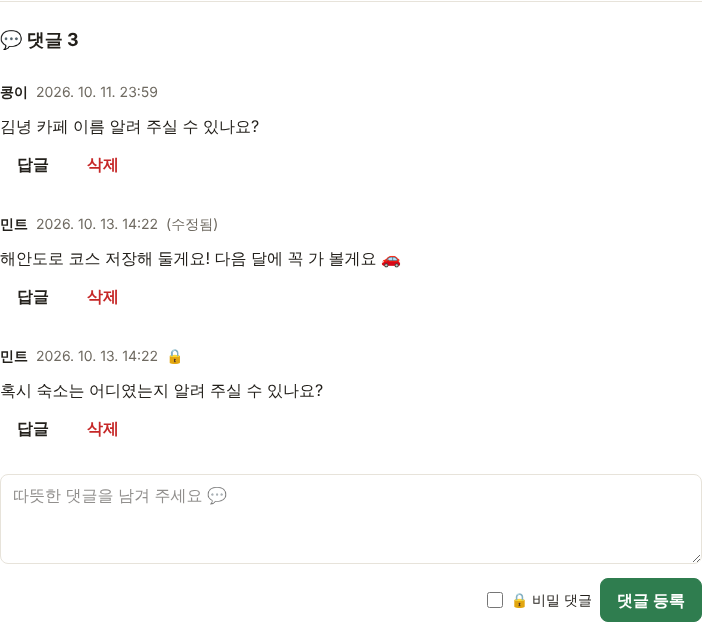
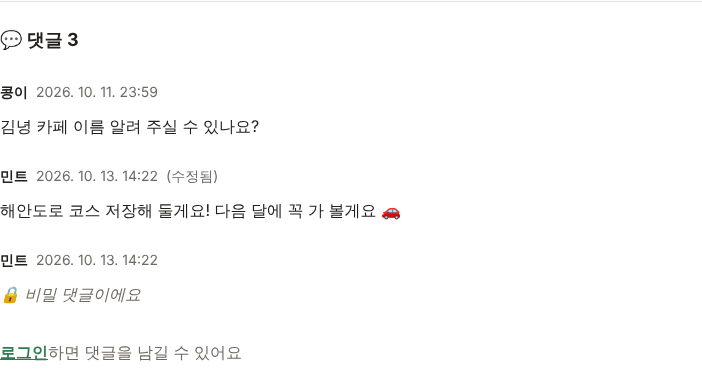
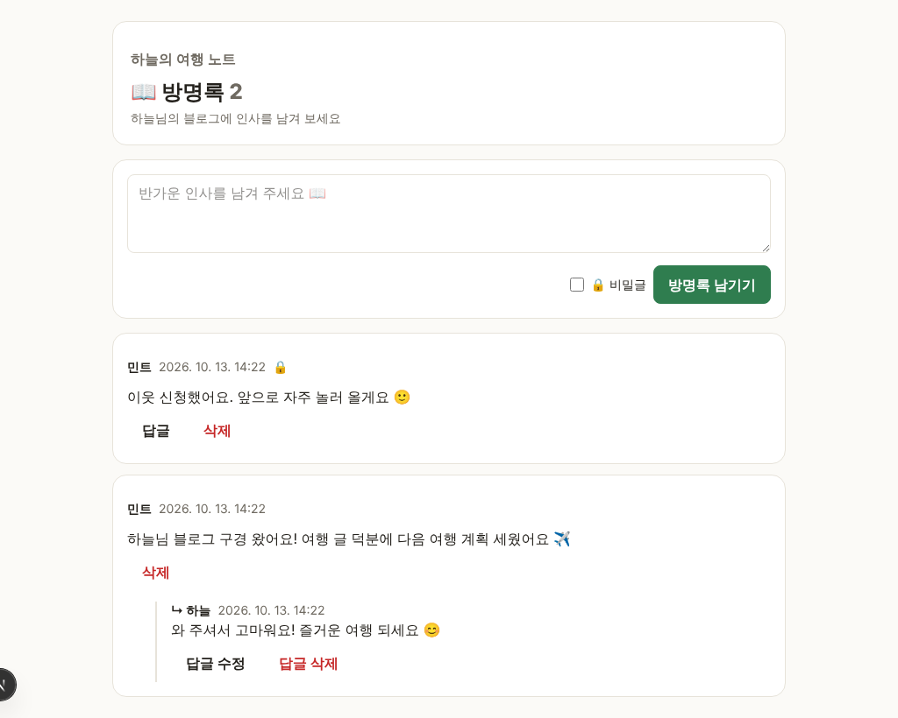
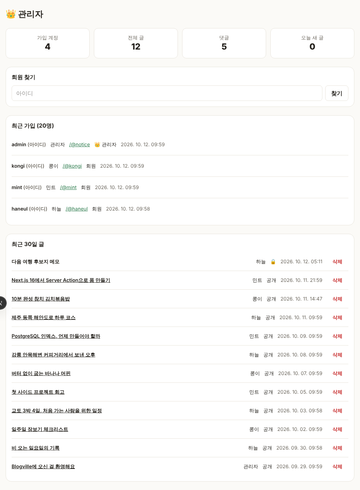
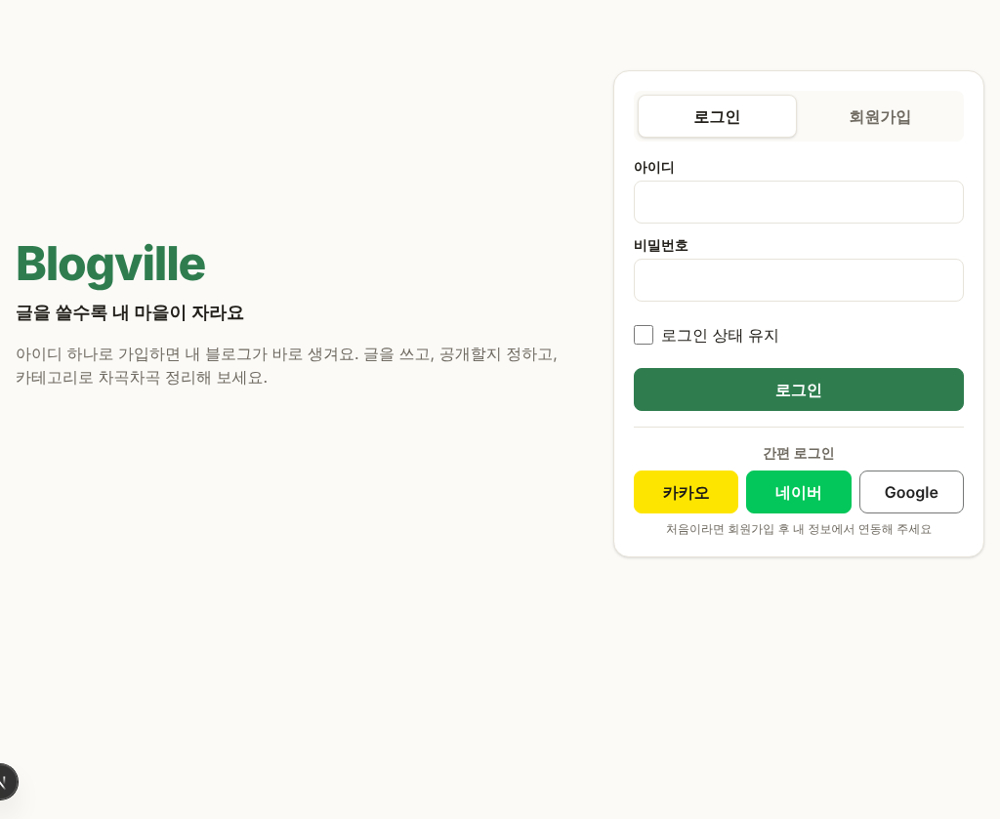
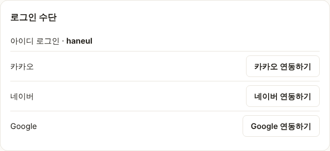
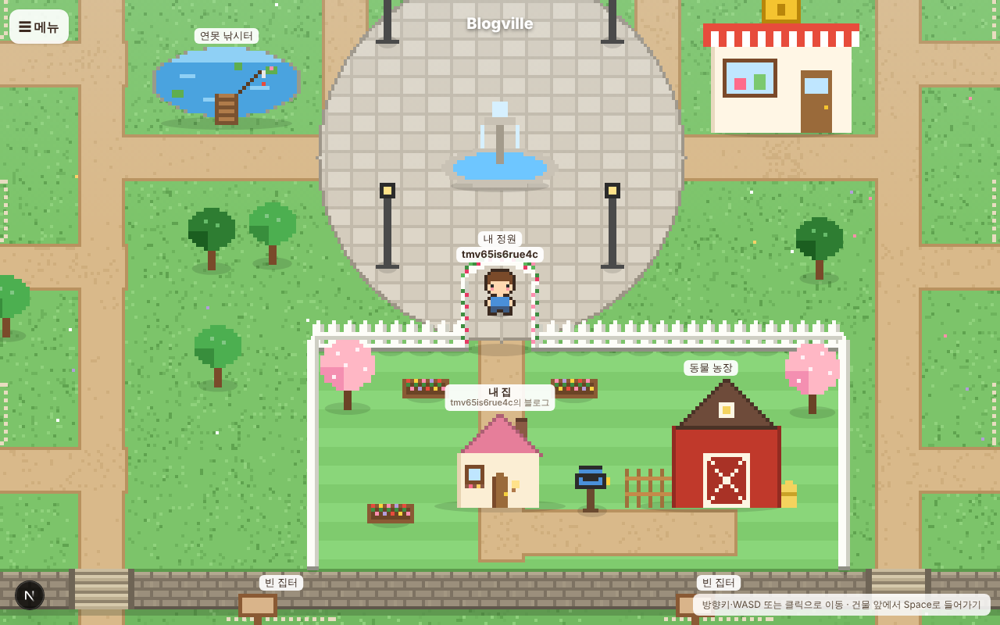
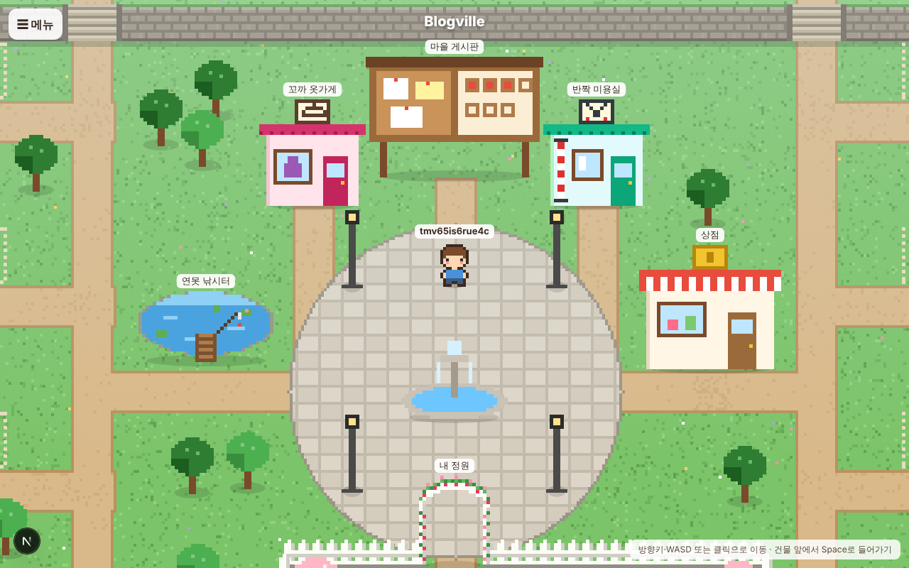

# Blogville v1.0.0 (2026-10-13)

Git Flow로 처음 내는 릴리스예요. 오늘 하루 동안 서버에 올라간 것과 이번에 함께 올라가는 것을 모았어요.

## 한눈에

| | 새로 생긴 것 |
|---|---|
| 📝 블로그 | 글 목록 대표 사진, 같은 카테고리의 다른 글, RSS·공유 미리보기·사이트맵 |
| 💬 소통 | 댓글 수정 (수정됨), 🔒 비밀 댓글, 📖 방명록 |
| 🏡 마을 | 내 정원, 광장의 옷가게·미용실 건물 |
| 👑 관리 | 사이트 관리자 계정 (`/admin`, 공지 블로그 `/@notice`) |
| 🔑 로그인 | 간편 로그인(카카오·네이버·Google) 연동, 키를 넣으면 켜짐 |
| ⚙️ 운영 | 무중단 배포(블루·그린), PR 자동 검사(CI), Git Flow, README·개발환경 문서 |

## 📝 글 목록에 대표 사진

글에 넣은 첫 사진이 목록 오른쪽에 작게 보여요. 사진이 없는 글은 글만 보여요.

## 🗂 같은 카테고리의 다른 글

글을 다 읽으면 댓글 아래에 같은 카테고리의 다른 글이 최대 5개 보여요. [더 보기]를 누르면 그 카테고리 목록으로 가요.

## 💬 댓글 수정과 🔒 비밀 댓글

- 쓴 사람은 댓글·답글을 [수정]할 수 있고, 고치면 시간 옆에 **(수정됨)**이 붙어요.
- **🔒 비밀 댓글**은 쓴 사람과 블로그 주인·관리자만 내용을 봐요. 다른 사람에게는 "🔒 비밀 댓글이에요"만 보이고, 내용은 아예 보내지 않아요.

| 블로그 주인이 볼 때 | 다른 사람이 볼 때 |
|---|---|
|  |  |

## 📖 방명록

블로그마다 `/@주소/guestbook`이 생겼어요. 옆 칸 맨 위의 "📖 방명록"으로 들어가요.

- 회원이 인사를 남기고, **🔒 비밀글**은 쓴 사람·블로그 주인·관리자만 봐요.
- 블로그 주인은 글마다 답글을 달 수 있고, 새 방명록과 답글은 🔔 알림으로 와요.
- 쓴 사람은 수정·삭제, 블로그 주인·관리자는 삭제할 수 있어요.

## 👑 사이트 관리자

GitHub 시크릿 `ADMIN_USERNAME`·`ADMIN_PASSWORD`(12~64자)를 넣고 배포하면 관리자 계정과 공지 블로그 `/@notice`가 생겨요. `/admin`에서 회원·글·댓글을 관리해요.

## 🔑 간편 로그인 (카카오·네이버·Google)

소셜 계정은 **가입이 아니라 연동**이에요. 아이디로 가입한 뒤 👤 내 정보 → 로그인 수단에서 연동해 두면, 다음부터 첫 화면 버튼으로 바로 로그인돼요. 키를 넣은 서비스의 버튼만 보여요 (지금 운영 서버는 키가 없어 버튼이 숨어 있어요).

| 첫 화면 (세 서비스 키를 넣었을 때) | 내 정보 → 로그인 수단 |
|---|---|
|  |  |

## 🏡 내 정원과 광장 가게

광장 아래 흰 울타리 정원 안에 내 집·우체통·동물 농장이 모였고, 장미 아치 문으로 들어가요. 광장 게시판 양옆에 👗 옷가게와 💇 미용실 건물이 생겼어요.

| 내 정원 | 광장의 옷가게·미용실 |
|---|---|
|  |  |

## 📡 RSS·공유 미리보기·사이트맵

- 블로그 옆 칸의 "📡 RSS로 구독하기"(`/@주소/rss`)로 새 글을 구독할 수 있어요.
- 글 주소를 카카오톡·슬랙 등에 붙이면 제목·요약·대표 사진이 미리보기로 떠요.
- 검색 엔진용 `sitemap.xml`·`robots.txt`가 생겼어요.

## ⚙️ 운영

- **무중단 배포**: 새 버전을 쉬는 쪽(blue/green)에 띄워 확인한 뒤 넘겨요. 배포 중에도 사이트가 끊기지 않아요.
- **PR 자동 검사**: `develop`·`main`으로 가는 PR마다 lint·타입 검사·단위 테스트·빌드를 돌려요.
- **Git Flow**: 기능은 `feature/*` → `develop`, 배포는 `release/*` → `main`. 규칙은 [CONTRIBUTING.md](../../CONTRIBUTING.md).
- **문서**: README에 소개·기능·구조, [개발환경](../dev-environment.md) 문서.

## 해야 할 일 (사용자)

- 간편 로그인을 켜려면 서비스별 키를 GitHub 시크릿에 넣어 주세요: `KAKAO_CLIENT_ID`·`KAKAO_CLIENT_SECRET`, `NAVER_CLIENT_ID`·`NAVER_CLIENT_SECRET`, `GOOGLE_CLIENT_ID`·`GOOGLE_CLIENT_SECRET`. 각 개발자 센터에 Redirect URI `https://{도메인}/api/auth/callback/{kakao|naver|google}`을 등록해요.
- `APP_URL` 시크릿에 실제 주소(`https://unqiuepcg.java21.net`)를 넣어 주세요. 소셜 로그인 주소와 RSS 링크가 이 주소를 써요.
