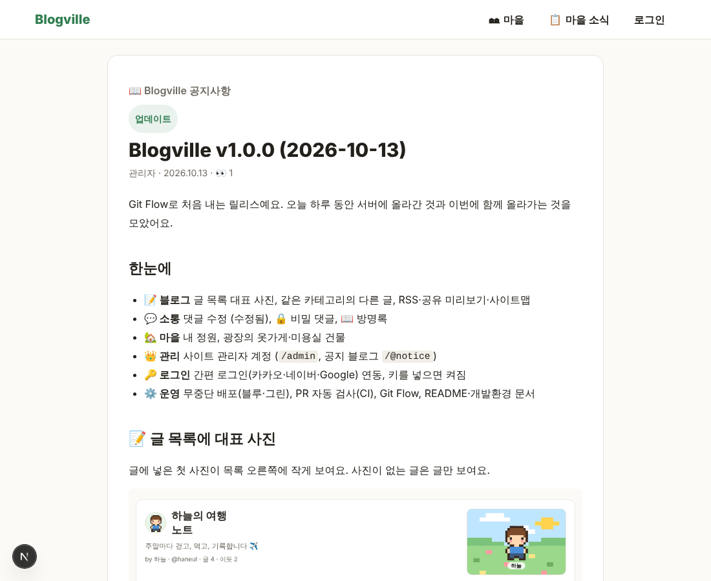

# Blogville v1.1.0 (2026-10-13)

이제 릴리스 노트를 블로그 사이트 안에서도 볼 수 있어요.

## 한눈에

| | 새로 생긴 것 |
|---|---|
| 📢 공지 블로그 | 배포할 때마다 릴리스 노트가 `/@notice`의 '업데이트' 글로 사진과 함께 올라가요 |
| 🆕 업데이트 소식 | 모든 화면 맨 아래(마을 화면 제외) 링크로 `/updates`에서 버전별 소식을 모아 봐요 |

## 📢 공지 블로그의 '업데이트' 글

새 버전이 서버에 올라가면 그 버전의 릴리스 노트가 공지 블로그 `/@notice`에 **업데이트** 카테고리 글로 자동으로 올라가요. 사진도 서버에 함께 저장돼서 글 안에서 바로 보여요. 공지 블로그를 이웃으로 둔 회원은 이웃 새 글에서도 볼 수 있어요.

## 🆕 업데이트 소식 페이지

모든 화면 맨 아래의 **🆕 업데이트 소식**을 누르면 `/updates`에서 지금까지 나온 버전의 노트를 최신순으로 볼 수 있어요. GitHub 릴리스를 가져와 보여 주고, 새 버전이 나오면 10분 안에 저절로 반영돼요.

## 운영

- 배포 순서: GitHub 릴리스 → 공지 블로그 글 → 업데이트 소식 페이지가 모두 같은 노트(`docs/releases/v<버전>.md`)로 만들어져요.
- 공지 블로그 글은 관리자 계정(`/@notice`)이 있을 때만 올라가요.
