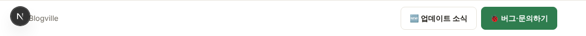
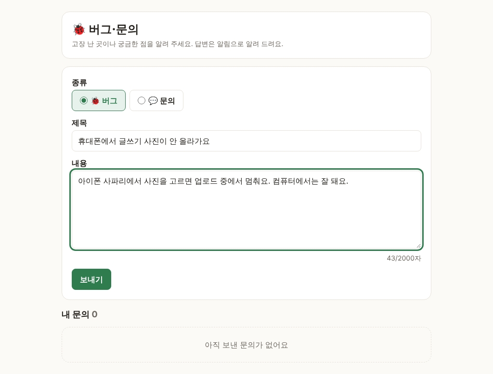
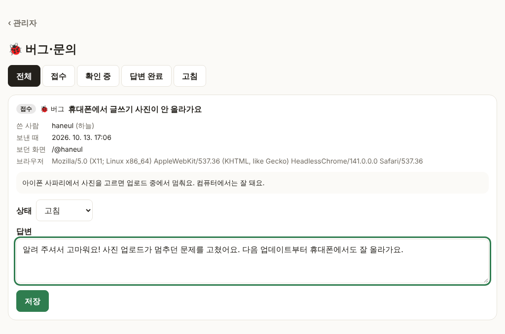
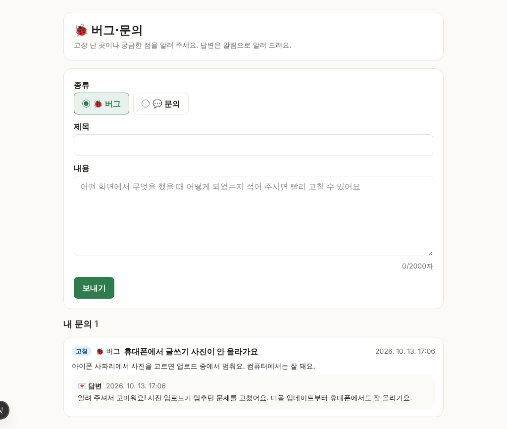
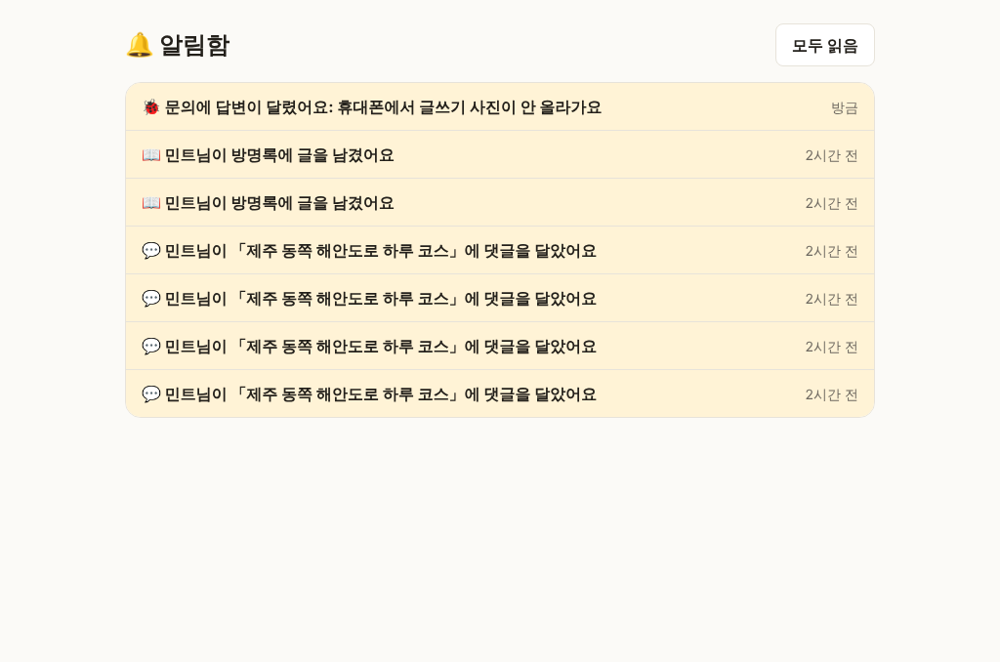

# Blogville v1.2.0 (2026-10-13)

화면 맨 아래에 업데이트 소식과 버그·문의 버튼이 생겼어요. 불편한 점을 보내면 관리자가 답하고, 답변은 알림으로 와요.

## 한눈에

| | 새로 생긴 것 |
|---|---|
| 🆕 업데이트 소식 | 모든 화면 맨 아래 막대의 버튼으로 릴리스 노트를 봐요. 새 버전이 나오고 3일 동안은 NEW 표시가 붙어요 |
| 🐞 버그·문의하기 | 버그나 궁금한 점을 보내고, "내 문의"에서 진행 상태와 답변을 봐요 |
| 👑 관리자 | `/admin/feedback`에서 문의를 모아 보고 상태와 답변을 저장해요 |

## 아래 막대

모든 화면 맨 아래에 **🆕 업데이트 소식**과 **🐞 버그·문의하기** 버튼이 있어요. 마을 화면에서는 ☰ 메뉴에 들어 있어요.

릴리스 노트는 이제 이 버튼(`/updates`)에서만 보여요. 공지 블로그에는 더 이상 자동으로 올리지 않아요.

## 🐞 버그·문의 보내기

종류(🐞 버그 / 💬 문의), 제목, 내용을 쓰고 **보내기**를 누르면 돼요. 어느 화면에서 눌렀는지는 자동으로 함께 보내져요. 한 시간에 5번까지 보낼 수 있어요.

## 관리자가 답하기

관리자는 `/admin/feedback`에서 상태(접수 · 확인 중 · 답변 완료 · 고침)로 걸러 보고, 상태와 답변을 저장해요.

## 답변 확인

답변이 달리면 🔔 알림이 오고, "내 문의"에서 상태와 답변을 볼 수 있어요.

| 내 문의 | 알림 |
|---|---|
|  |  |

## 운영

- 문의를 자동으로 처리하는 봇용 통로(`/api/feedback`)가 생겼어요. GitHub 시크릿 `FEEDBACK_BOT_TOKEN`(32자 이상)을 넣고 배포해야 켜지고, 없으면 닫혀 있어요.
