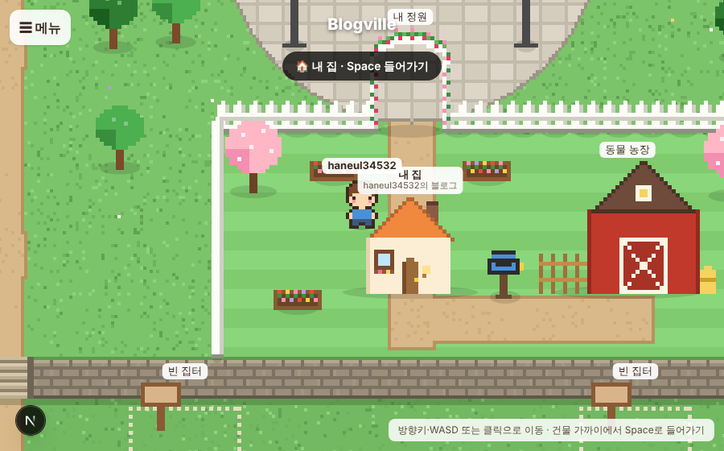

# Blogville v1.2.1 (2026-10-13)

🐞 버그·문의하기로 들어온 불편 두 가지를 고쳤어요.

## 한눈에

| | 바뀐 것 |
|---|---|
| 🖼 사진 올리기 | 본문을 누르지 않고 🖼 사진을 고르면 글 맨 위로 들어가던 것을 고쳐, 이제 글 끝에 들어가요 |
| 🖼 큰 사진 | 10MB가 넘는 사진(PNG·JPG·WEBP)은 올리기 전에 자동으로 줄여서 JPG로 올려요 |
| 🏘 마을 | 내 집·이웃 집은 앞문까지 돌아가지 않아도 집 옆·뒤 가까이에서 Space로 들어가요 |

## 사진 올리기

- 글을 고칠 때처럼 본문을 아직 한 번도 누르지 않았으면 커서가 글 맨 앞에 있어서, 🖼 사진으로 고른 사진이 글 맨 위로 올라갔어요. 이제는 본문을 누르지 않았으면 **글 끝**에 넣어요. 본문을 누른 뒤 고르면 지금처럼 누른 자리에 들어가요.
- 휴대폰·카메라 원본 사진처럼 10MB가 넘는 사진은 브라우저에서 긴 쪽 3200px 안으로 줄여 JPG로 바꾼 뒤 올려요. 움직이는 GIF는 줄이지 않아서 10MB까지만 올릴 수 있어요.

## 마을에서 집에 들어가기

집 둘레(옆·뒤 40px 안)에 서면 `🏠 내 집 · Space 들어가기` 안내가 떠요. 바로 옆에 우체통처럼 더 가까운 입구가 있으면 그쪽이 먼저예요. 마을 아래 안내 문구도 "건물 가까이에서 Space로 들어가기"로 바꿨어요.

