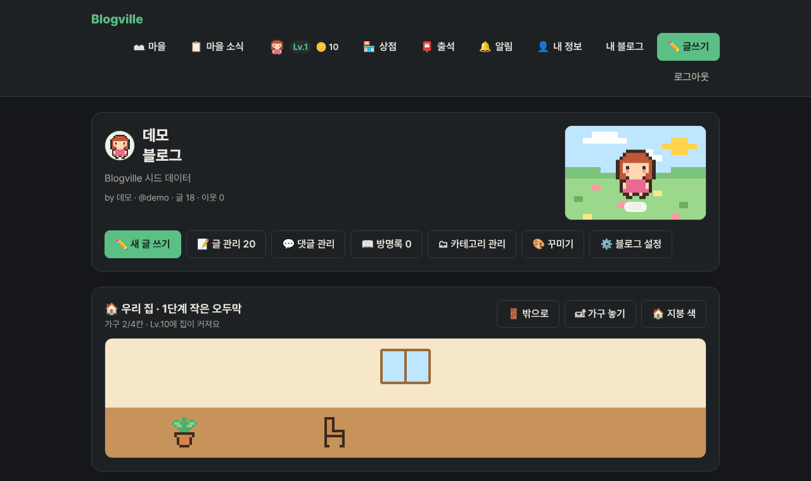
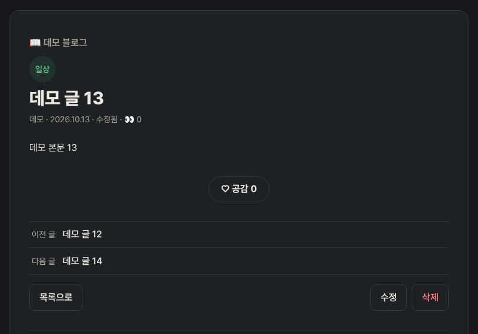
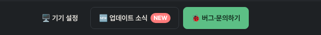

# Blogville v1.2.2 (2026-10-13)

어두운 화면이 생기고, 글꼴·보안·속도·검색 노출을 다듬었어요.

## 한눈에

| | 바뀐 것 |
|---|---|
| 🌙 어두운 화면 | 컴퓨터·휴대폰이 어두운 모드면 블로그도 어둡게 보여요. 아래 막대 버튼으로 직접 고를 수도 있어요 |
| 🔤 글꼴 | 어느 기기에서나 Pretendard 글꼴로 보여요 (전에는 기기 기본 글꼴로 보였어요) |
| 🖼 사진 속도 | 공개 글의 사진·프로필 사진은 한 번 받으면 하루 동안 다시 받지 않아 더 빨리 떠요 |
| 🔎 검색 노출 | 구글·네이버가 글의 제목·작성자·날짜·카테고리를 정확히 읽도록 구조화 정보를 넣었어요 |
| 🔒 보안 | 다른 사이트가 블로그를 몰래 틀 안에 넣지 못하게 막고, 다른 사이트로 나갈 때 글 주소가 새지 않게 했어요 |
| 🛟 운영 | 매일 새벽 DB 백업, 15분마다 사이트 살아 있는지 확인, 문제가 생기면 바로 전 버전으로 되돌리는 버튼 |

## 어두운 화면

기기 설정을 그대로 따라가요. 밤에만 어둡게 쓰고 싶거나 반대로 늘 밝게 쓰고 싶으면, 화면 맨 아래 **🖥️ 기기 설정** 버튼을 누를 때마다 🌙 어둡게 → ☀️ 밝게 → 🖥️ 기기 설정 순서로 바뀌어요. 고른 값은 그 브라우저에 남아요. 마을 게임 그림은 그대로예요.

## 보이지 않는 곳에서 바뀐 것

- 글꼴: Pretendard를 블로그가 직접 내려줘요. 글자 범위별로 잘게 나눈 파일이라 화면에 쓰인 글자 몫만 받아요.
- 보안: 모든 화면에 HSTS·X-Frame-Options·Referrer-Policy 같은 보안 헤더를 붙였어요.
- 검색 노출: 공개 글에 BlogPosting·BreadcrumbList 정보를 넣었어요. 비공개 글에는 넣지 않아요.
- 운영: 매일 새벽 3시 DB 백업(14개 보관), 15분마다 사이트 감시, GitHub Actions의 되돌리기(rollback) 버튼이 생겼어요.
