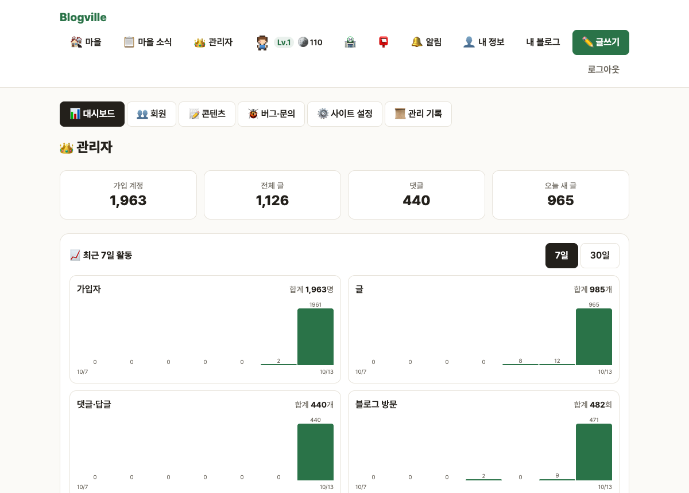
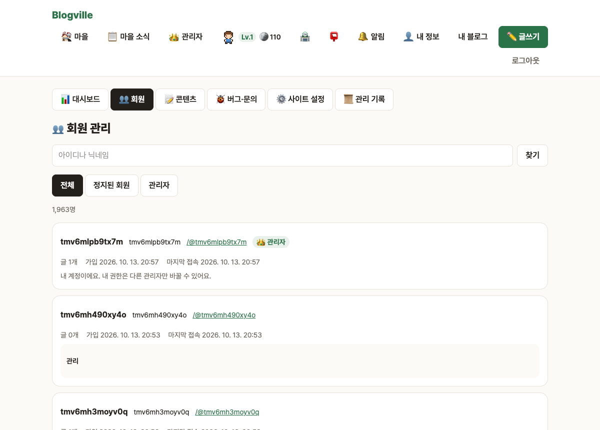
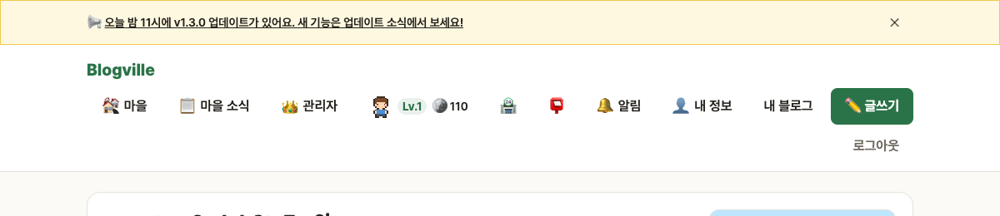
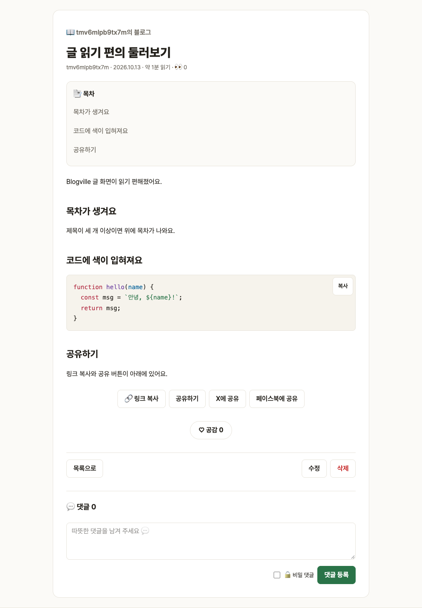
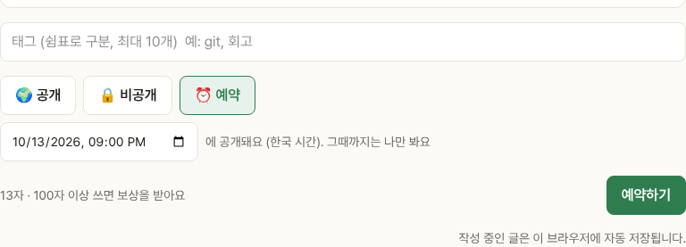
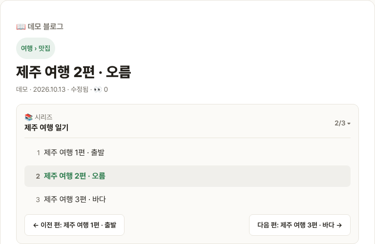
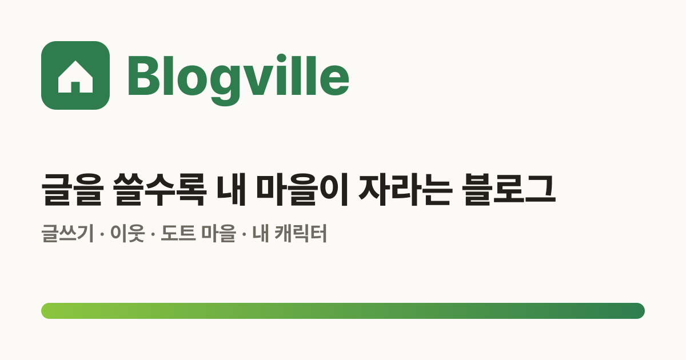

# Blogville v1.3.0 (2026-10-13)

관리자 화면을 크게 보강하고, 글을 읽고 쓰는 편의 기능을 여럿 더했어요.

## 한눈에

| | 바뀐 것 |
|---|---|
| 👑 관리자 | 대시보드 그래프, 회원 정지·관리자 지정·강제 탈퇴, 콘텐츠 한꺼번에 지우기·블라인드, 공지 띠, 금지어, 관리 기록 |
| 📖 글 읽기 | 읽는 시간, 📑 목차, 코드 색 입히기와 [복사], 사진 크게 보기, 🔗 링크 복사·공유, ↑ 맨 위로 |
| ⏰ 예약 발행 | 글쓰기 공개 설정의 ⏰ 예약에서 날짜·시간을 고르면 그 시각에 공개돼요(5분 뒤~90일 안). 그때까지는 나만 봐요 |
| 📚 시리즈 | 글쓰기의 📚 시리즈 칸에서 연재를 묶으면, 글 위 상자에 몇 번째 편인지와 이전 편·다음 편이 보여요 |
| 📈 블로그 통계 | 블로그 관리에 🧭 어디서 왔나요(최근 30일 유입 경로)와 🏆 인기 글 카드 |
| 🔎 검색 속도 | 블로그 안 글 검색·블로그 찾기가 글이 많아도 빨라요 (DB가 허락하면 자동으로 인덱스를 만들어요) |
| 🖼 공유 미리보기 | 사진 없는 글·블로그 홈을 카카오톡에 붙여도 Blogville 기본 그림이 나와요. 휴대폰 홈 화면에 추가하면 앱처럼 열려요 |
| ♿ 접근성 | 마을 소식·블로그의 글자 대비와 링크 이름을 고쳐 접근성 점수 100 |

## 👑 관리자 화면

관리자 화면(`/admin`) 위에 탭이 생겼어요: 대시보드 · 회원 · 콘텐츠 · 버그·문의 · 사이트 설정 · 관리 기록.

- **대시보드**: 최근 7일/30일의 가입자·글·댓글·방문 그래프와 합계, 방문이 많은 블로그 10곳.
- **회원**: 아이디·닉네임 검색. 정지(1일·7일·30일·영구, 사유)와 해제, 관리자 지정·해제, 비밀번호 초기화, 강제 탈퇴. 정지된 회원은 로그인할 때 `이용이 정지된 계정이에요 (…까지, 사유: …)`를 봐요. 자기 자신과 마지막 관리자는 바꿀 수 없어요.

- **콘텐츠**: 글·댓글·방명록을 한곳에서 보고, 골라서 한꺼번에 지우기(한 번에 50개까지). 글은 블라인드로 숨길 수도 있어요.
- **사이트 설정**: 모든 화면 위에 뜨는 **공지 띠**(닫을 수 있고, 새 공지는 다시 떠요)와 **금지어**(들어 있으면 글·댓글·방명록·문의를 저장하지 않아요).
- **관리 기록**: 정지·권한·탈퇴·삭제·블라인드·공지·금지어·문의 답변을 누가 언제 했는지 남겨요.

## 📖 글 읽기 편의

- 날짜 옆에 `약 N분 읽기`.
- 제목이 세 개 이상인 글은 본문 위에 `📑 목차`. 누르면 그 제목으로 가요.
- 코드 블록에 색이 입혀지고, 오른쪽 위 `[복사]`로 바로 복사돼요.
- 본문 사진을 누르면 크게 보여요. Esc나 바깥을 누르면 닫혀요.
- 공개 글 아래 `🔗 링크 복사`, `공유하기`(휴대폰), X·페이스북 공유. 긴 글에서는 `↑`로 맨 위로.

## ⏰ 예약 발행

## 📚 시리즈

## 🖼 공유 미리보기 기본 그림

