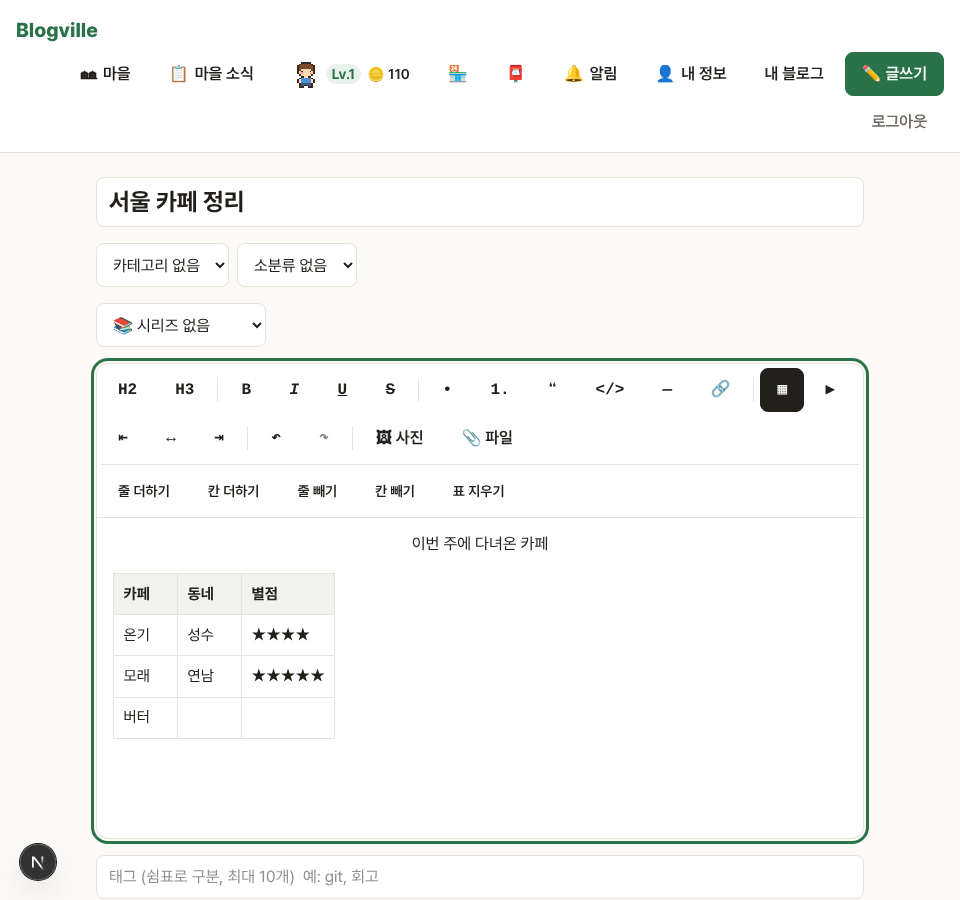
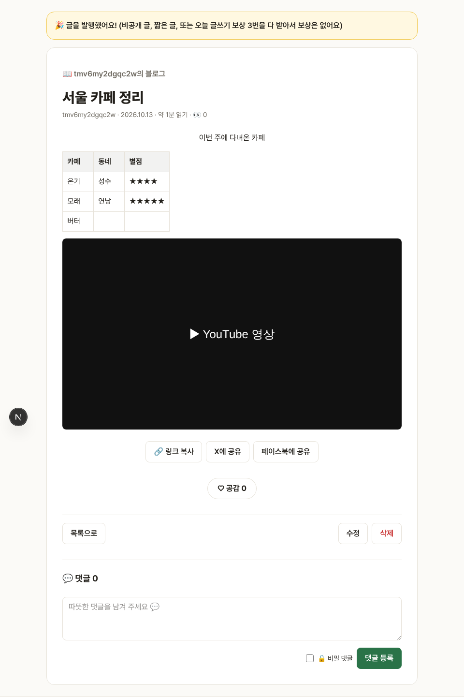

# Blogville v1.3.1 (2026-10-13)

글쓰기 도구에 표, YouTube 영상, 문단 정렬이 생겼어요.

## 한눈에

| | 바뀐 것 |
|---|---|
| ▦ 표 | 글쓰기 도구의 ▦를 누르면 3×3 표가 들어가요. 표 안에 있으면 [줄 더하기]·[칸 더하기]·[줄 빼기]·[칸 빼기]·[표 지우기]가 보여요. Tab으로 다음 칸 |
| ▶ YouTube | ▶를 누르고 YouTube 주소(youtube.com/watch, youtu.be, shorts)를 넣으면 글에 영상이 들어가요 |
| ⇤ ↔ ⇥ 정렬 | 문단과 소제목을 왼쪽·가운데·오른쪽으로 맞춰요 |

## 표 넣기

## 글에서 보이는 모습

## 보이지 않는 곳에서 바뀐 것

- 영상은 쿠키를 남기지 않는 `youtube-nocookie.com` 주소로 바꿔 넣어요. YouTube가 아닌 주소의 틀은 저장할 때 지워요.
- 표는 칸 합치기 수만, 정렬은 `text-align`(왼쪽·가운데·오른쪽)만 남기고 나머지 꾸밈은 지워요.
- 휴대폰에서는 넓은 표가 화면 밖으로 밀리지 않고 표 안에서 옆으로 넘겨 봐요.
