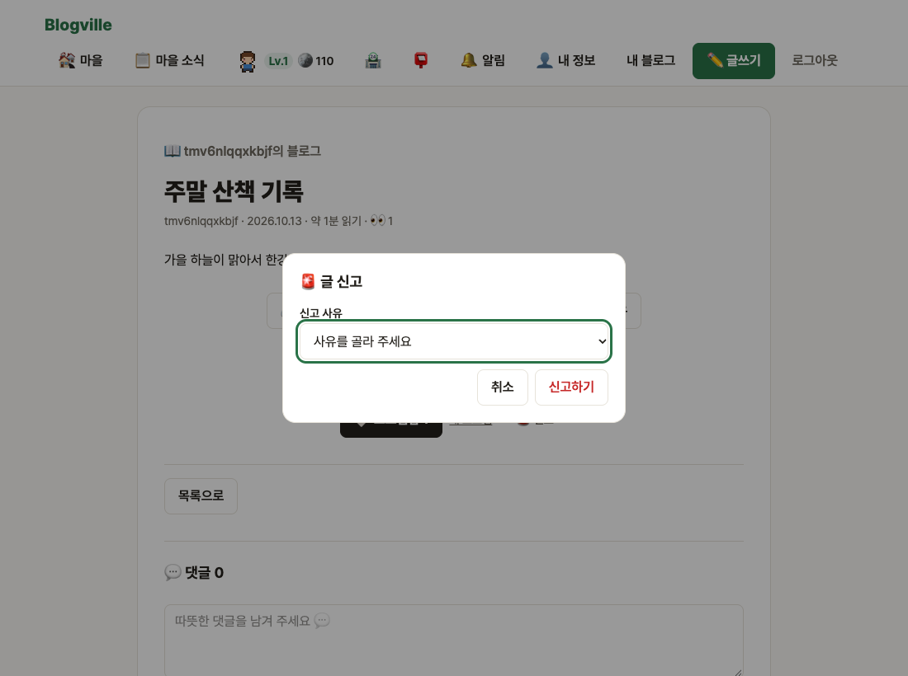
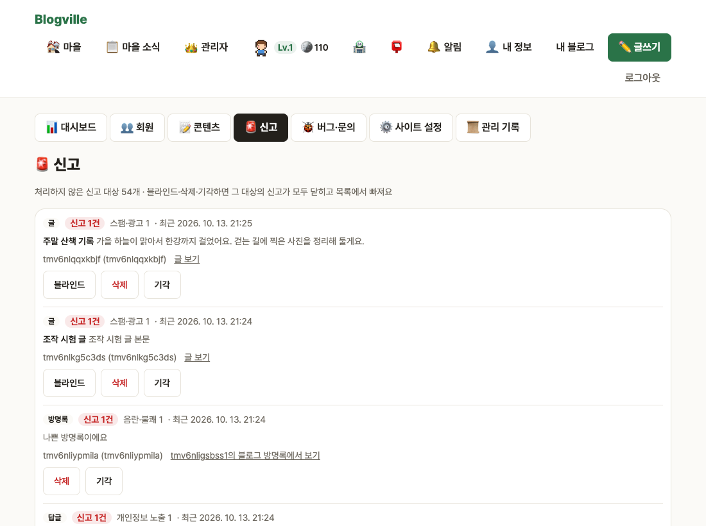
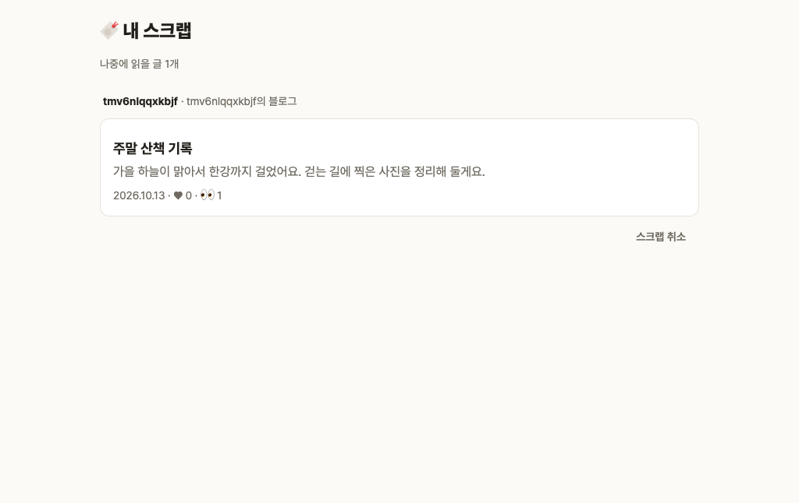
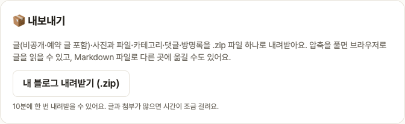

# Blogville v1.4.0 (2026-10-13)

문제 있는 글을 알리는 신고, 나중에 읽을 글을 모으는 스크랩, 내 블로그를 통째로 내려받는 내보내기가 생겼어요.

## 한눈에

| | 새로 생긴 것 |
|---|---|
| 🚨 신고하기 | 남의 글·댓글·답글·방명록에 `🚨 신고`. 관리자 화면 `🚨 신고` 탭에서 블라인드·삭제·기각으로 처리 |
| 🔖 스크랩 | 공개 글에 `🔖 스크랩`, 모아 보기는 `🔖 내 스크랩`(내 정보·마을 ☰ 메뉴) |
| 📦 내보내기 | 블로그 설정에서 내 글 전체·사진·댓글·방명록을 .zip 하나로 내려받기 |

## 🚨 신고하기

- 사유는 스팸·광고 / 욕설·비방 / 음란·불쾌 / 개인정보 노출 / 기타(설명 적기) 중에서 골라요.
- 내가 볼 수 있는 남의 글만, 같은 것은 한 번만 신고할 수 있어요. 한 시간에 10건까지예요.
- 관리자는 대시보드의 `🚨 신고 처리 대기 N건`과 `🚨 신고` 탭에서 대상별로 모아 보고, **블라인드**(글)·**삭제**·**기각** 중 하나로 처리해요. 처리하면 그 대상의 신고가 모두 닫히고 관리 기록에 남아요.

## 🔖 스크랩

마음에 드는 공개 글에서 `🔖 스크랩`을 누르면 `🔖 내 스크랩`에 모여요. 글이 비공개가 되면 목록에서 잠시 빠져요.

## 📦 내 블로그 내보내기

블로그 설정 맨 아래 `📦 내보내기`의 [내 블로그 내려받기 (.zip)]를 누르면 받아져요. 압축을 풀면 `index.html`로 브라우저에서 글을 읽을 수 있고, 글마다 Markdown 파일도 들어 있어 다른 곳으로 옮기기 쉬워요. 비공개·예약 글도 표시와 함께 들어가고, 10분에 한 번 받을 수 있어요.

