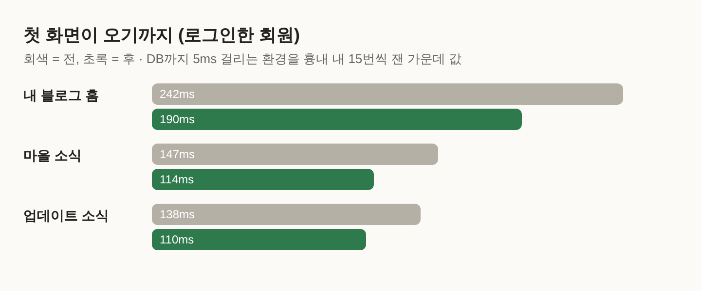

# Blogville v1.4.1 (2026-10-13)

화면은 그대로이고, 로그인한 회원에게 블로그가 더 빨리 떠요.

## 한눈에

| | 바뀐 것 |
|---|---|
| ⚡ 블로그 홈 | 첫 화면이 약 20% 빨라졌어요 |
| ⚡ 다른 화면 | 위쪽 메뉴(코인·레벨·알림)를 기다리지 않고 본문부터 그려요 |

## 보이지 않는 곳에서 바뀐 것

- 위쪽 메뉴를 본문과 따로 그려요. 메뉴가 준비되는 아주 짧은 동안은 로고만 있는 같은 높이 막대가 보여요.
- 블로그 카테고리와 글 수를 하나씩 기다리지 않고 한꺼번에 읽어요.
- 한 화면을 그리는 동안 같은 블로그 정보, 같은 출석 기록을 두 번 읽지 않아요.
- 오늘 출석 보상은 지금처럼 본문보다 먼저 기록해서, 위쪽 메뉴와 화면의 코인 숫자가 늘 같아요.
