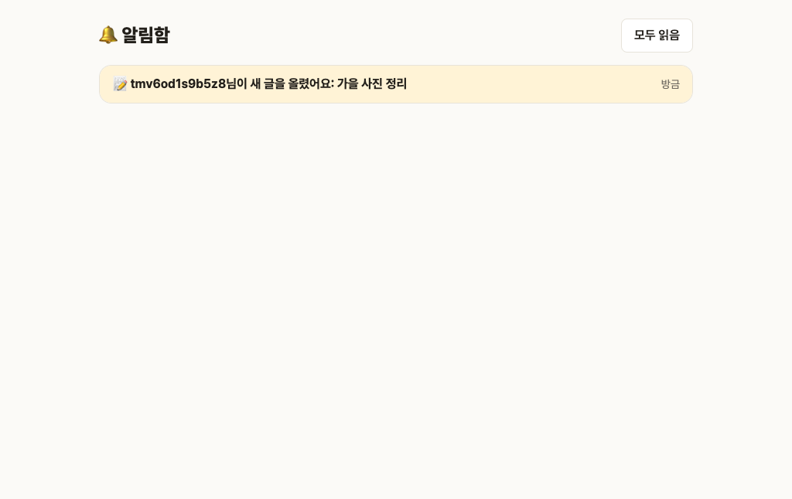
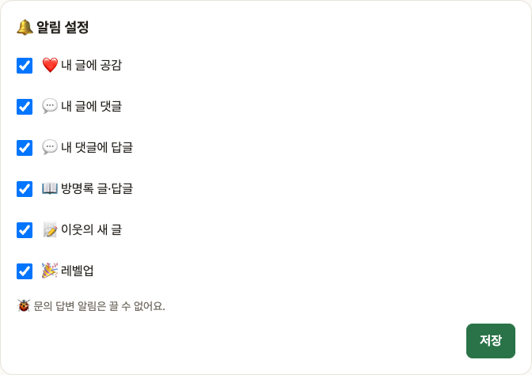
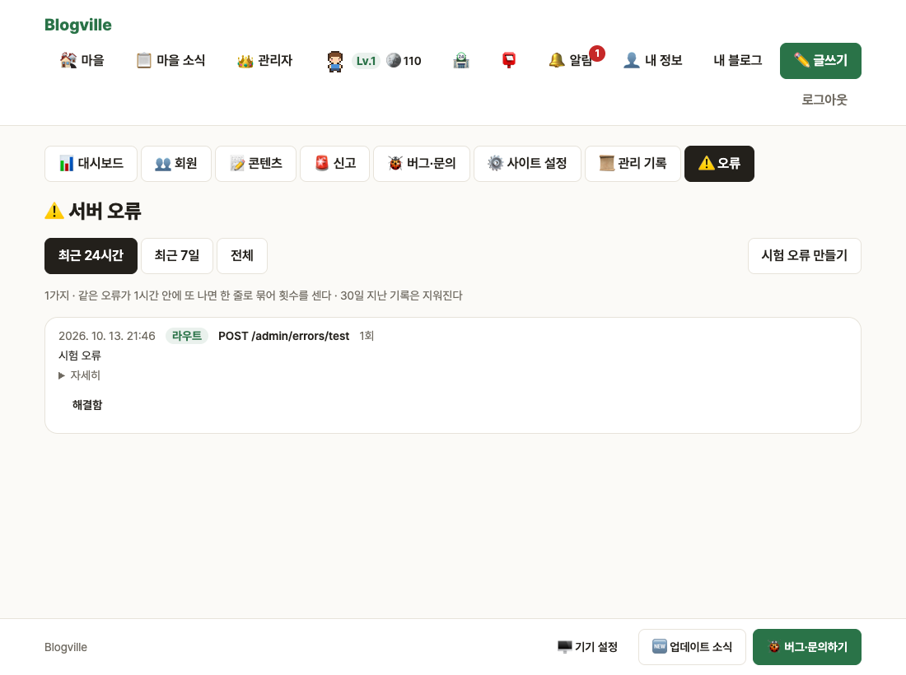

# Blogville v1.5.0 (2026-10-13)

이웃이 새 글을 올리면 알려 주고, 알림을 종류별로 끌 수 있어요. 운영에서 난 서버 오류는 관리자 화면에서 바로 볼 수 있어요.

## 한눈에

| | 새로 생긴 것 |
|---|---|
| 📝 새 글 알림 | 이웃으로 추가한 회원이 공개 글을 새로 올리면 알림. 예약 글은 실제로 공개되는 시각에 |
| 🔔 알림 설정 | 내 정보에서 공감·댓글·답글·방명록·새 글·레벨업 알림을 켜고 끄기 |
| ⚠️ 서버 오류 기록 | 관리자 화면 `⚠️ 오류` 탭에서 언제·어느 화면에서 오류가 났는지, 몇 번 났는지 보기 |

## 📝 이웃 새 글 알림

- 누르면 그 글로 가요. 글을 고치거나 비공개로 쓴 글은 알리지 않아요.

## 🔔 알림 설정

내 정보(`👤 내 정보`) 아래 `🔔 알림 설정`에서 받고 싶은 알림만 남기고 [저장]을 눌러요. 버그·문의 답변 알림은 늘 받아요.

## ⚠️ 서버 오류 기록 (관리자)

처리되지 못한 서버 오류가 자동으로 기록돼요. 같은 오류가 1시간 안에 또 나면 한 줄로 묶어 횟수를 세고, 펼치면 자세한 내용을 볼 수 있어요. 고친 뒤 `해결함`을 누르면 목록에서 빠지고 관리 기록에 남아요. `시험 오류 만들기`로 기록이 잘 되는지 확인할 수 있어요. 비밀번호 같은 비밀 값은 기록에서 가려요.

