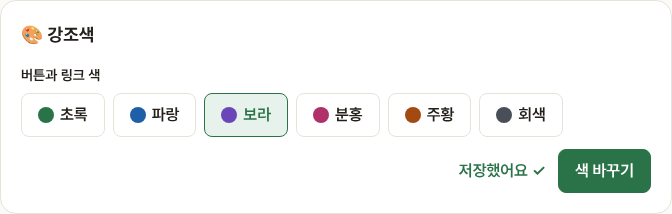
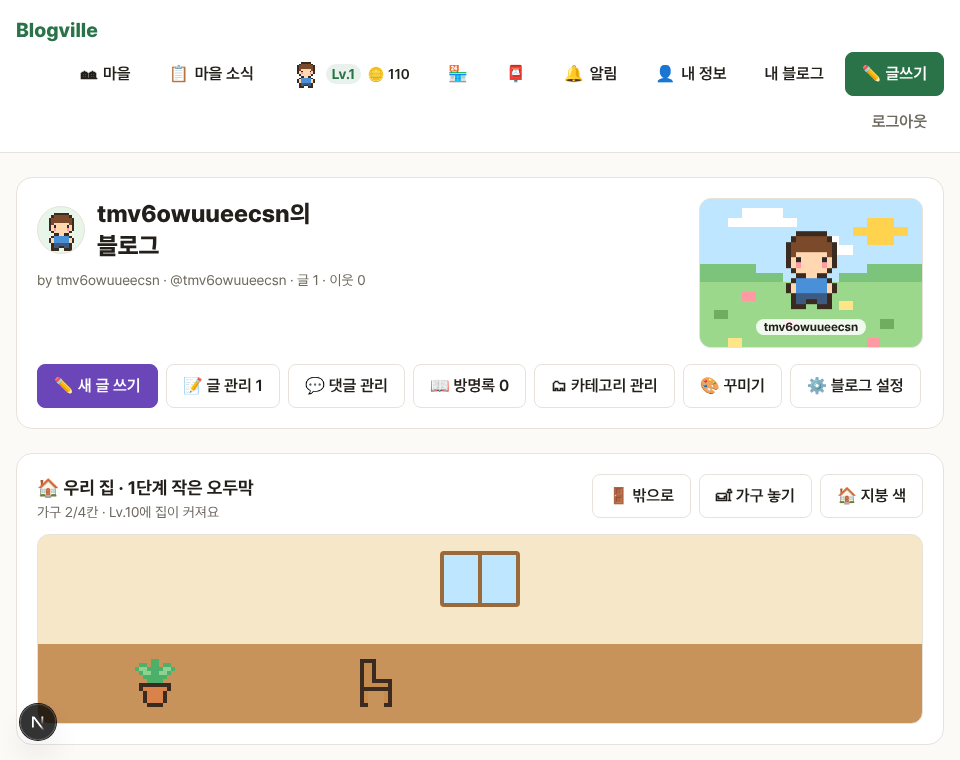

# Blogville v1.5.1 (2026-10-13)

내 블로그의 버튼·링크 색을 고를 수 있어요.

## 한눈에

| | 바뀐 것 |
|---|---|
| 🎨 강조색 | 블로그 관리의 🎨 강조색에서 초록·파랑·보라·분홍·주황·회색 중 하나를 고르면, 내 블로그 홈·글·방명록의 버튼·링크 색이 바뀌어요 |

## 색 고르기

블로그 관리(`/settings/blog`)에서 색을 누르고 [색 바꾸기]를 누르면 돼요.

## 보라색으로 바꾼 블로그

블로그 안의 버튼·링크만 바뀌고, 위쪽 메뉴처럼 사이트 전체에 쓰는 부분은 그대로예요. 어두운 화면에서는 같은 색의 밝은 쪽을 써서 글씨가 잘 보여요.

