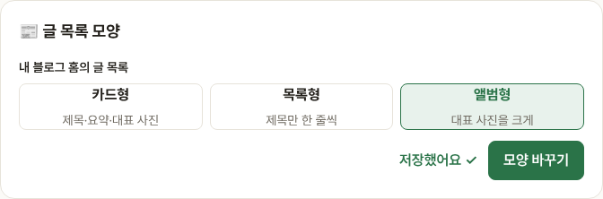
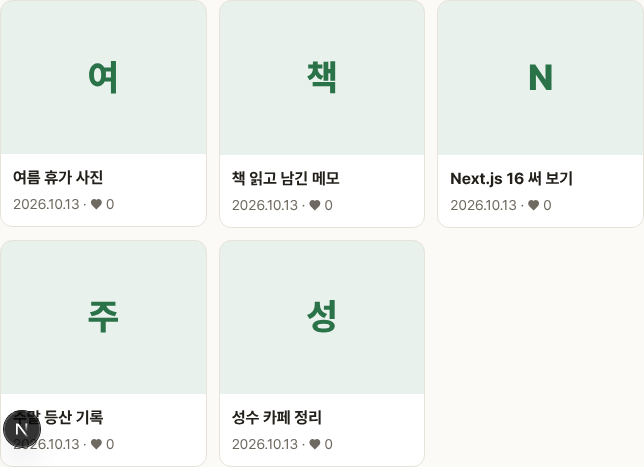
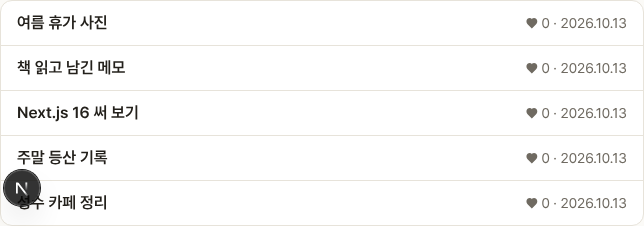

# Blogville v1.5.2 (2026-10-13)

내 블로그 홈의 글 목록 모양을 고를 수 있어요.

## 한눈에

| | 바뀐 것 |
|---|---|
| 📰 글 목록 모양 | 블로그 관리에서 카드형·목록형·앨범형 중에서 골라요 |

## 모양 고르기

블로그 관리(`/settings/blog`)의 📰 글 목록 모양에서 고르고 [모양 바꾸기]를 누르면 돼요. 처음에는 지금처럼 카드형이에요.

## 앨범형

대표 사진을 크게 보여 줘요. 사진이 없는 글은 제목 첫 글자 칸이 대신 나와요.

## 목록형

제목만 한 줄씩 보여 줘서 글이 많은 블로그를 훑어보기 좋아요.

