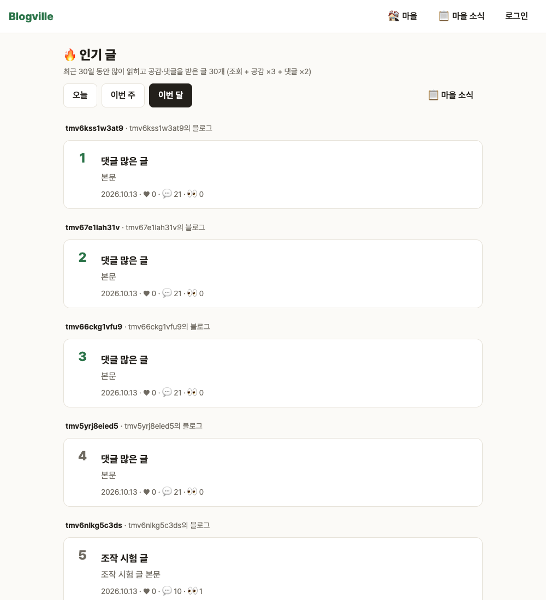

# Blogville v1.6.0 (2026-10-14)

마을 전체의 🔥 인기 글을 모아 보는 화면이 생겼어요. 사진이 더 가볍게 뜨고, 배포·백업도 더 믿을 수 있게 다졌어요.

## 한눈에

| | 바뀐 것 |
|---|---|
| 🔥 인기 글 | 마을 소식·마을 ☰ 메뉴의 `🔥 인기 글`에서 오늘·최근 7일·최근 30일 동안 많이 읽히고 공감·댓글을 받은 글 30개 |
| 🖼 사진 썸네일 | 글 목록 대표 사진과 프로필 사진을 작은 webp로 보내 목록이 더 빨리 떠요 |
| 🧪 배포 전 화면 시험 | 운영으로 가는 배포마다 실제 DB를 띄워 화면 시험 288개를 자동으로 돌려요 |
| 💾 백업 되살리기 | 매일 백업을 새 DB에 그대로 되살리는 도구가 생겼어요. 39,266행을 1초에 되살려 행 수가 모두 맞는 것을 확인했어요 |

## 🔥 인기 글

점수는 기간 안의 조회 + 공감 ×3 + 댓글 ×2예요. 같으면 새 글이 먼저예요. 비공개·숨긴 글·예약 중인 글은 나오지 않아요.

