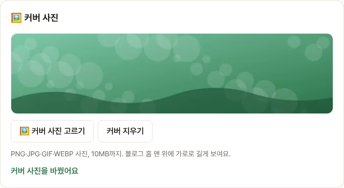
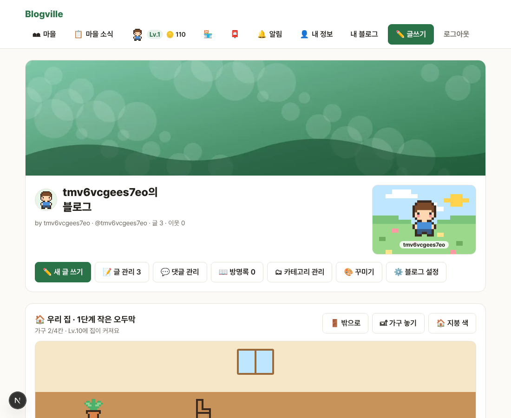

# Blogville v1.6.1 (2026-10-14)

내 블로그 홈 맨 위에 커버 사진을 걸 수 있어요.

## 한눈에

| | 바뀐 것 |
|---|---|
| 🖼️ 커버 사진 | 블로그 관리에서 사진을 고르면 블로그 홈 맨 위에 가로로 길게 보여요 |

## 커버 사진 고르기

블로그 관리(`/settings/blog`)의 🖼️ 커버 사진에서 [🖼️ 커버 사진 고르기]를 누르고 사진을 고르면 바로 바뀌어요. PNG·JPG·GIF·WEBP 사진, 10MB까지예요. [커버 지우기]로 다시 뺄 수 있어요.

## 블로그 홈

커버 사진은 블로그 이름 칸 위에 걸리고, 방문자도 똑같이 봐요. 화면 폭에 맞춘 가벼운 사진(webp)으로 받아서 빨리 떠요.

