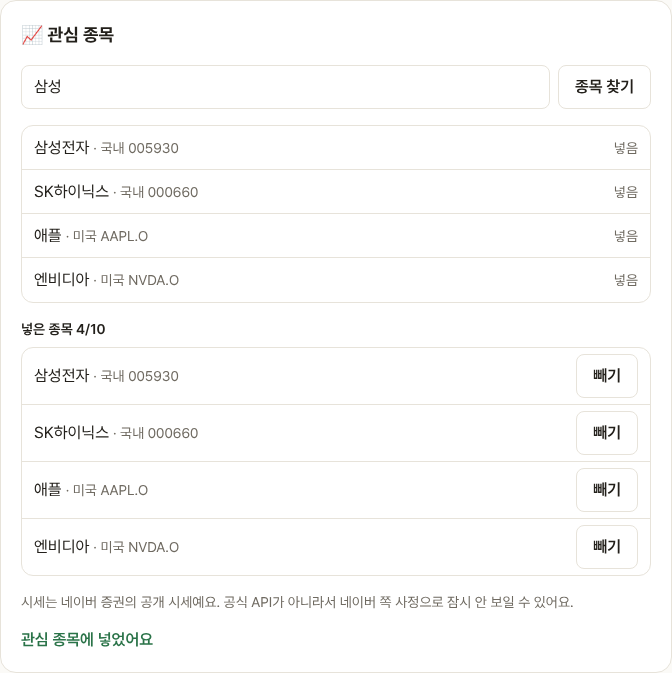
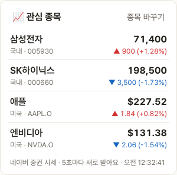

# Blogville v1.6.3 (2026-10-14)

블로그 옆 칸에 실시간 주식 시세 창이 생겼어요.

## 한눈에

| | 바뀐 것 |
|---|---|
| 📈 관심 종목 | 블로그 설정에서 종목을 넣고 빼면 블로그 옆 칸에 현재가·등락이 5초마다 바뀌며 보여요 |

## 종목 넣고 빼기

블로그 설정(`/settings/blog`)의 📈 관심 종목에서 이름이나 코드로 찾아 [넣기]를 누르면 돼요. 국내·미국 주식을 10개까지 넣을 수 있고, [빼기]로 뺄 수 있어요.

## 옆 칸 시세

블로그 홈 옆 칸에 넣은 순서대로 현재가와 등락, 등락률이 보여요. 화면을 열어 둔 동안 5초마다 새로 받아요. 오르면 빨강 ▲, 내리면 파랑 ▼예요. 방문자도 같이 봐요.

- 시세는 네이버 증권의 공개 시세예요. 공식 API가 아니라서 네이버 쪽 사정으로 잠시 "시세를 못 받았어요"가 보일 수 있어요.
- 다른 탭을 보는 동안에는 쉬었다가, 돌아오면 바로 새로 받아요.
