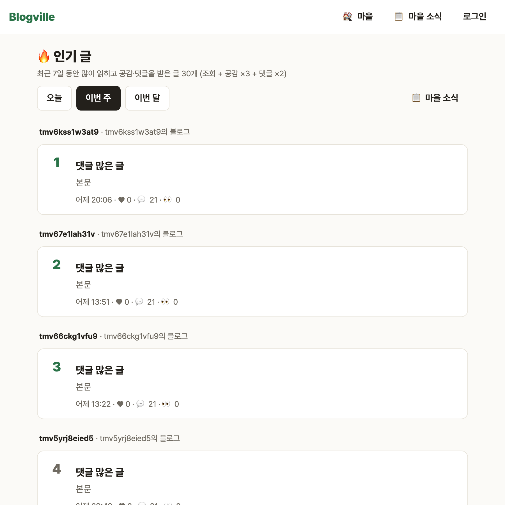
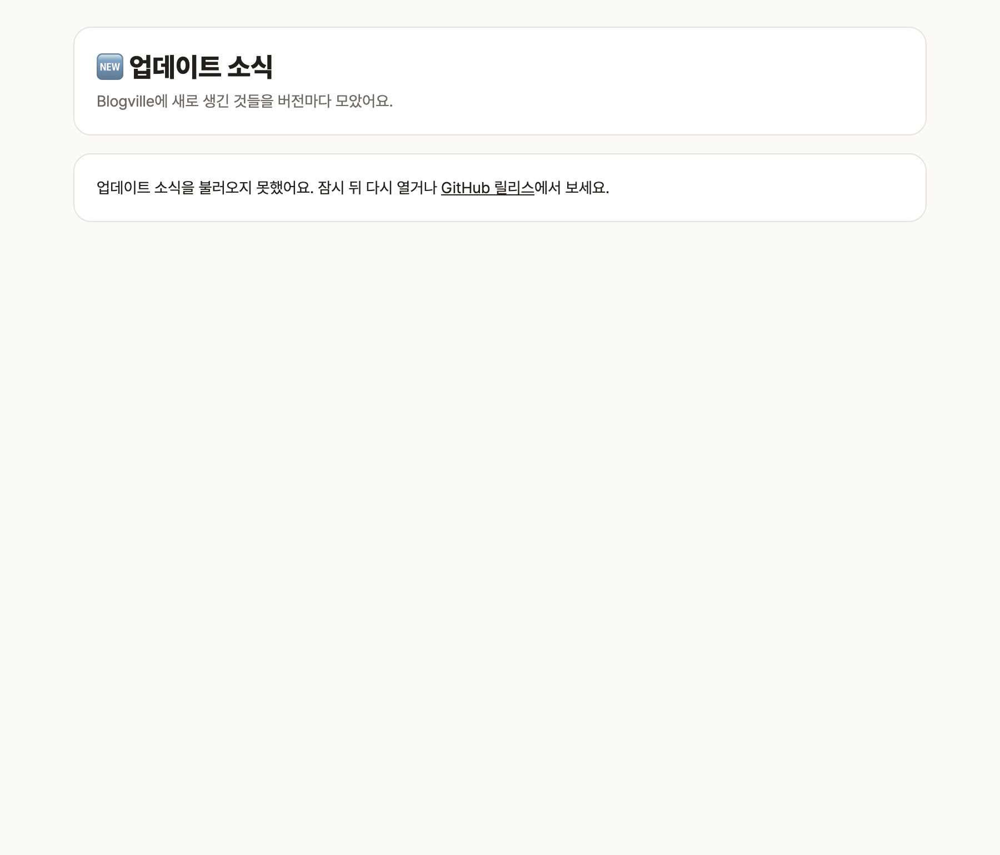

# Blogville v1.6.4 (2026-10-14)

글·댓글·업데이트 소식 등 블로그 곳곳에 날짜뿐 아니라 시각(분까지)이 보여요.

## 한눈에

| | 바뀐 것 |
|---|---|
| 🕒 시각 표시 | 최근 것은 "방금 전 · 12분 전 · 3시간 전 · 어제 14:05", 그 전은 "2026.10.12 14:05" |
| 🖱️ 전체 시각 | 시각에 마우스를 올리면 "2026년 10월 14일 오전 10:16 (한국 시간)" |
| 🔄 저절로 새로 고침 | "12분 전" 같은 글자는 화면을 열어 둔 동안 바뀌는 때에 맞춰 저절로 바뀌어요 |

## 목록·댓글·방명록·알림

글 목록과 카드, 카테고리 글, 댓글, 방명록, 알림, 업데이트 목록은 얼마나 지났는지로 보여요. 오늘 쓴 것은 "N분 전·N시간 전", 어제 쓴 것은 "어제 20:06", 그 전은 날짜와 시각이에요. 모두 한국 시간이에요.

## 정확한 시각이 필요한 곳

글·업데이트 상세, 지갑(경험치·코인 내역), 내 문의, 내 글·댓글 관리, 관리자 화면은 "2026.10.14 10:16"처럼 날짜와 시각을 그대로 보여 줘요. 관리자 오류 기록은 같은 분에 여러 번 생길 수 있어서 마우스를 올리면 초까지 보여요.
