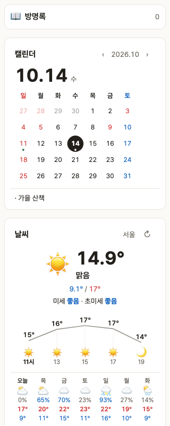
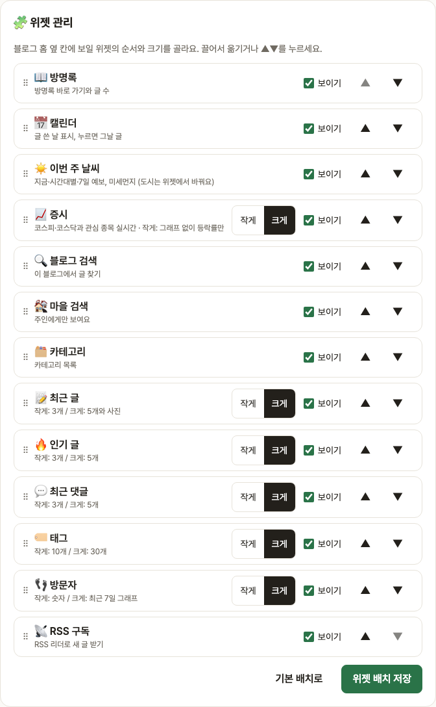
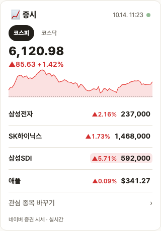

# Blogville v1.7.0 (2026-10-14)

블로그 옆 칸이 "위젯 보드"로 바뀌었어요. 순서·보이기·크기를 직접 고르고, 날씨·캘린더·증시 위젯이 새로 생겼어요.

## 한눈에

| | 바뀐 것 |
|---|---|
| 🧩 위젯 관리 | 블로그 관리에서 끌어서(또는 ▲▼) 순서 바꾸기, 보이기·숨기기, 작게·크게 |
| 📅 캘린더 | 큰 오늘 날짜와 달력, 글 쓴 날 점, 누르면 그날 글. 공휴일·주말 색 |
| ☀️ 이번 주 날씨 | 지금 기온·미세먼지·시간대별 기온·7일 예보. 📍 내 위치 또는 블로그 도시 |
| 📈 증시 | 코스피·코스닥 지수와 오늘 흐름 그래프 + 관심 종목, 실시간으로 바로 바뀜 |
| 👣 방문자 | 최근 7일 막대 그래프 |

## 🧩 위젯 관리

블로그 관리(`/settings/blog#widgets`)의 🧩 위젯 관리에서 옆 칸 위젯을 마음대로 놓을 수 있어요.

- 마우스로 끌어 놓거나, 휴대폰에서는 ▲▼ 버튼으로 순서를 바꿔요.
- [보이기]를 끄면 그 위젯이 옆 칸에서 빠져요.
- 작게/크게: 작게는 목록 3개·태그 10개처럼 짧게, 크게는 5개와 작은 사진·그래프까지 보여요.
- [기본 배치로]를 누르면 처음 모양으로 돌아가요.

## 📈 증시 (실시간)

네이버 메인 증시 위젯처럼 코스피(또는 코스닥) 지수와 오늘 흐름 그래프, 그 아래 블로그 관심 종목이 보여요.

- 예전에는 5초마다 새로 물어봤는데, 이제는 서버가 시세가 바뀌는 순간 바로 보내 줘요(실시간 스트림). 가격이 바뀐 칸은 잠깐 빨강(오름)·파랑(내림)으로 깜빡여요.
- 연결이 끊겨도 저절로 다시 붙고, 그동안은 마지막 시세를 그대로 보여 줘요. 오른쪽 위 초록 점이 깜빡이면 실시간 연결 중이에요.
- 관심 종목이 없어도 방문자에게 지수는 보여요.

## ☀️ 날씨 · 📅 캘린더

- 날씨는 처음엔 블로그 주인이 고른 도시(기본 서울)로 보이고, 보는 사람이 [📍 내 위치 날씨]를 허락하면 그 자리 날씨로 바뀌어요. 주인은 위젯에서 바로 도시를 바꿀 수 있어요.
- 캘린더는 글을 쓴 날에 점이 찍히고, 날짜를 누르면 그날 쓴 글이 보여요. ‹ ›로 달을 넘겨요.
