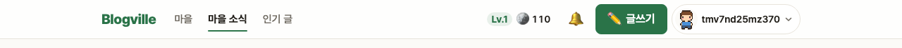
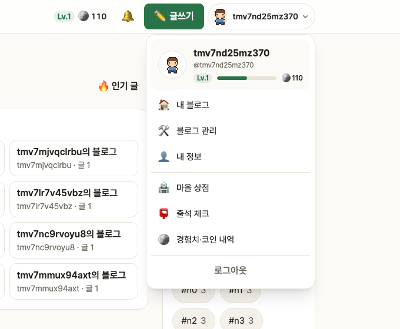
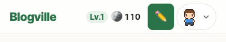

# Blogville v1.7.1 (2026-10-14)

맨 위 막대(상단바)를 깔끔하게 정리했어요.

## 한눈에

| | 바뀐 것 |
|---|---|
| 🧭 큰 메뉴 | 로고 옆에 마을 · 마을 소식 · 인기 글. 지금 보는 곳은 굵게 + 초록 밑줄 |
| 👤 내 메뉴 | [캐릭터 + 닉네임 ▾]를 누르면 내 블로그·블로그 관리·내 정보·상점·출석·경험치 내역·로그아웃이 한곳에 |
| 📌 붙는 막대 | 화면을 내려도 상단바가 위에 반투명하게 붙어 있어요 |

## 👤 내 메뉴

아이콘 9개가 한 줄에 늘어서 있던 것을 오른쪽 [캐릭터 + 닉네임 ▾] 버튼 하나로 모았어요. 맨 위에 닉네임·레벨 경험치 막대·코인이 보이고, 그 아래 자주 가는 곳이 있어요. 처음 온 회원에게는 "여기를 누르면…" 말풍선이 한 번 떠요. 바깥을 누르거나 Esc를 누르면 닫혀요.

## 📱 휴대폰

휴대폰에서는 로고·레벨과 코인·✏️ 글쓰기·[캐릭터 ▾]만 남기고, 마을 소식·상점·알림은 아래 탭에서 써요.

