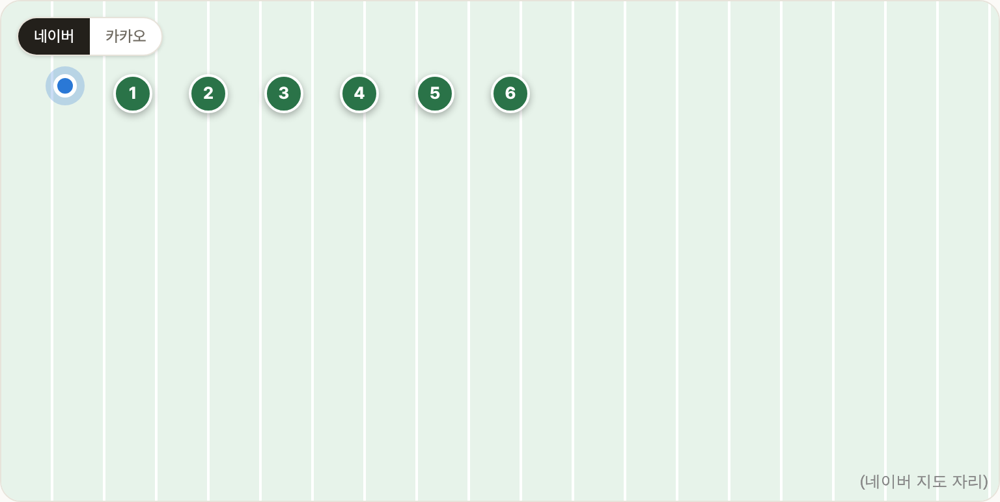
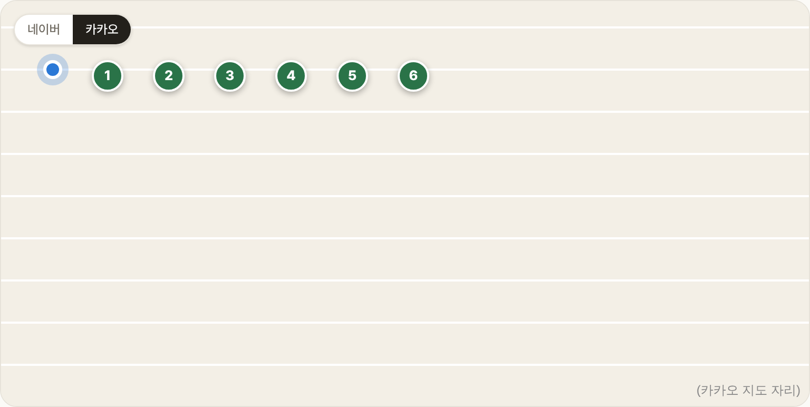

# Blogville v1.7.14 (2026-10-14)

맛집 지도를 네이버 지도와 카카오 지도 중에서 골라 볼 수 있어요.

## 한눈에

| | 바뀐 것 |
|---|---|
| 🗺 지도 고르기 | 맛집 지도 왼쪽 위 [네이버 \| 카카오] 버튼, 고른 지도는 다음에도 그대로 |

## 🗺 지도 고르기

- 맛집(`/food`)의 내 주변·지역 인기·식당 상세 지도 왼쪽 위에 **[네이버 | 카카오]** 버튼이 생겼어요.
- 고른 지도는 이 브라우저에 기억해서, 다음에 들어와도 그 지도로 열려요.
- 처음에는 네이버 지도로 열리고, 네이버 지도가 열리지 않으면 지금처럼 카카오 지도로 바로 바뀌어요.

(그림은 실제 지도 대신 색 배경을 깔고 찍었어요. 버튼, 내 위치 점, 번호 핀 자리는 실제와 같아요.)
