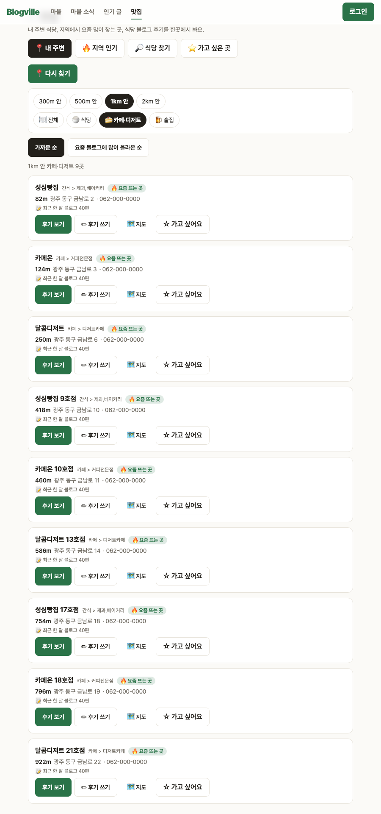

# Blogville v1.7.15 (2026-10-14)

🍽 맛집에서 거리와 분류를 고르고, 엉뚱한 블로그 후기는 걸러 보여 줘요.

## 한눈에

| | 바뀐 것 |
|---|---|
| 📍 거리 고르기 | 내 주변을 300m · 500m · 1km · 2km 안으로 |
| 🍚🍰🍺 분류 | 식당 · 카페·디저트 · 술집으로 나눠 보기 (식당 찾기도) |
| 🧹 후기 거르기 | 식당 이름만 같은 다른 이야기(게임·영화)·광고 글은 빼고, 뺀 글 수 안내 |
| 📄 후기 10쪽 | 블로그 후기를 10편씩 10쪽까지 |

## 📍 거리와 분류

- 내 주변에서 [300m 안] [500m 안] [1km 안] [2km 안] 중 고르면 그 안의 가게만 보여요(많아야 30곳). 없으면 [더 넓게 찾기]를 눌러요.
- [식당] [카페·디저트] [술집]을 고르면 그 분류만 보여요. 카페·빵집·디저트 가게는 따로 모아 찾아요.
- 고른 거리·분류는 [다시 찾기]나 지도의 [이 지역에서 다시 찾기]에서도 그대로 이어져요.

## 🧹 블로그 후기 거르기

- 후기는 제목·요약에 그 식당 이름이 있어야 보여요. "마피아"처럼 이름이 짧거나 다른 분야와 겹치면, 동네 이름과 먹은 이야기가 같이 있어야 보여요.
- 대출·분양·카지노·모집 같은 광고 글은 빼요. 몇 편을 뺐는지 위에 알려 줘요.
- 후기는 10편씩 10쪽까지 넘겨 볼 수 있어요.
