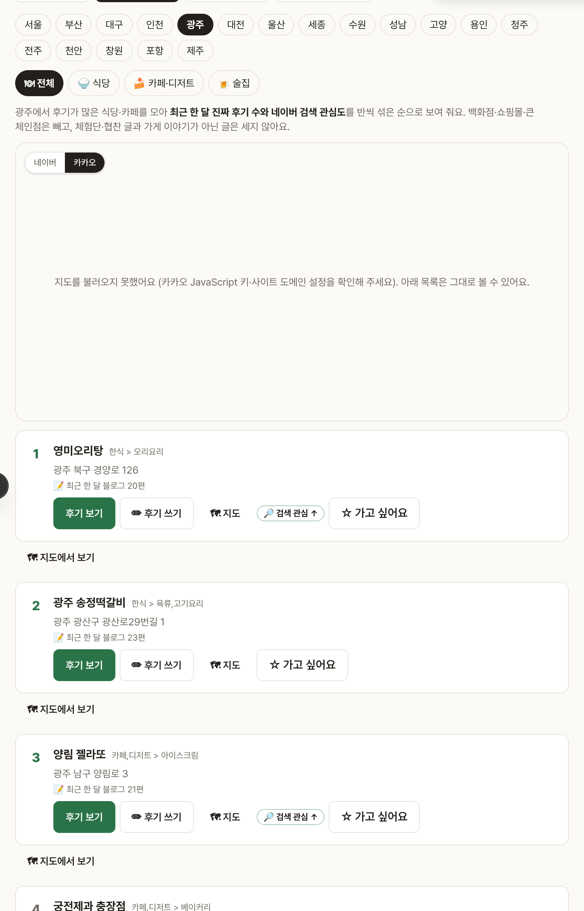
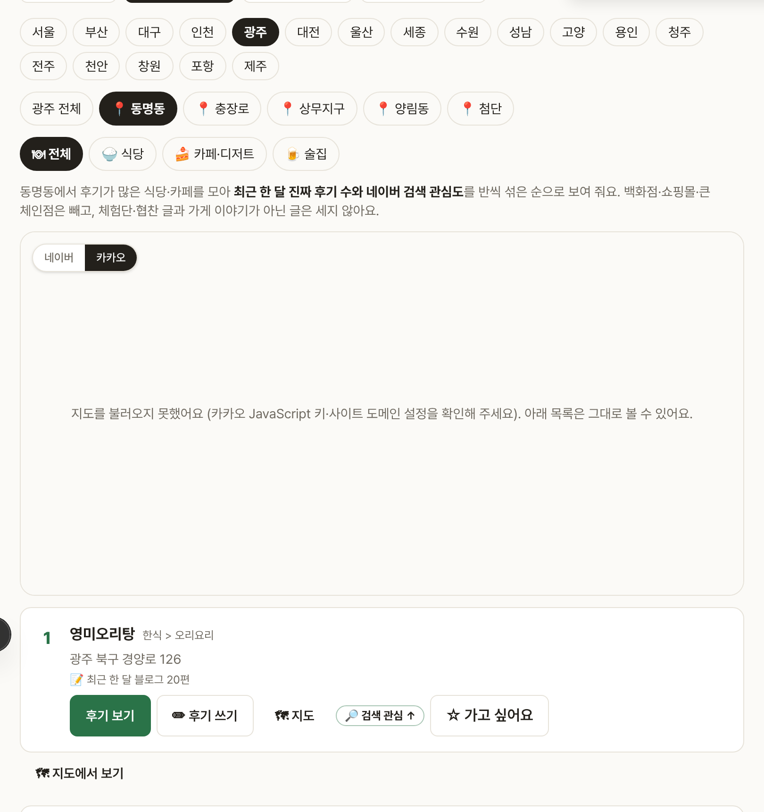
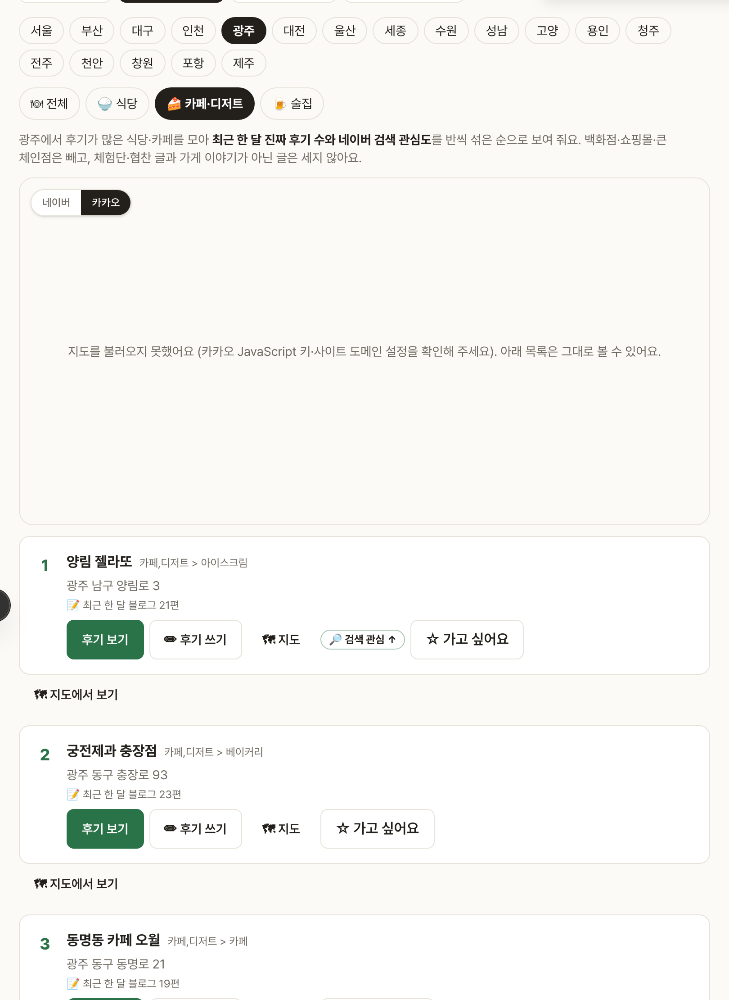

# Blogville v1.7.16 (2026-10-14)

🔥 지역 인기에 진짜 식당·카페만 나오고, 광고 글은 빼고 세고, 요즘 사람들이 많이 찾는 곳이 위로 와요.

## 한눈에

| | 바뀐 것 |
|---|---|
| 🧹 진짜 식당만 | 백화점·쇼핑몰·아울렛·호텔과 스타벅스·메가커피 같은 큰 체인은 지역 인기에서 빼요 |
| 📝 진짜 후기만 세기 | 체험단·협찬 글, 가게 이야기가 아닌 글은 "최근 한 달 블로그 N편"에서 빼고, 같은 블로거는 한 번만 (내 주변 "많이 올라온 순"도 같아요) |
| 🔎 검색 관심도 | 네이버 데이터랩 검색량(최근 8주)과 후기 수를 반씩 섞어 순위, 요즘 2주 검색이 늘어난 곳은 "🔎 검색 관심 ↑" |
| 📍 동네 고르기 | 도시 아래 동네 칩(서울: 성수·홍대·연남동·을지로…)으로 좁혀 보기 |
| 🍚🍰🍺 분류 | 지역 인기도 식당 · 카페·디저트 · 술집으로 나눠 보기 |

## 🧹 진짜 식당·카페만

- 네이버가 알려 주는 업종이 쇼핑·유통·숙박·문화면 빼고, 이름에 백화점·아울렛·몰이 들어간 곳도 빼요.
- 어디서나 볼 수 있는 큰 체인(카페·패스트푸드·치킨·베이커리 등)은 지역 인기에서만 빼요. 내 주변·식당 찾기에는 그대로 나와요.
- 빠진 만큼 채우려고 "현지인 맛집·술집·카페·디저트·빵집·브런치"까지 더 넓게 모아요.

## 📝 진짜 후기만 세기

- 제목·요약에 가게 이름이 있고, 그 가게 이야기로 보이는 글만 세요(이름이 같은 게임·영화 글은 빼요).
- "체험단·협찬·원고료·제공받아" 같은 문구가 있는 글은 세지 않아요.
- 한 블로거가 여러 번 써도 한 편으로 세요.

## 🔎 검색 관심도

- 네이버 데이터랩 검색어 트렌드로 가게 이름 검색량을 재고, 지역 기준 검색어("성수 맛집")와 견줘 비교해요. 하루에 한 번 새로 받아요.
- 요즘 2주 검색이 그 전보다 30% 넘게 늘어난 곳에는 **🔎 검색 관심 ↑**가 붙어요.
- 검색량을 못 받으면 후기 수만으로 줄 세워요.

(그림은 시험용 가짜 데이터와 색 배경 지도로 찍었어요.)
