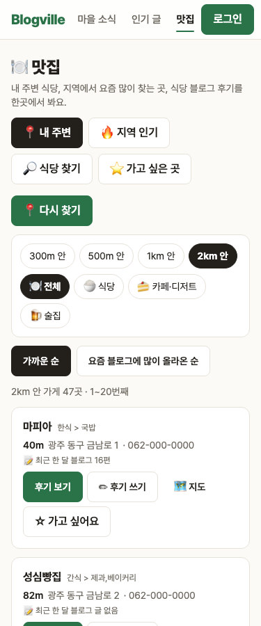

# Blogville v1.7.17 (2026-10-14)

🍽 맛집 내 주변을 더 넓고 많이 보고, 걸러 낸 후기도 확인할 수 있어요.

## 한눈에

| | 바뀐 것 |
|---|---|
| 📍 넓은 반경 | 1km·2km는 지역을 칸으로 나눠 찾아, 가게가 많은 곳에서도 가까운 30곳에 그치지 않아요 (가까운 200곳까지) |
| 📄 쪽 넘기기 | 내 주변 목록을 20곳씩 쪽으로, 지도 핀 번호도 쪽에 맞춰 |
| 🧹 뺀 후기 보기 | 후기 아래 [뺀 글 N편 보기]에서 뺀 글과 까닭(광고·스팸 / 식당 이름 없음 / 다른 이야기) |
| 🔎 검색 관심 그래프 | 식당 상세에 최근 12주 네이버 검색 관심 꺾은선 |

## 📍 넓은 반경과 쪽 넘기기

- 카카오는 한 번에 45곳까지만 알려 줘서, 가게가 많은 곳에서는 2km를 골라도 가까운 곳만 보였어요. 이제 1km는 4칸, 2km는 9칸으로 나눠 칸마다 찾아 합쳐요.
- 목록 위에 "2km 안 가게 47곳 · 21~40번째"처럼 보이고, 아래 쪽 번호로 넘겨요.

## 🧹 뺀 후기 보기

- 블로그 후기 아래 [뺀 글 N편 중 10편 보기]를 펼치면 뺀 글 제목과 까닭이 나와요. 잘못 빠진 글이 있으면 알려 주세요, 규칙을 다듬을게요.
