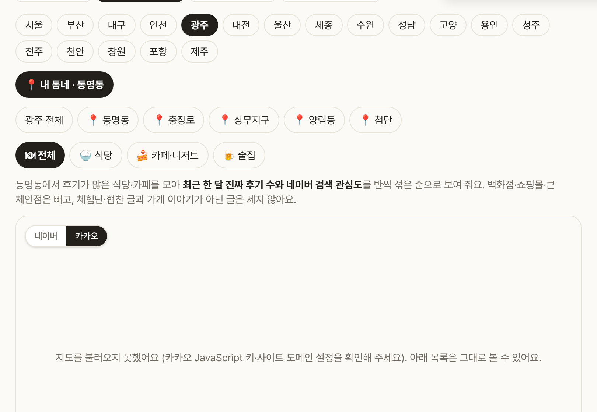
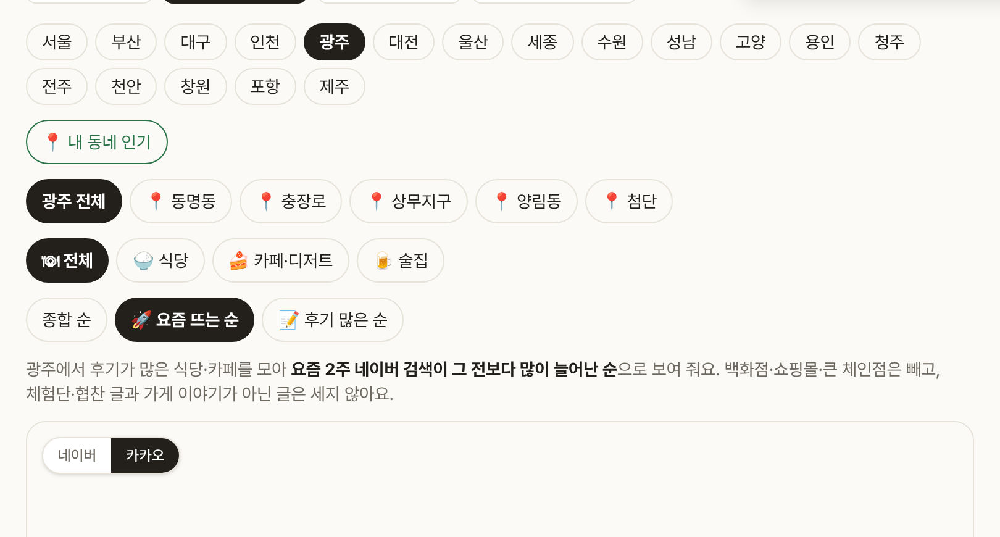

# Blogville v1.7.18 (2026-10-14)

🔥 지역 인기를 지금 있는 동네로 바로 보고, 요즘 뜨는 순으로도 줄 세워 봐요.

## 한눈에

| | 바뀐 것 |
|---|---|
| 📍 내 동네 인기 | 버튼 하나로 지금 있는 동네(예: 동명동·성수동)의 인기 식당·카페 TOP 10 |
| 🚀 정렬 고르기 | [종합 순] [요즘 뜨는 순] [후기 많은 순] |

## 📍 내 동네 인기

- 맛집 > 지역 인기 맨 위 **[📍 내 동네 인기]** 를 누르면 브라우저가 위치를 묻고, 그 자리의 동네 이름을 찾아 그 동네 순위를 보여 줘요.
- 버튼에 "📍 내 동네 · 동명동"처럼 찾은 동네가 나오고, 도시 칩도 그 도시로 바뀌어요.
- 분류(식당·카페/디저트·술집)와 정렬도 그대로 써요. 위치는 저장하지 않아요.

## 🚀 정렬 고르기

- **종합 순**: 최근 한 달 진짜 후기 수와 네이버 검색 관심도를 반씩 섞은 순 (지금까지와 같아요)
- **요즘 뜨는 순**: 요즘 2주 네이버 검색이 그 전 4주보다 많이 늘어난 순
- **후기 많은 순**: 광고·관련 없는 글을 뺀 최근 한 달 후기가 많은 순

(그림은 시험용 가짜 데이터로 찍었어요.)
