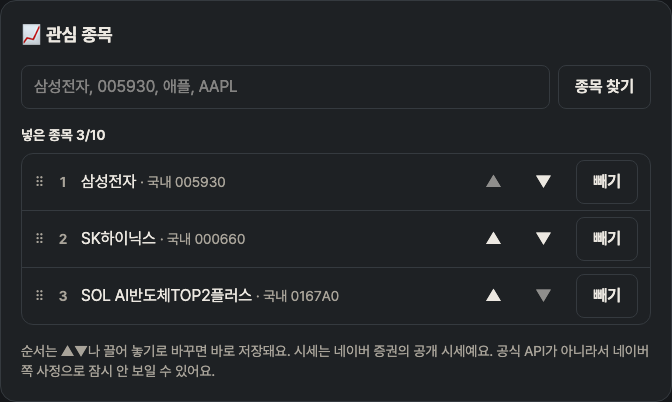

# Blogville v1.7.2 (2026-10-14)

관심 종목의 순서를 바꿀 수 있어요.

## 한눈에

| | 바뀐 것 |
|---|---|
| 📈 종목 순서 | 블로그 관리 → 관심 종목에서 ▲▼ 또는 끌어 놓기로 순서 바꾸기, 바로 저장 |

## 📈 관심 종목 순서

블로그 관리(`/settings/blog#stocks`)의 넣은 종목 목록에 순번과 ⠿ 손잡이, ▲▼ 버튼이 생겼어요.

- PC에서는 ⠿를 잡고 끌어 놓고, 휴대폰에서는 ▲▼를 눌러요.
- 바꾸는 즉시 저장되고, 블로그 옆 📈 증시에도 그 순서대로 보여요.
- 지금까지 넣은 종목은 넣은 순서 그대로이고, 새로 넣는 종목은 맨 뒤에 붙어요.

