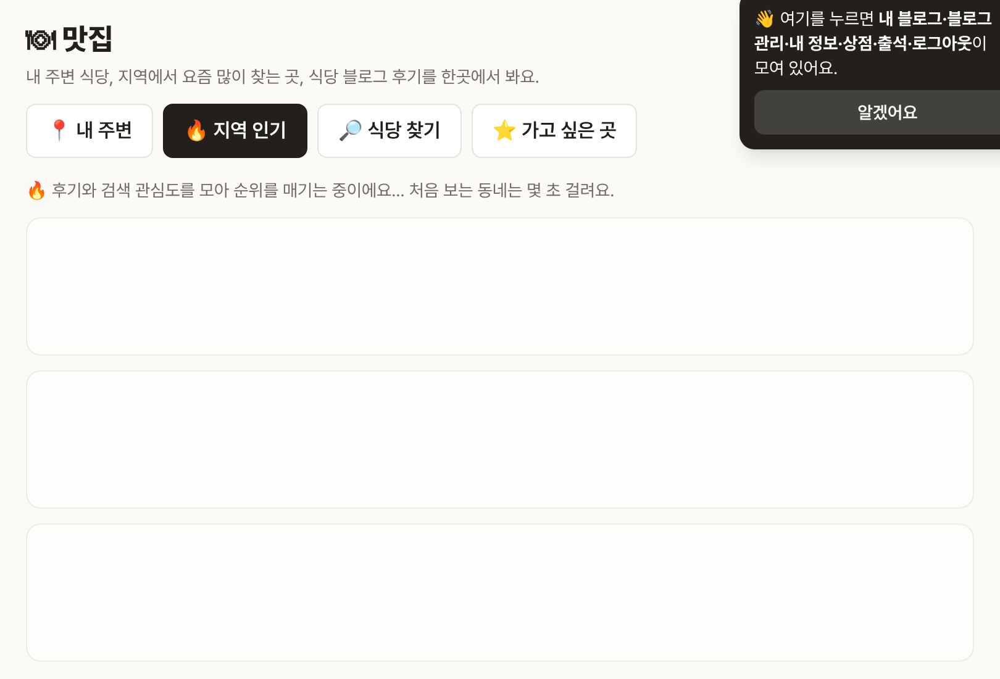

# Blogville v1.7.20 (2026-10-14)

맛집에서 동네·분류를 바꿀 때 기다리는 동안 무엇을 하는지 보여 줘요.

## 한눈에

| | 바뀐 것 |
|---|---|
| ⏳ 모으는 중 안내 | 탭·거리·분류·동네를 바꾸면 탭 줄은 바로 바뀌고, 목록 자리에 "순위를 매기는 중이에요…"와 자리표시 카드가 떠요 |
| 💬 빈 결과 문구 | 지역 인기가 비면 "동네나 분류를 바꿔 보세요"라고 안내해요 |

## ⏳ 모으는 중 안내

- 처음 보는 동네나 분류는 네이버·카카오에 여러 번 물어봐야 해서 몇 초 걸려요. 그동안 화면이 멈춘 것처럼 보이지 않게 안내를 띄워요.
- 한 번 본 동네는 몇 시간 동안 기억해서 바로 열려요.

