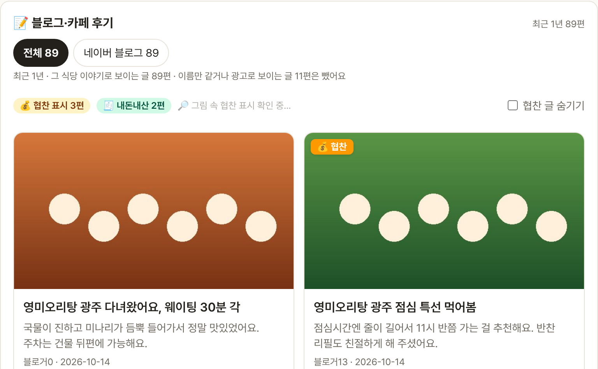
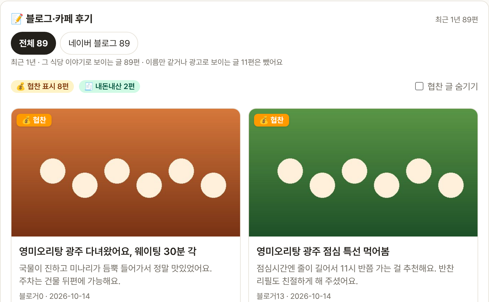

# Blogville v1.7.24 (2026-10-15)

협찬을 그림이나 태그로만 밝힌 블로그 후기도 💰 협찬으로 표시해요. 전남 시·군 식당 후기도 잘 잡히게 했어요.

## 한눈에

| | 바뀐 것 |
|---|---|
| 🔎 그림 속 협찬 표시 | "본 포스팅은 협찬을 포함합니다" 같은 그림을 서버가 뒤에서 읽어, 다 읽은 카드에 💰 협찬을 이어 붙여요 |
| #️⃣ #협찬 태그 | #협찬·#체험단·#원고료 태그, 그림 파일 이름·설명에 협찬이 적힌 글도 협찬으로 봐요 |
| 🗺 전남 시·군 후기 | 목포·순천 같은 시·군 식당은 "만호 목포"처럼 블로거가 쓰는 말로 후기를 찾아요 |
| 📝 상세 후기 표시 | 후기 머리에 "최근 1년 N편", 후기가 없을 때도 1년 기준으로 안내해요 |

## 🔎 그림 속 협찬 표시

- 후기는 지금처럼 바로 보여요. 위에 "🔎 그림 속 협찬 표시 확인 중…"이 뜨는 동안 서버가 글 맨 앞 2장과 맨 끝 4장 그림의 글자를 읽어요.
- 다 읽으면 그 카드에 💰 협찬이 붙고, "협찬 글 숨기기"에도 바로 반영돼요.
- 한 번 읽은 글은 하루 동안 기억해서 다음에 열면 기다리지 않아요.

