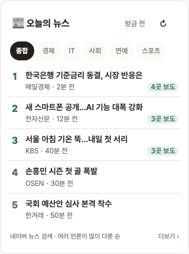

# Blogville v1.7.3 (2026-10-14)

블로그 옆 칸에 📰 오늘의 뉴스가 생겼어요.

## 한눈에

| | 바뀐 것 |
|---|---|
| 📰 오늘의 뉴스 | 종합·경제·IT·사회·연예·스포츠 탭, 여러 언론이 많이 다룬 이슈 TOP 5 |

## 📰 오늘의 뉴스

- 네이버 뉴스에서 최근 기사를 받아, 같은 이야기를 쓴 기사끼리 묶고 여러 언론사가 많이 다룬 순으로 5개를 보여 줘요. "4곳 보도"처럼 몇 곳이 다뤘는지도 나와요.
- 제목·언론사·시각만 보이고, 누르면 원문 기사가 새 탭으로 열려요.
- 10분마다 새로 받고, ↻를 누르면 바로 새로 받아요.
- 블로그 관리 → 🧩 위젯 관리에서 순서·숨기기·작게(3개)/크게(5개)를 고를 수 있어요.

