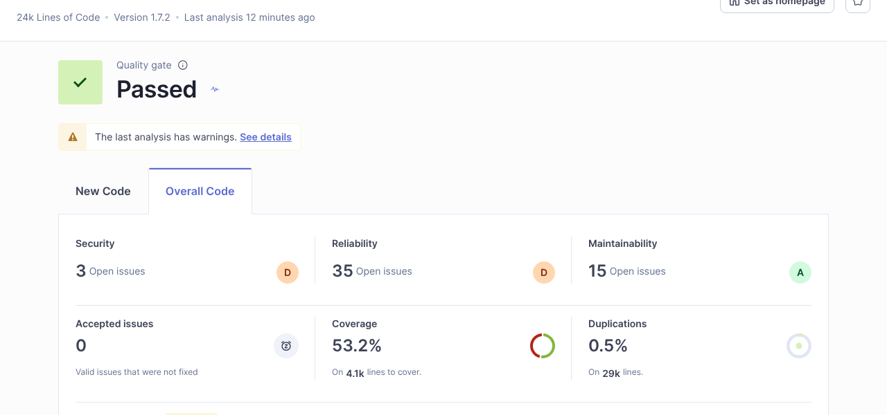
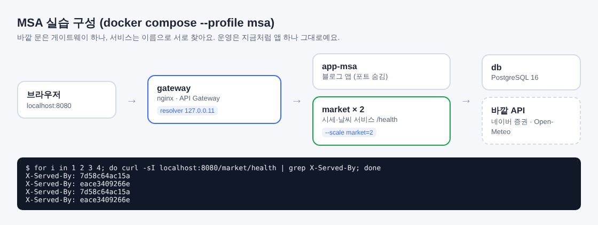

# Blogville v1.7.4 (2026-10-14)

블로그 화면은 그대로이고, 함께 만들고 운영하는 방법이 더 좋아졌어요. 팀 학습 우선순위(Git Flow → 빌드 → Sonar → Docker → CI/CD → MSA)에 맞춰 빈 곳을 채웠어요.

## 한눈에

| | 바뀐 것 |
|---|---|
| 📚 학습 문서 | `docs/learning/`에 11편: Git Flow, 빌드, Sonar, Docker, GitHub Actions, Secrets, Jenkins(개념), 무중단 배포, MSA, API Gateway, Service Discovery |
| 🧪 품질 검사 | `npm run verify` 한 번에 lint·타입·커버리지·빌드, SonarQube 품질 게이트, VS Code에 SonarQube for IDE 추천 |
| 🐛 버그 5건 | SonarQube가 찾은 정렬 비교 함수·처리 안 한 Promise 고침 |
| 🐳 도커 실행 | `docker compose --profile app up --build` 한 줄로 앱+DB |
| 📦 이미지 저장소 | 배포마다 같은 이미지를 `ghcr.io/handsomeguen/blogville`에 버전·latest 꼬리표로 올림 |
| 🩺 상태 확인 | `/api/health`가 DB까지 확인해 UP/DOWN과 버전을 알려 주고, 도커가 30초마다 확인(healthy) |
| 🧩 MSA 실습 | 게이트웨이 → 블로그 앱 + 시세·날씨 서비스(여러 벌), 이름으로 서로 찾기 |

## 🧪 품질 검사 (SonarQube)

- 단위 테스트가 커버리지를 재요(`npm run test:coverage`, 지금 53.2%).
- 내 컴퓨터에서 `docker compose --profile sonar up -d`로 SonarQube를 띄워 분석할 수 있고, 첫 분석에서 품질 게이트를 통과했어요.
- GitHub에서는 SonarCloud 열쇠(`SONAR_TOKEN`)를 넣으면 PR마다 품질 게이트가 돌아요. 넣는 방법은 `docs/learning/03-sonar.md`에 화면 순서대로 있어요.

## 🧩 MSA 실습 (로컬)

증시·날씨 위젯이 바깥 API를 부르는 부분을 작은 서비스로 떼어 냈어요. 블로그 앱 코드는 그대로이고, 운영도 지금처럼 앱 하나로 돌아요.

- **API Gateway**: 바깥 문은 nginx 하나(8080), 경로를 보고 앱이나 서비스로 나눠 보내요.
- **Service Discovery**: 서비스는 IP 대신 이름(`market`, `app-msa`)으로 서로 찾고, `--scale market=2`로 늘리면 게이트웨이가 번갈아 보내요.
- 시세·날씨 서비스를 멈춰도 블로그는 그대로 뜨고 위젯만 "못 받았어요"가 돼요.

