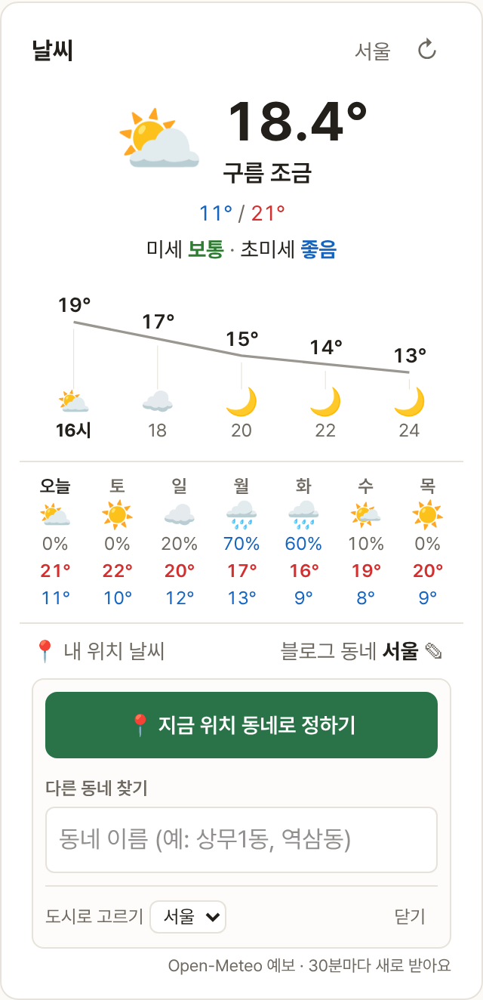
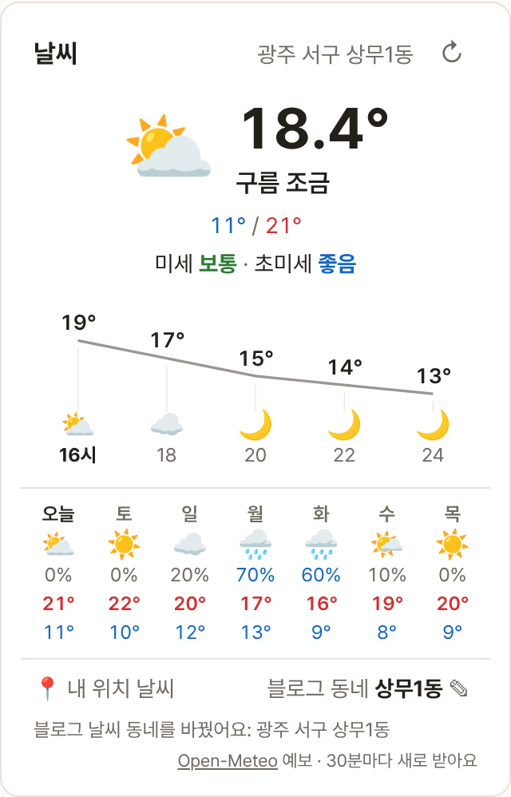
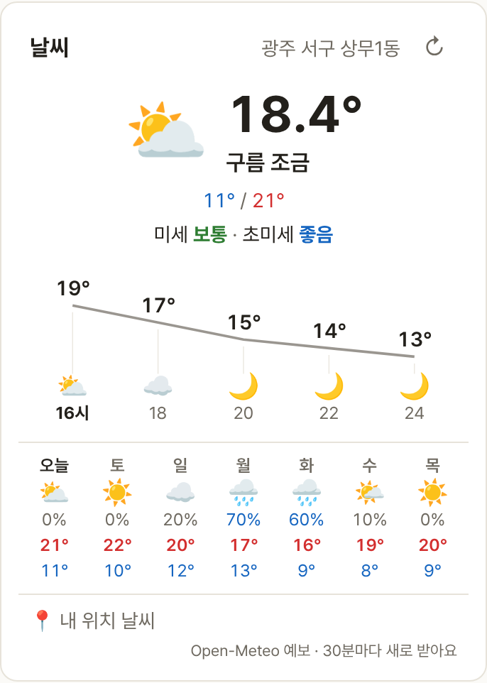

# Blogville v1.7.42 (2026-10-16)

블로그 주인이 날씨 위젯의 동네를 정할 수 있어요. 📍 한 번이면 지금 위치의 동네로, 다른 동네는 이름으로 찾아 고르면 위젯에 "광주 서구 상무1동"처럼 그 동네 날씨가 나와요.

## 한눈에

| | 바뀐 것 |
|---|---|
| ☀️ 블로그 동네 | 위젯 아래 "블로그 동네 ✎" → 📍 지금 위치 동네로 정하기, 또는 동네·역·건물 이름으로 찾기 |
| 👀 방문자 | 도시 대신 블로그 주인이 고른 동네 날씨를 봐요 (📍로 자기 동네로 바꿀 수 있는 건 그대로) |

## ☀️ 블로그 동네 정하기

- 블로그 홈 날씨 위젯 아래 **블로그 동네 ✎**를 누르면 고르는 칸이 열려요.
- **📍 지금 위치 동네로 정하기**를 누르면 지금 있는 곳의 행정동(예: 광주 서구 상무1동)으로 바로 정해져요.
- 다른 동네는 **다른 동네 찾기**에 동 이름, 역 이름, 건물 이름(예: 상무1동, 역삼동, 상무역)을 치면 행정동 목록이 나와요.
- 예전처럼 도시로 돌아가려면 아래 **도시로 고르기**에서 도시를 고르면 돼요.

## 👀 방문자 화면

- 방문자에게도 위젯 위쪽에 "광주 서구 상무1동"처럼 블로그 동네와 그 동네 날씨가 나와요. 좁은 화면에서는 앞쪽이 줄어들고 동 이름은 늘 보여요.
- 이 사이트에 위치를 허락한 방문자는 지금처럼 자기 동네 날씨가 먼저 나와요(v1.7.41).

## 지켜 둔 것

- 동네 좌표는 약 1km 단위로만 저장해요. 집 주소나 건물로 찾아도 그 자리는 남지 않고, 저장되는 건 동 이름과 대략의 좌표뿐이에요.
- 카카오 검색이 잠깐 막혀도 "없어요"로 잘못 기억하지 않고, 잠시 뒤 다시 찾으면 나와요.

(그림의 날씨 숫자는 시험용이에요.)
