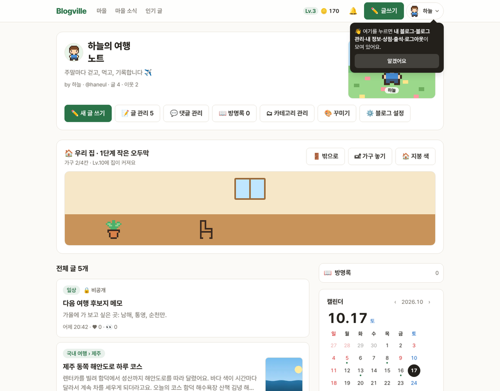
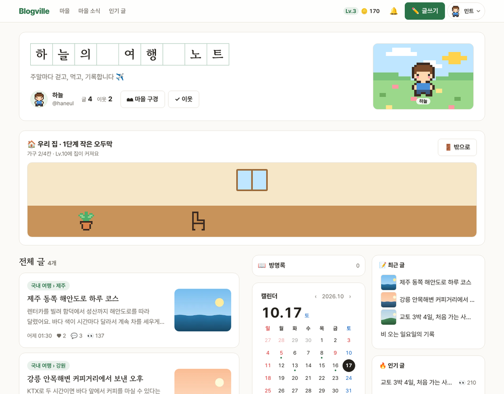
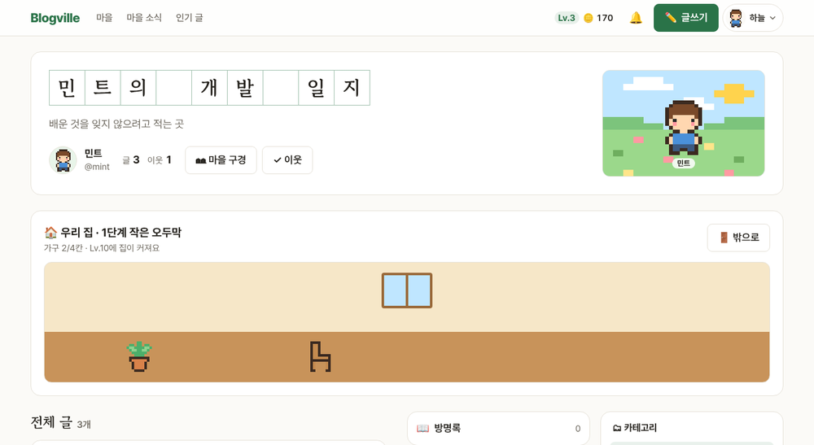
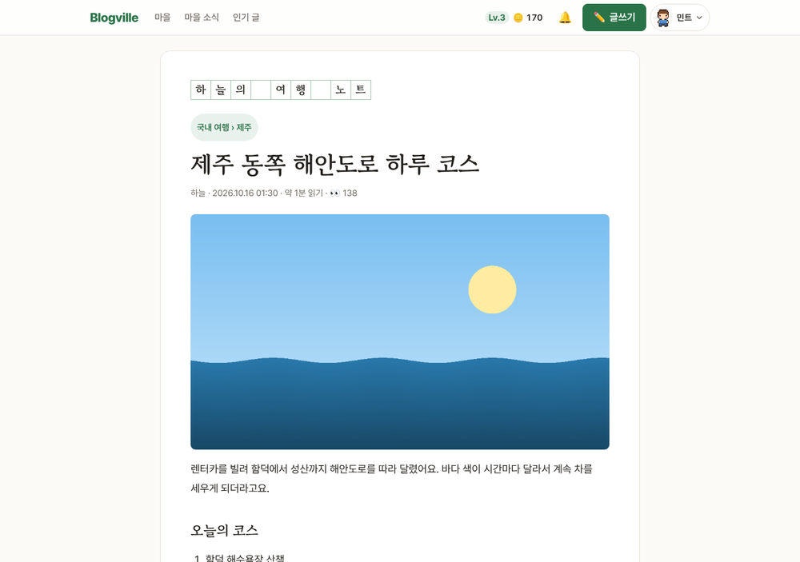
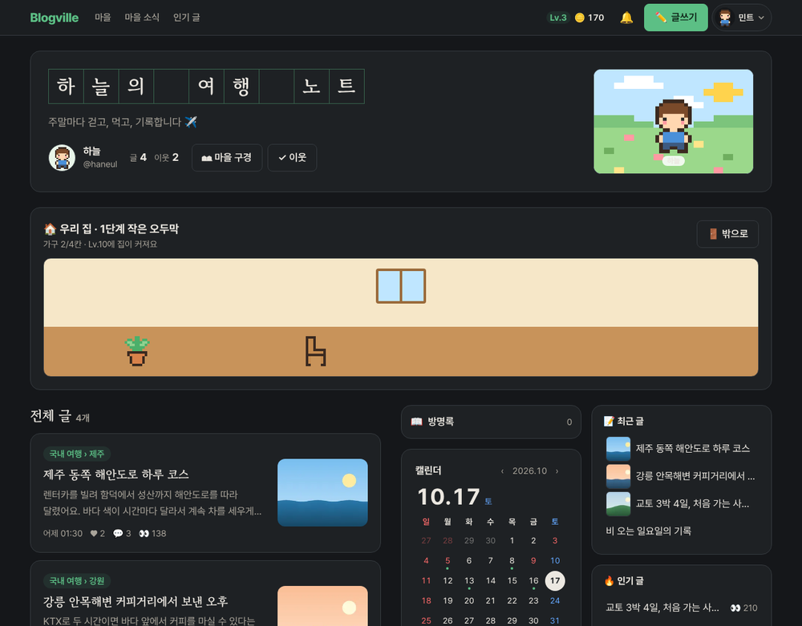
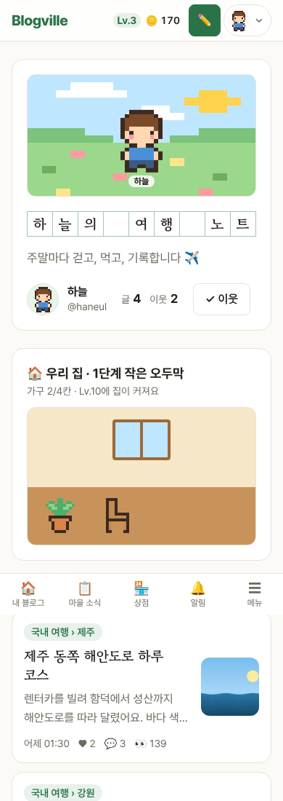

# Blogville v1.7.44 (2026-10-17)

블로그 홈과 글 화면 디자인이 새로 바뀌었어요. 블로그 이름이 원고지 칸에 한 글자씩 써지고, 제목은 명조 글꼴로 나와요. 넓은 화면에서는 옆 칸이 두 줄로 나뉘어 한눈에 더 많이 보여요.

## 한눈에

| | 바뀐 것 |
|---|---|
| 📝 블로그 이름 | 원고지 칸에 한 글자씩. 칸 선은 블로그 꾸미기 색을 따라가요 |
| 🖋 제목 글꼴 | 블로그 이름·글 제목·목록 제목을 명조(고운바탕)로 |
| 🏠 블로그 머리 | 프로필·글 수·이웃 수를 한 줄로, 주인 도구는 새 글 쓰기만 진하게 |
| 🖥 넓은 화면 | 1280px 이상에서 블로그 홈을 넓히고 옆 칸 위젯을 두 줄로 (블로그 홈 길이가 60%쯤으로) |
| 📖 글 화면 | 큰 명조 제목, 본문 글자를 조금 키우고 줄 사이를 넓혀 읽기 편하게 |

## 📝 원고지 블로그 이름

- 블로그 홈 맨 위 블로그 이름이 원고지 칸에 한 글자씩 써져요. 띄어쓰기도 원고지처럼 빈칸 하나예요.
- 이름이 짧으면 칸이 커지고, 길면 칸 크기에 맞춰 다음 줄로 넘어가요. 휴대폰에서도 칸이 잘리지 않아요.
- 칸 선 색은 **꾸미기**에서 고른 블로그 색을 따라가요. 어두운 화면에서도 잘 보여요.
- 글 화면 위에는 같은 원고지 이름이 작게 나와요. 누르면 블로그 홈으로 가요.

## 🏠 블로그 머리와 글 목록

- 프로필 사진·닉네임·@주소 옆에 **글 수**와 **이웃 수**를 크게 보여 줘요.
- 주인에게만 보이는 도구 줄은 **✏️ 새 글 쓰기**만 진한 버튼이고, 나머지(글 관리·댓글 관리·꾸미기 등)는 조용한 글자 버튼이에요. 하는 일은 그대로예요.
- 글 목록 카드는 둥글고 여유 있게, 제목은 명조로 바뀌었어요. 앨범형 목록 제목도 명조예요.

## 🖥 넓은 화면에서 두 줄 옆 칸

- 화면 너비가 1280px 이상이면 블로그 홈이 넓어지고, 옆 칸 위젯이 두 줄로 나뉘어요. 위젯 순서는 블로그 설정 **🧩 위젯 관리**에서 정한 그대로예요.
- 블로그 홈 길이가 예전의 60%쯤으로 줄어 스크롤을 덜 해도 돼요.
- 그보다 좁은 화면이나, 위젯을 하나만 보이게 한 블로그는 예전처럼 한 줄이에요.

## 📖 글 화면

- 글 제목이 큰 명조로 나오고, 본문 글자를 조금 키우고 줄 사이를 넓혔어요. 본문 속 소제목도 명조예요.

## 🌙 어두운 화면 · 📱 휴대폰

## 지켜 둔 것

- 명조 글꼴은 화면이 먼저 뜬 뒤에 받아요. 그래서 첫 화면이 느려지지 않고, 받기 전에는 기기에 있는 명조로 보여요.
- 화면 읽기 프로그램은 원고지 이름을 글자마다 끊지 않고 "하늘의 여행 노트"처럼 한 번에 읽어요.
- 누르는 곳은 휴대폰에서도 44px 이상이에요.
- 휴대폰에서 닉네임이 길면 글·이웃 수가 통째로 다음 줄로 내려가요(글자 사이에서 끊기지 않아요).

(그림은 시험용 블로그예요.)
