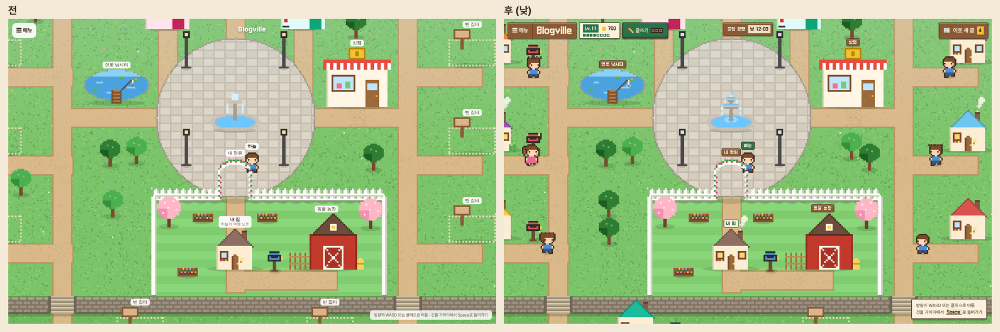
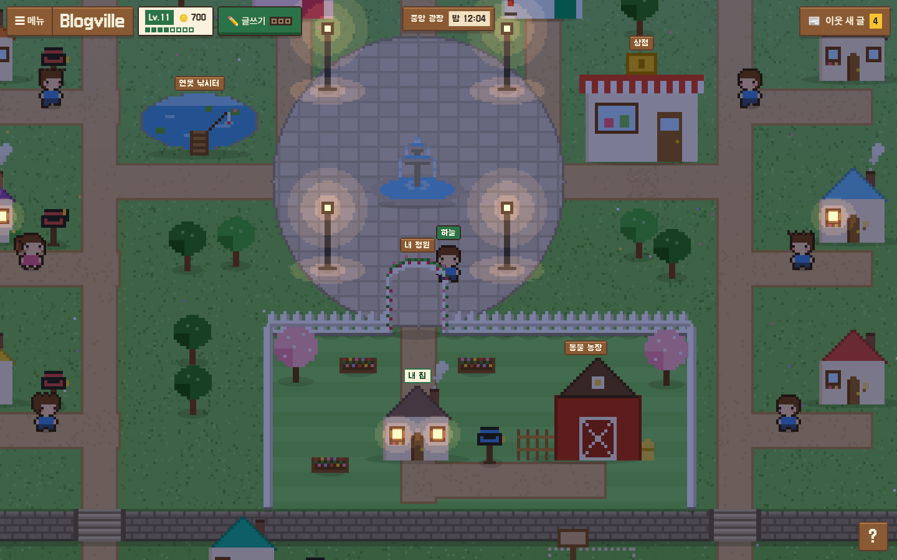
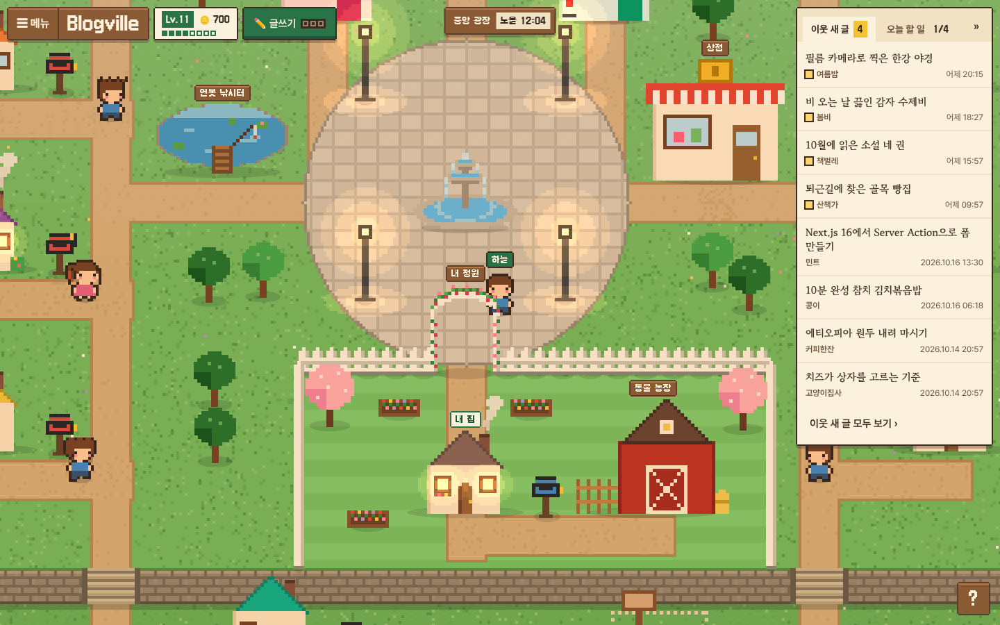
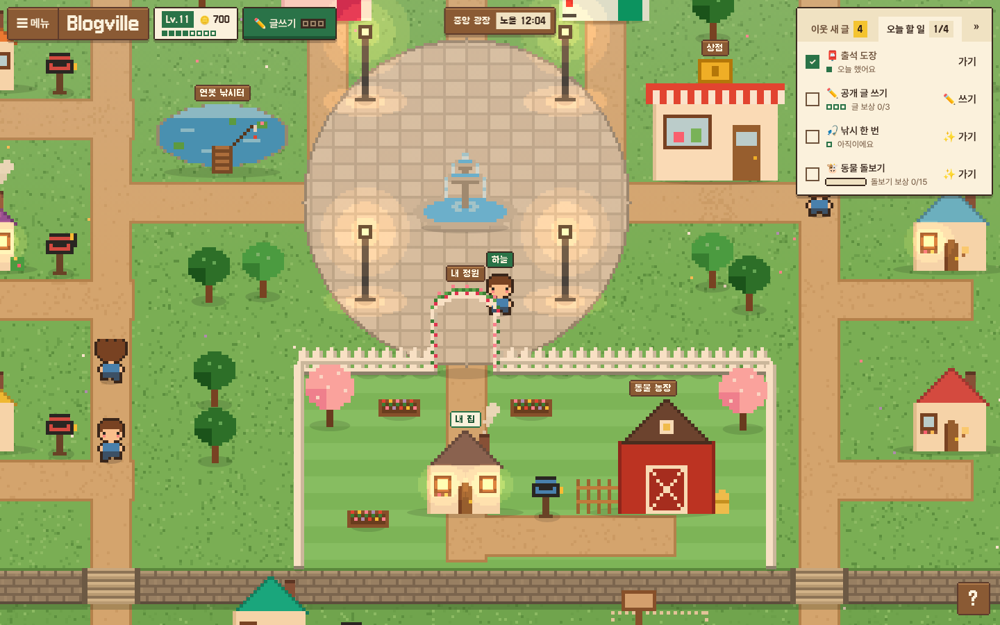
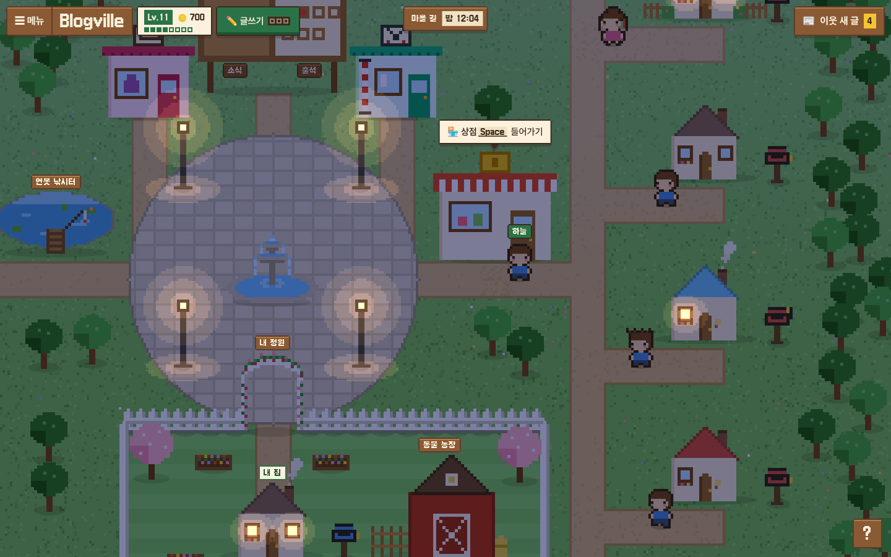
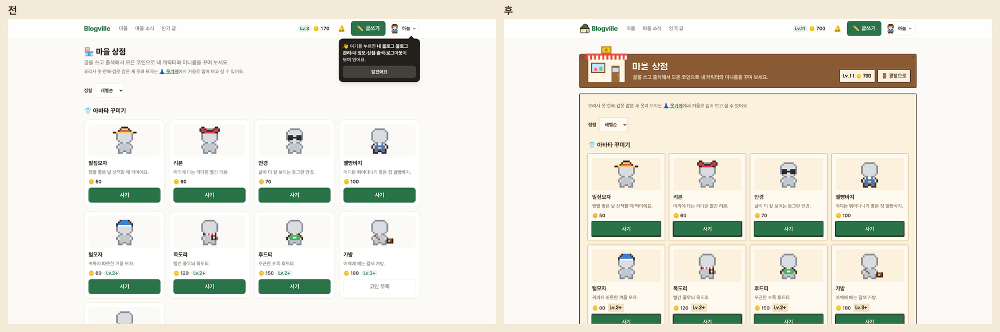
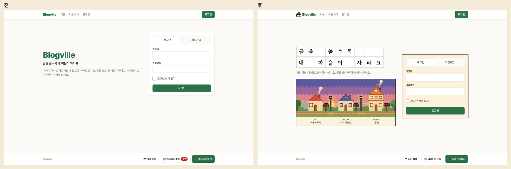
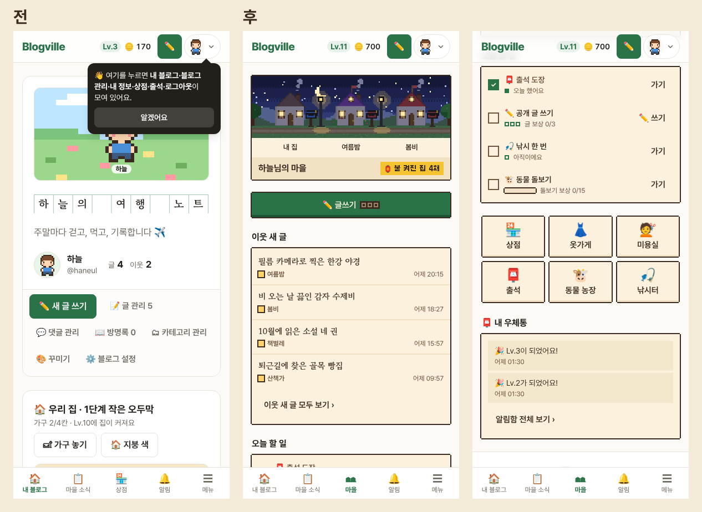

# Blogville v1.7.45 (2026-10-18)

마을 광장이 "등불 마을"로 새로 바뀌었어요. 하루 안에 글을 쓴 집은 창에 불이 켜지고, 하늘은 한국 시각을 따라 새벽·낮·노을·밤으로 바뀌어요. 광장 메뉴와 게임 화면, 첫 화면도 나무 간판과 종이 쪽지 모양으로 함께 바뀌었어요.

## 한눈에

| | 바뀐 것 |
|---|---|
| 🏮 글 쓴 집에 불 | 24시간 안에 공개 글을 쓴 집은 창에 불이 켜지고 굴뚝 연기·우체통 깃발이 올라요 |
| 🌇 한국 시각 하늘 | 새벽(5~7시)·낮(7~17시)·노을(17~19시)·밤으로 바뀌고, 낮이 아니면 가로등이 켜져요 |
| 🪵 광장 메뉴 | 위쪽 나무 간판(☰·레벨·코인·오늘 글쓰기 보상·지금 있는 곳과 시각), 오른쪽 서랍(이웃 새 글·오늘 할 일) |
| 🏪 게임 화면 | 상점·옷가게·미용실·농장·낚시터·출석·지갑이 '건물 안' 모양(나무 간판 + 종이 한 장) |
| 🏠 첫 화면 | 원고지 제목 "글을 쓸수록 내 마을이 자라요"와 작은 마을 그림 |
| 📱 휴대폰 광장 | 휴대폰 회원도 마을을 열면 세로 광장을 봐요. 아래 탭 🏪 상점 → 🏘 마을 |

## 🏮 등불 마을

- 24시간 안에 공개 글을 쓴 집은 창에 노란 불이 켜지고, 굴뚝에서 연기가 나고, 우체통 깃발이 올라가요. 이웃이 오늘 글을 썼는지 광장을 걸으며 바로 알 수 있어요.
- 하늘은 한국 시각을 따라 바뀌어요. 밤에는 마을이 어두워지고 가로등과 불 켜진 창이 빛나요.
- 글을 쓴 이웃 가까이 가면 그 이웃의 새 글 제목이 말풍선으로 떠요.
- 분수·연못·게시판 그림도 새로 그렸어요. 게시판의 출석 도장 수는 내 출석 날짜를 따라가요.
- 움직임 줄이기를 켜 두면 연기와 물결이 멈춘 그림 한 장으로 나와요.

## 🪵 광장 메뉴

- 위쪽 왼쪽에 ☰ 메뉴, 레벨·코인, ✏ 글쓰기가 나무 간판으로 모였어요. 글쓰기 옆 세 칸은 오늘 받은 글 보상(하루 3번)이에요.
- 위쪽 가운데 간판에 지금 있는 곳(중앙 광장·마을 길·내 정원 등)과 시각이 나와요.
- 오른쪽 서랍에는 **이웃 새 글**과 **오늘 할 일**이 있어요. 오늘 할 일은 출석 도장·공개 글 쓰기·낚시 한 번·동물 돌보기이고, [가기]를 누르면 그 장소 앞으로 바로 가요.
- 서랍은 화면이 아주 넓을 때(1680px 이상)만 처음부터 펼쳐져 있고, 접거나 펼친 것은 기억해요.
- 메뉴나 창이 열려 있을 때 마을을 누르면 창이 닫히면서 그 자리로 바로 걸어가요.

## 🚪 들어가기 안내

- 건물이나 집 가까이 가면 그 이름표 자리에 `상점 Space 들어가기`처럼 안내가 떠요. 안내는 위쪽 간판에 가리지 않고, 안내를 눌러도 들어가요.
- 게시판 아래 `소식`·`출석` 팻말이나 건물·집 이름표를 누르면 그 문으로 걸어가서 들어가요.
- 태블릿처럼 손으로 누르는 화면에서는 안내 옆 [들어가기] 버튼을 누르면 돼요.

## 🏪 게임 화면

- 상점·옷가게·미용실·꾸미기·농장·낚시터·출석·경험치·코인 내역 화면 위에 그 건물 그림이 걸린 나무 간판이 생기고, 내용은 종이 한 장 위에 놓여요.
- 간판 오른쪽 [🚪 광장으로]를 누르면 그 건물 문 앞으로 돌아가요.

## 🏠 첫 화면과 사이트

- 첫 화면에 원고지 제목과 작은 마을 그림(집 1·20·50단계)이 나오고, 로그인 판이 옆에 있어요. 휴대폰에서는 로그인 판이 마을 그림보다 위에 있어요.
- 넓은 화면(1024px 이상)에서는 헤더 로고 옆에 집 마크가 생겼어요. 사이트 아이콘도 같은 초록으로 맞췄어요.
- 마을 소식·인기 글 같은 모아 보기 화면 머리에 작은 그림이 생기고, 글 카드 위쪽에 쓴 사람이 나와요.

## 📱 휴대폰 광장

- 휴대폰 회원이 마을을 열면 내 블로그로 옮겨 가는 대신 세로 광장을 봐요: 내 집과 이웃 집 그림, 글쓰기, 이웃 새 글, 오늘 할 일, 장소 6곳(상점·옷가게·미용실·출석·동물 농장·낚시터), 내 우체통.
- 아래 탭의 🏪 상점이 🏘 마을로 바뀌었어요. 상점은 휴대폰 광장의 [상점] 버튼으로 가요.
- 방문자는 예전처럼 간단 메뉴를 봐요.

## 지켜 둔 것

- PC 광장은 사이트를 어두운 화면으로 바꿔도 캔버스와 같은 밝은 종이·나무 색이에요. 게임 화면과 휴대폰 광장은 어두운 화면을 따라가요.
- 도트 글꼴(갈무리)은 마을 화면의 짧은 이름표에만 쓰고, 화면 배율이 정수가 아니면 흐려지지 않게 보통 글꼴로 바꿔요.
- 키보드로 움직이면 모든 버튼에 두 겹 초점 테두리가 보여요. 누르는 곳은 휴대폰에서 44px 이상이에요.
- 프레임이 느린 컴퓨터에서도 캐릭터가 같은 빠르기로 걸어요.

(그림은 시험용 마을이에요.)
