# Blogville v1.7.46 (2026-10-18)

광장 한가운데에 청사초롱 줄등이 걸렸어요. 이웃 한 명마다 초롱이 하나씩 달리고, 24시간 안에 글을 쓴 이웃의 초롱에만 불이 켜져요. 마을은 한국 날짜를 따라 계절이 바뀌고, 이웃과 주고받을 거리도 늘었어요.

## 한눈에

| | 바뀐 것 |
|---|---|
| 🏮 청사초롱 줄등 | 광장 위 줄등에 이웃 초롱이 달리고, 글을 쓴 이웃의 초롱이 켜져요. 오늘 글을 쓰면 장대 꼭대기 내 초롱도 켜져요 |
| 🚶 길찾기 | 클릭하면 분수와 벽을 돌아서 걸어가고, 걷는 길이 점선으로 보여요 |
| ❗ 할 일 표시 | 오늘 할 일이 남은 곳(연못·외양간·내 집) 위에 '!'가 떠요 |
| 🍁 계절 | 한국 날짜를 따라 봄·여름·가을·겨울로 바뀌어요. 지금은 단풍·은행·감나무와 낙엽이 보여요 |
| 🏡 이사 올 이웃 | 빈 집터에 추천 이웃의 집이 흐리게 서고, 바로 이웃으로 모실 수 있어요 |
| ✉️ 우체통 쪽지 | 이웃 우체통에 쪽지를 넣을 수 있어요 |
| 📝 이번 주 글감 | 게시판 가운데 문으로 들어가면 이번 주 글감과 이웃의 답장이 모여 있어요 |
| 🐟 낚시 도감 | 낚은 물고기가 도트 그림 도감 6칸에 채워져요 |
| 📱 휴대폰 광장 | 줄등이 걸리고, 이웃 집을 누르면 글과 쪽지 넣기가 나와요 |

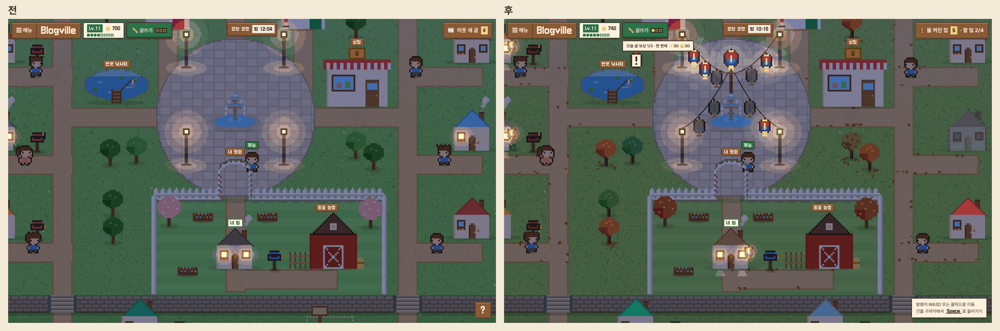

## 🏮 청사초롱 줄등

- 분수 북쪽 장대에서 가로등 네 개로 줄이 늘어지고, 즐겨찾기 이웃 한 명마다 초롱이 하나씩 달려요(최대 10개).
- 24시간 안에 공개 글을 쓴 이웃의 초롱만 켜지고, 최근에 쓴 글일수록 밝아요.
- 켜진 초롱 아래에 멈춰 서서 Space를 누르면 그 이웃의 새 글이 열려요.
- 장대 꼭대기는 내 초롱이에요. 오늘 글을 쓰면 켜지고, 아직이면 누르면 글쓰기로 가요.
- 글을 쓴 이웃 집 처마에도 같은 초롱이 달려서, 어느 초롱이 어느 집인지 알 수 있어요.
- 밤에는 지붕 색이 살아 있고, 켜진 창 아래 땅에 불빛이 번져요.

## 🚶 걷기와 할 일

- 마을 어디를 클릭해도 길을 찾아 분수와 벽을 돌아서 가요. 걷는 길은 점선과 X 표시로 잠깐 보여요.
- 방향키로 걷다가 모서리에 걸리면 옆으로 미끄러져 돌아가요.
- 오늘 할 일이 남은 곳 위에 '!' 쪽지가 떠요. 누르면 그곳으로 걸어가서 들어가요.
- 이웃의 새 글 말풍선을 누르면 그 글이 열려요.

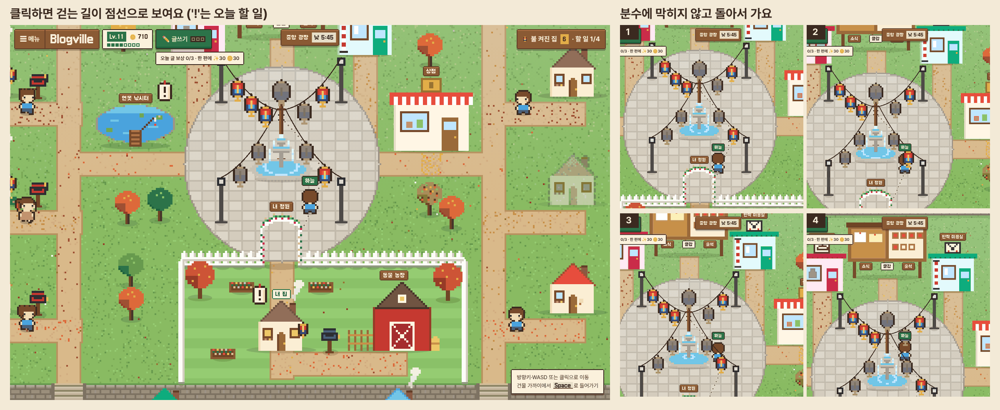

## 🍁 계절

- 3~5월 봄, 6~8월 여름, 9~11월 가을, 12~2월 겨울이에요(한국 시각).
- 가을에는 단풍·은행·감나무가 서고, 나무 밑과 길가에 낙엽이 쌓여요. 겨울에는 지붕과 나무에 눈이 덮여요.
- 나무 색도 마을 초록에 맞췄고, 노을이 조금 더 붉어졌어요.

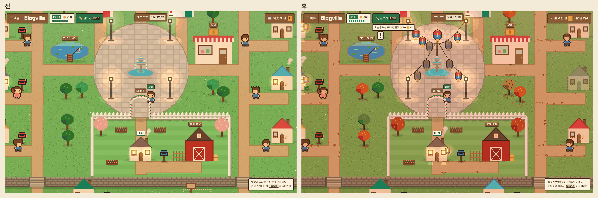

## 🏡 이웃과 주고받기

- 이웃이 10명이 안 되면, 빈 집터에 '이사 올 집'이 흐리게 서요. 나를 ⭐한 사람이 먼저 나와요. 우체통 창에서 [⭐ 이웃 맺고 여기 모시기]를 누르면 바로 그 자리에 집이 서요.
- 이웃 우체통에 쪽지를 넣으면 그 블로그 방명록에 남아요. 한 사람이 한 시간에 10개까지 넣을 수 있어요.
- 방문 수는 내 우체통, 그리고 방문자 위젯을 켜 둔 이웃의 우체통에만 나와요.
- 서랍 이름이 "불 켜진 집"이 됐어요. 읽은 새 글에는 ✓가 붙고, 다 읽으면 그렇다고 알려 줘요.
- 오늘 할 일 위에 연속 출석 도장이 찍히고, 이웃 글에 댓글 달기 칸이 생겼어요. 칸마다 받을 보상이 적혀 있어요(새 보상은 없어요).
- 친구 마을의 외양간에 들어가면 그 친구 농장을 구경할 수 있어요. 게임 화면에서 [🚪 광장으로]를 누르면 친구 마을로 돌아가요.

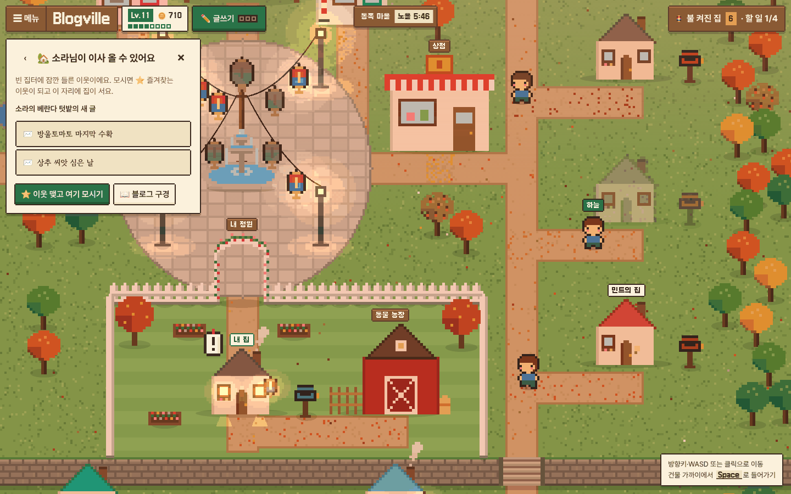
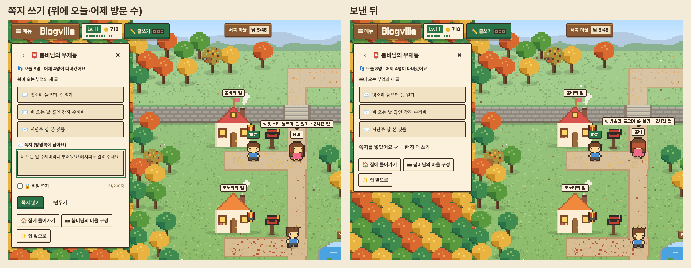
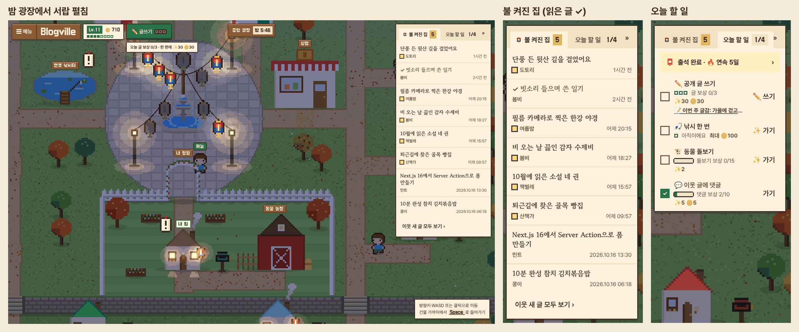

## 📝 이번 주 글감과 내 초롱 켜기

- 매주 글감이 하나씩 나와요. 명절이 낀 주에는 그 명절 글감이에요. [✏️ 이 글감으로 쓰기]를 누르면 태그가 미리 채워져요.
- 같은 글감으로 쓴 이웃의 글이 "이웃의 답장"에 모여요.
- 글을 발행한 뒤 [🏮 광장에서 내 초롱 켜기]를 누르면, 광장에서 내 집 창에 불이 차례로 켜지고 몇 명의 마을에서 내 집이 빛나는지 알려 줘요.

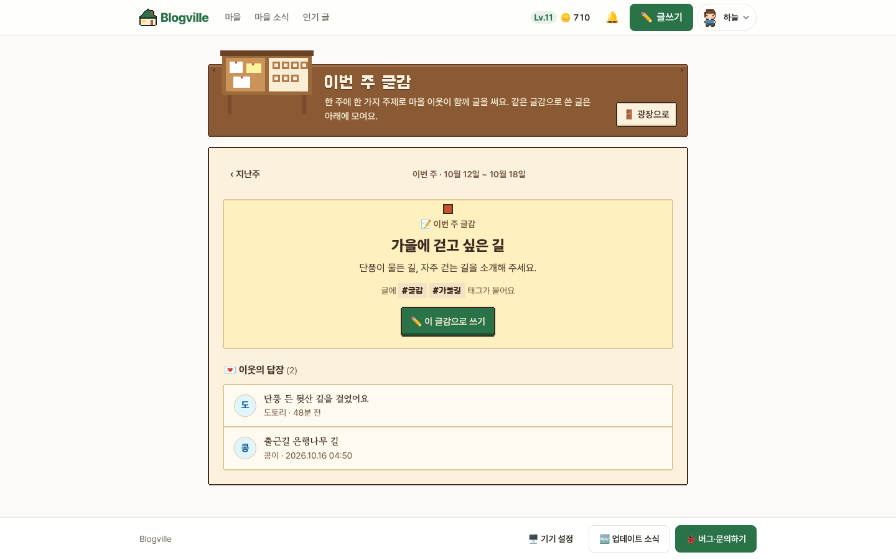
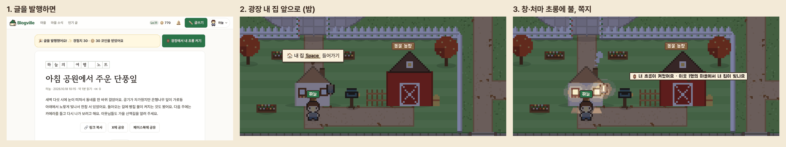

## 🐟 낚시 도감

- 낚시터 화면에 도트 연못이 생기고, 물고기 6종이 도감 칸에 채워져요. 아직 못 낚은 칸은 ???로 보여요.

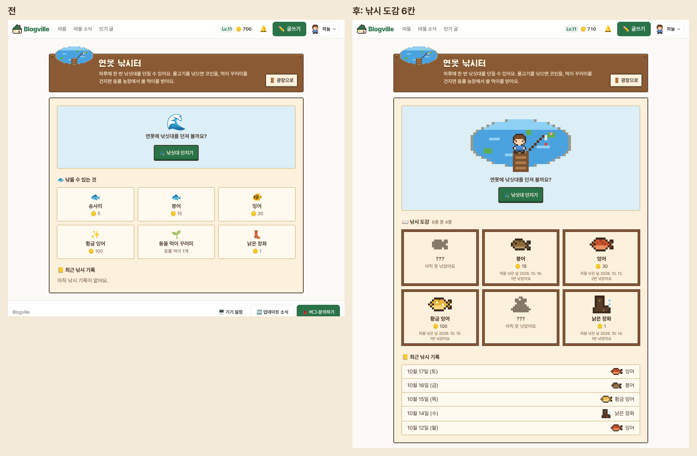
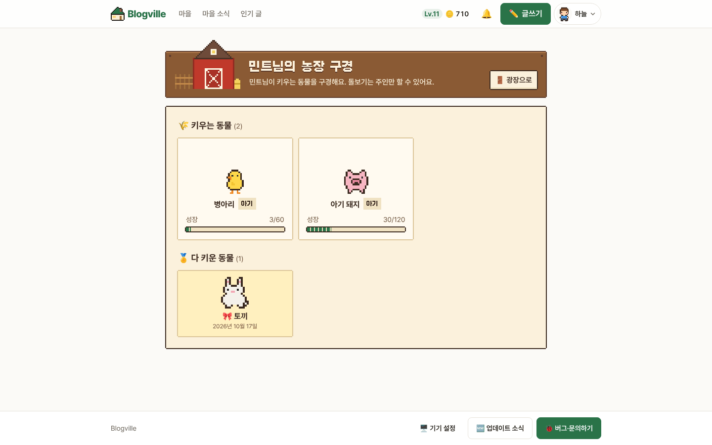

## 📱 휴대폰 광장

- 마을 그림에 줄등이 걸리고, 글을 쓴 이웃의 초롱이 켜져요. 계절도 같이 바뀌어요.
- 집 그림을 누르면 그 블로그로 가요. 아래 "이웃 집" 띠에서 집을 누르면 최근 글 3개와 쪽지 넣기가 나와요.

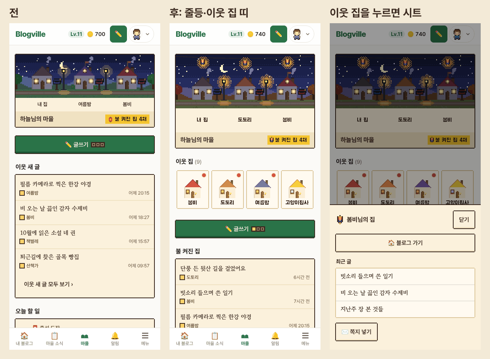

## 지켜 둔 것

- 새 코인·경험치 보상은 없어요. 할 일에 적힌 보상은 원래 받던 그대로예요.
- 움직임 줄이기를 켜 두면 초롱 흔들림, 걷는 길 점선, 불 켜지는 순간이 멈춘 그림으로 나와요.
- 휴대폰에서 누르는 곳은 44px 이상이에요.

(그림은 시험용 마을이에요.)
