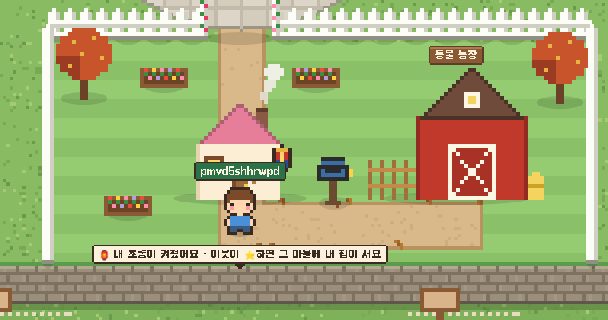

# Blogville v1.7.47 (2026-10-18)

글을 쓰고 광장으로 돌아왔을 때 뜨는 "내 초롱이 켜졌어요" 쪽지가 더는 외양간 같은 다른 건물을 가리지 않아요.

## 🏮 축하 쪽지 자리

- 쪽지가 내 집 오른쪽 옆, 왼쪽 옆, 지붕 위, 문 앞 캐릭터 아래 순으로 자리를 살펴보고, 다른 건물이나 나무와 겹치지 않는 첫 자리에 떠요.
- 넓은 화면(1440px)에서 외양간 지붕 위에 겹치던 문제가 없어졌어요. 1024px부터 1920px까지 확인했어요.

(그림은 시험용 마을이에요.)
