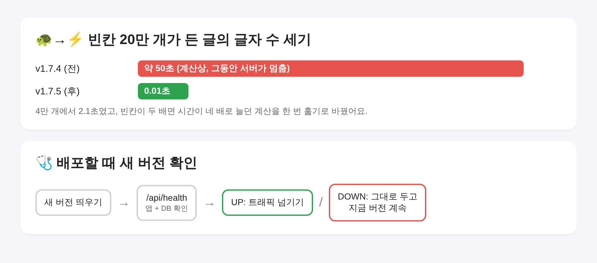

# Blogville v1.7.5 (2026-10-14)

빈칸이 아주 많이 든 글 때문에 서버가 멈추던 문제를 고치고, 배포할 때 새 버전을 더 꼼꼼히 확인해요.

## 한눈에

| | 바뀐 것 |
|---|---|
| ⚡ 글자 수 세기 | 줄 끝 빈칸이 아주 긴 글도 바로 처리(SonarQube가 찾은 느린 정규식 고침) |
| 🩺 배포 확인 | 새 버전의 `/api/health`(앱+DB)가 UP이어야 트래픽을 넘김 |

## ⚡ 빈칸이 많은 글

글자 수를 세거나 본문을 글자로 바꿀 때 줄 끝 빈칸을 지우는 정규식이, 빈칸이 길면 시간이 제곱으로 늘었어요. 빈칸 4만 개에 2.1초, 20만 개면 계산상 50초쯤이고 그동안 다른 요청도 기다려야 했어요. 이제 한 번 훑어서 지우고, 빈칸 20만 개도 0.5초 안에 끝나는지 시험이 확인해요. 결과 글자는 전과 같아요.

## 🩺 배포할 때 새 버전 확인

무중단 배포가 새 버전으로 트래픽을 넘기기 전에, 첫 화면 대신 `/api/health`를 불러 앱과 DB가 모두 UP인지 봐요. DB에 못 닿는 새 버전은 넘기지 않고 지금 버전이 그대로 서비스해요.

