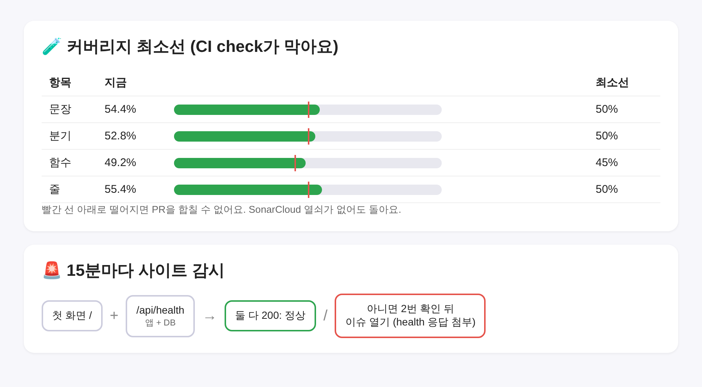

# Blogville v1.7.6 (2026-10-14)

블로그 화면은 그대로이고, 품질을 지키고 고장을 알아채는 장치를 더 단단하게 했어요.

## 한눈에

| | 바뀐 것 |
|---|---|
| 🧪 커버리지 최소선 | 단위 테스트 커버리지가 최소선보다 떨어지면 CI `check`가 빨개져서 PR을 합칠 수 없음 |
| 🚨 사이트 감시 | 15분마다 첫 화면에 더해 `/api/health`(앱+DB)까지 확인, 이슈에 health 응답을 같이 남김 |
| 📚 학습 문서 | `docs/learning` 9곳과 CONTRIBUTING을 지금 코드에 맞춤(필수 검사, compose 서비스, 시크릿 목록 등) |
| 🧹 lint | 경고 0개 |

## 🧪 커버리지 최소선

SonarCloud 열쇠(`SONAR_TOKEN`)를 넣기 전에도 도는 가장 작은 품질 게이트예요. PR마다 `npm run test:coverage`가 돌고, 문장 50·분기 50·함수 45·줄 50% 아래로 떨어지면 실패해요. 지금 숫자와 최소선은 Actions 실행 요약에 표로 남아요. 시험이 늘면 최소선도 같이 올려요.

## 🚨 사이트 감시

첫 화면은 떠도 DB가 끊긴 경우를 따로 잡아요. 문제가 생겨 열리는 이슈에는 `/api/health` 응답(버전, DB UP/DOWN)이 같이 남아서 원인을 바로 볼 수 있어요. Actions → status에도 같은 줄이 나와요.

