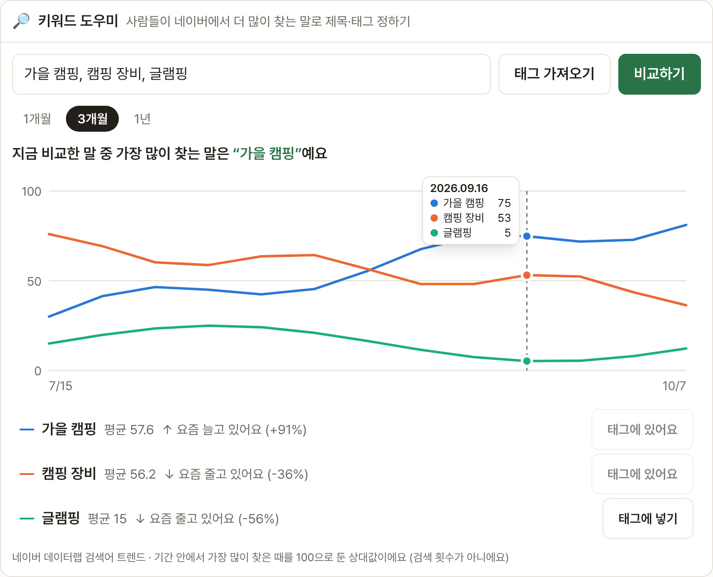

# Blogville v1.7.7 (2026-10-14)

글 쓸 때 사람들이 네이버에서 더 많이 찾는 말로 제목·태그를 고를 수 있게 **🔎 키워드 도우미**를 넣었어요.

## 한눈에

| | 바뀐 것 |
|---|---|
| 🔎 키워드 도우미 | 글쓰기 화면 태그 칸 아래에서 후보 단어(5개까지)의 네이버 검색 관심도를 그래프로 비교 |
| 📈 요즘 흐름 | 가장 많이 찾는 말, 단어별 평균, "↑ 요즘 늘고 있어요" 같은 흐름을 같이 보여 줌 |
| 🏷 태그에 넣기 | 고른 단어를 버튼 하나로 태그 칸에 더함 |

## 🔎 키워드 도우미

1. 글쓰기 화면에서 태그 칸 아래 **🔎 키워드 도우미**를 열어요.
2. 비교할 단어를 쉼표로 넣거나 **태그 가져오기**를 누르고 **비교하기**를 눌러요.
3. 1개월·3개월·1년 중에 골라 보세요. 그래프에 마우스를 올리면 날짜별 값이 나와요.
4. 마음에 드는 단어는 **태그에 넣기**로 바로 태그 칸에 넣어요.

숫자는 네이버 데이터랩 검색어 트렌드에서 받은 **상대값**이에요. 고른 기간 안에서 가장 많이 찾은 때를 100으로 두고 나머지를 견준 값이라, 검색 횟수와는 달라요.

## 블로그 주인에게

- 네이버 클라우드 **NAVER API HUB**의 Blogville 앱에 **검색어 트렌드**가 추가되어 있어야 그래프가 나와요. 추가되지 않았으면 도우미가 그렇다고 알려 줘요.
- 같은 단어 묶음은 하루 6시간 동안 기억해 둬서 네이버 한 달 호출 한도(5만 번)를 아껴요.
