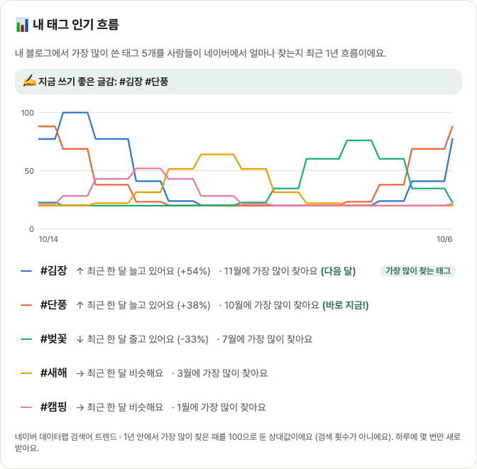

# Blogville v1.7.8 (2026-10-14)

블로그 관리에서 내 태그를 사람들이 언제 많이 찾는지 볼 수 있어요.

## 한눈에

| | 바뀐 것 |
|---|---|
| 📊 내 태그 인기 흐름 | 많이 쓴 태그 5개의 최근 1년 네이버 검색 관심도, 가장 많이 찾는 달, 지금 쓰기 좋은 글감 |

## 📊 내 태그 인기 흐름

블로그 관리(`/settings/blog#tag-trend`)의 인기 글 아래에 새 카드가 생겼어요.

- 내 블로그에서 가장 많이 쓴 태그 5개를 사람들이 네이버에서 얼마나 찾는지 1년 흐름을 겹친 그래프로 보여 줘요.
- 태그마다 최근 한 달 흐름(↑↓→)과 가장 많이 찾는 달을 알려 주고, 그 달이 이번 달이면 "바로 지금!", 다음 달이면 "다음 달"이라고 표시해요.
- 맨 위 "✍️ 지금 쓰기 좋은 글감"에 제철이거나 요즘 늘고 있는 태그를 모아 보여 줘요.
- 값은 네이버 데이터랩 검색어 트렌드의 상대값(1년 중 가장 많이 찾은 때 = 100)이에요.

