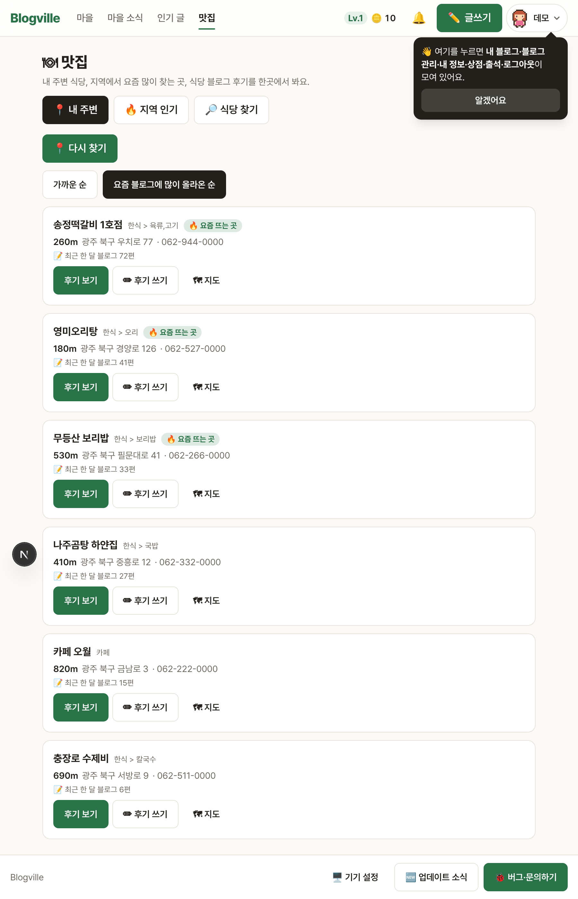
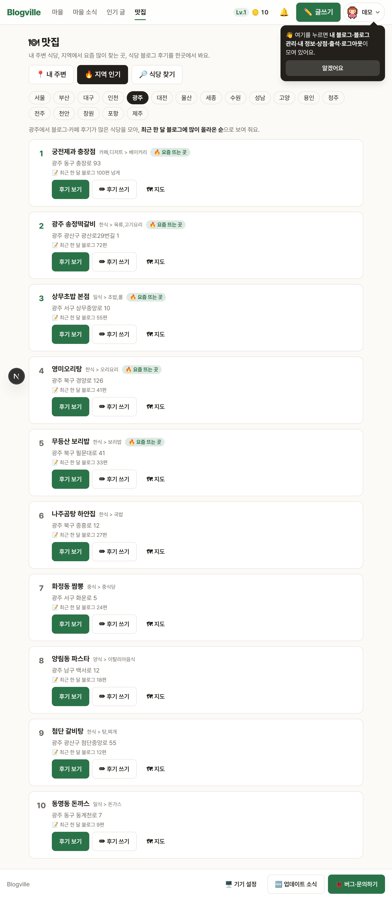
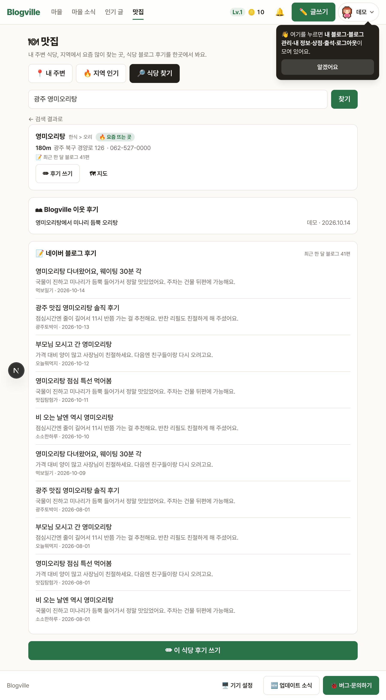
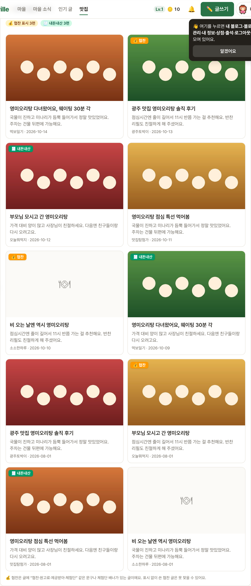
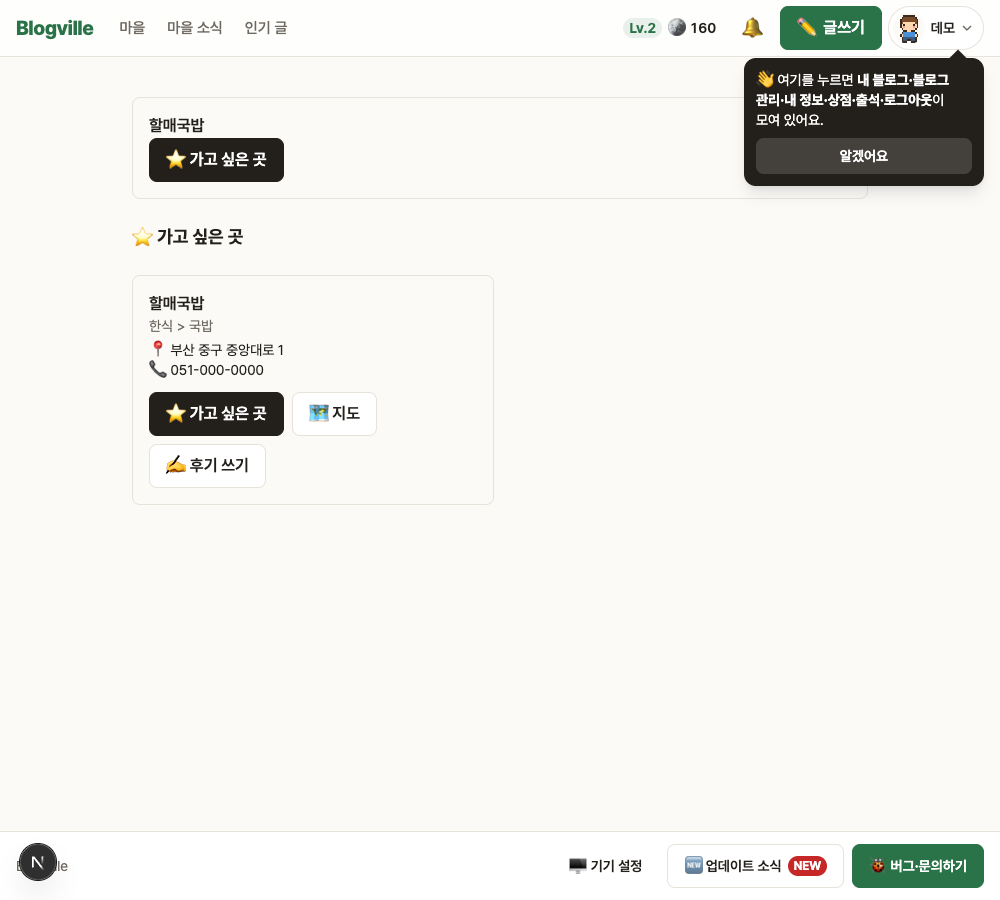
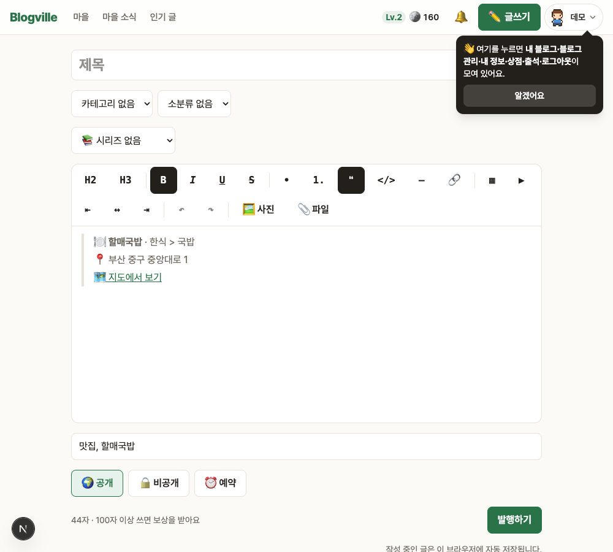

# Blogville v1.7.9 (2026-10-14)

내 위치 근처 맛집, 지역마다 요즘 많이 찾는 식당, 식당 후기를 한곳에서 볼 수 있는 🍽 맛집 페이지가 생겼어요.

## 한눈에

| | 바뀐 것 |
|---|---|
| 📍 내 주변 | 내 위치 1km 안 식당을 가까운 순 또는 블로그에 많이 올라온 순으로, 🔥 요즘 뜨는 곳 표시 |
| 🗺 지도 | 카카오맵에 내 위치(파란 점)와 번호 핀, 지도를 옮기면 "이 지역에서 다시 찾기" |
| 🏙 지역 인기 | 광주·서울 등 18개 지역에서 최근 블로그 후기가 많은 식당 TOP 10 |
| 🔍 식당 찾기 | 식당 정보와 네이버 블로그 후기, Blogville 이웃 글 |
| 🖼 후기 카드 | 대표 사진 배너 카드, 💰 협찬 / 🧾 내돈내산 배지, 협찬 글 숨기기 |
| ⭐ 가고 싶은 곳 | 식당을 저장해 두고 한 탭에서 모아 보기 |
| ✏ 후기 쓰기 | 글쓰기에 식당 카드·맛집 태그를 미리 채워 줌 |

## 📍 내 주변과 🗺 지도

상단바의 **맛집**(`/food`)에서 [📍 내 위치로 찾기]를 누르면 근처 식당을 보여 줘요. 위치는 저장하지 않아요.

- 정렬: 가까운 순 / 블로그 많이 올라온 순(최근 30일 후기 수)
- 지도에서 핀을 누르면 말풍선이 열리고, 목록의 [🗺 지도에서 보기]를 누르면 그 식당으로 옮겨 가요.

## 🏙 지역 인기

지역을 고르면 그 지역에서 최근 블로그 후기가 많이 올라온 식당 10곳을 순위로 보여 줘요.

## 🔍 식당 찾기와 🖼 후기 카드

식당 이름을 검색하면 주소·전화·카카오맵 링크와 함께 후기를 보여 줘요.

- 블로그 후기는 대표 사진이 위에 걸린 카드로 보여요.
- 글 본문에 "협찬·원고료·제공받아·체험단" 같은 말이 있으면 **💰 협찬**, "내돈내산·협찬 아님"이면 **🧾 내돈내산** 배지가 붙어요. [협찬 글 숨기기]로 빼고 볼 수 있어요.
- 자동 판별이라 틀릴 수 있어요. 네이버 플레이스 방문자 리뷰는 네이버가 외부에 열어 주지 않아 블로그 후기만 보여 줘요.

## ⭐ 가고 싶은 곳과 ✏ 후기 쓰기

식당 카드의 [☆ 가고 싶어요]로 저장하면 ⭐ 탭에 모여요(로그인 필요, 최대 200곳). [✏ 후기 쓰기]를 누르면 글쓰기에 식당 카드와 태그가 미리 채워져요.

## 운영 메모

- 새 표 `food_saved`(마이그레이션 0050)가 배포 때 자동으로 생겨요.
- 필요한 키: `KAKAO_REST_API_KEY`(식당 검색), `NAVER_SEARCH_CLIENT_ID/SECRET`(지역 인기·블로그 후기), `KAKAO_JS_KEY`(지도). 키가 없으면 그 부분만 숨거나 안내가 보여요.
